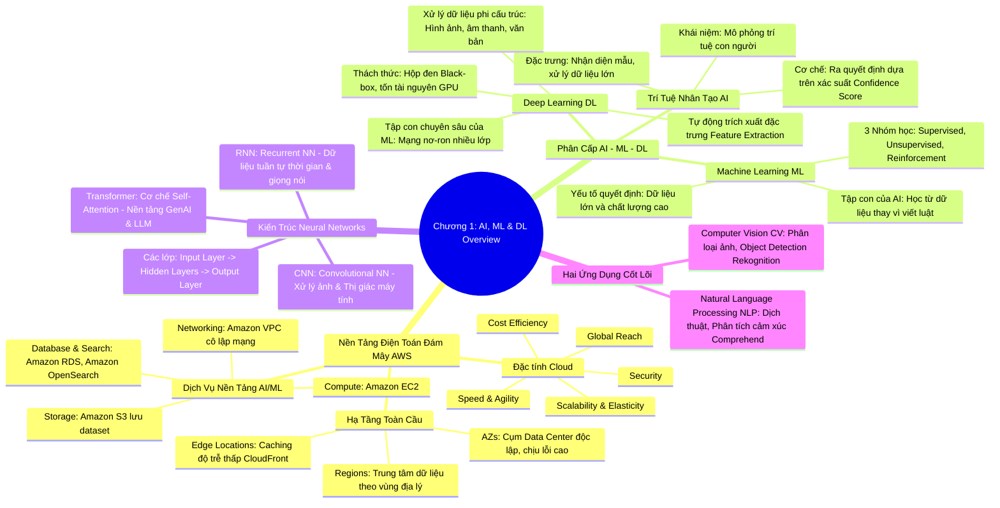

# CHƯƠNG 01: TỔNG QUAN VỀ AI, MACHINE LEARNING VÀ DEEP LEARNING
*(Section 1 - Domain 1: Fundamentals of AI and ML)*

---

## 🎯 MỤC TIÊU BÀI HỌC & TRỌNG TÂM THI (EXAM FOCUS)
- Nắm vững mối quan hệ phân cấp hình phễu: **AI ⊃ Machine Learning (ML) ⊃ Deep Learning (DL) ⊃ Generative AI (GenAI)**.
- Phân biệt sự khác nhau giữa **Lập trình truyền thống (Traditional Programming)** và **Học máy (Machine Learning)**.
- Hiểu kiến trúc mạng nơ-ron (**Neural Networks**) và các biến thể chính: **CNN** (thị giác máy tính), **RNN** (dữ liệu tuần tự), **Transformer** (xử lý ngôn ngữ tự nhiên & GenAI).
- Nắm các khái niệm nền tảng hạ tầng AWS hỗ trợ AI/ML: **Regions, Availability Zones (AZs), Edge Locations**, cùng các dịch vụ cơ sở: **EC2, S3, RDS, OpenSearch, VPC**.
- Nhận diện cách thức hoạt động của hai nhánh lớn: **Thị giác máy tính (Computer Vision - CV)** và **Xử lý ngôn ngữ tự nhiên (Natural Language Processing - NLP)**.

---

## 🧠 BẢN ĐỒ TƯ DUY (MINDMAP) CHƯƠNG 1

### Sơ đồ tư duy trực quan (Mermaid Diagram)


---

## 📚 KIẾN THỨC CỐT LÕI CHI TIẾT (DEEP DIVE)

### 1. Nền tảng AWS Cloud và Hạ tầng phục vụ AI/ML
Điện toán đám mây (Cloud Computing) cung cấp tài nguyên CNTT theo yêu cầu (On-demand) thông qua mạng Internet với mô hình thanh toán theo mức sử dụng (Pay-as-you-go).

#### a. 5 Lợi ích lớn của AWS Cloud:
1. **Hiệu quả chi phí (Cost Efficiency):** Chuyển đổi chi phí đầu tư hạ tầng cố định ban đầu (CapEx) thành chi phí vận hành linh hoạt (OpEx). Không cần mua trước máy chủ đắt đỏ có GPU.
2. **Khả năng mở rộng (Scalability & Elasticity):** Tự động co giãn theo khối lượng công việc huấn luyện (Training) hoặc suy luận (Inference).
3. **Phạm vi toàn cầu (Global Reach):** Triển khai ứng dụng AI tới người dùng trên toàn thế giới chỉ trong vài phút.
4. **Tốc độ và sự linh hoạt (Speed & Agility):** Khởi tạo môi trường thử nghiệm AI/ML (Sandbox/Notebooks) trong vài giây thay vì mất nhiều tuần đặt mua phần cứng.
5. **Bảo mật chuẩn doanh nghiệp (Security):** Tích hợp kiểm soát truy cập và mã hóa dữ liệu mặc định.

#### b. Cấu trúc hạ tầng toàn cầu (AWS Global Infrastructure):
- **Regions (Vùng địa lý):** Các khu vực địa lý riêng biệt trên thế giới (ví dụ: `us-east-1`, `ap-southeast-1`), chứa nhiều AZs.
- **Availability Zones (AZs - Vùng sẵn sàng):** Gồm một hoặc nhiều trung tâm dữ liệu riêng biệt có nguồn điện, mạng dự phòng độc lập nhằm đảm bảo tính sẵn sàng cao (High Availability) và khả năng chịu lỗi (Fault Tolerance).
- **Edge Locations (Điểm biên):** Mạng lưới các điểm PoP (Points of Presence) đặt gần người dùng cuối, phục vụ bộ nhớ đệm (Caching) thông qua **Amazon CloudFront** giúp giảm độ trễ tối đa khi phân phối nội dung hoặc mô hình AI.

#### c. Dịch vụ AWS nền tảng bắt buộc phải nhớ:
- **Amazon EC2 (Elastic Compute Cloud):** Máy chủ ảo cung cấp năng lực tính toán linh hoạt. Trong AI/ML, EC2 cung cấp các dòng instance chuyên dụng gắn GPU (như G4dn, G5, P4d) hoặc chip chuyên biệt của AWS (**AWS Trainium**, **AWS Inferentia**).
- **Amazon S3 (Simple Storage Service):** Lưu trữ đối tượng (Object Storage) không giới hạn dung lượng, độ bền 99.999999999% (11 số 9). Đóng vai trò là **Data Lake** chứa tập dữ liệu thô (Raw data), nhãn, và trọng số mô hình (Model artifacts).
- **Amazon RDS (Relational Database Service):** Lưu trữ dữ liệu có cấu trúc phục vụ phân tích nghiệp vụ.
- **Amazon OpenSearch Service:** Lưu trữ và tìm kiếm vector (Vector Search / Semantic Search), đóng vai trò then chốt trong kiến trúc RAG (Retrieval-Augmented Generation).
- **Amazon VPC (Virtual Private Cloud):** Mạng ảo riêng biệt cách ly tài nguyên AI/ML an toàn khỏi mạng Internet công cộng.

---

### 2. Phân biệt Trí tuệ nhân tạo (AI), Machine Learning (ML) và Deep Learning (DL)

```
┌────────────────────────────────────────────────────────┐
│ TRÍ TUỆ NHÂN TẠO (ARTIFICIAL INTELLIGENCE - AI)        │
│  Mô phỏng hành vi thông minh của con người            │
│  ┌──────────────────────────────────────────────────┐  │
│  │ MACHINE LEARNING (ML)                            │  │
│  │  Học từ dữ liệu và kinh nghiệm, không hard-code  │  │
│  │  ┌────────────────────────────────────────────┐  │  │
│  │  │ DEEP LEARNING (DL)                         │  │  │
│  │  │  Mạng nơ-ron sâu đa lớp, tự trích đặc trưng│  │  │
│  │  │  ┌──────────────────────────────────────┐  │  │  │
│  │  │  │ GENERATIVE AI (GENAI)                │  │  │  │
│  │  │  │  Tạo nội dung mới (Text, Image, Code)│  │  │  │
│  │  │  └──────────────────────────────────────┘  │  │  │
│  │  └────────────────────────────────────────────┘  │  │
│  └──────────────────────────────────────────────────┘  │
└────────────────────────────────────────────────────────┘
```

#### a. Trí tuệ nhân tạo (Artificial Intelligence - AI)
- **Định nghĩa:** Là khái niệm bao trùm (Umbrella term) chỉ các hệ thống hoặc máy móc có khả năng bắt chước các chức năng nhận thức của con người như giải quyết vấn đề, ra quyết định, suy luận và học hỏi.
- **Đặc trưng:**
  - AI đòi hỏi lượng dữ liệu đào tạo khổng lồ, vượt xa số lượng mẫu mà một con người cần để học một kỹ năng tương tự.
  - Hoạt động dựa trên **xác suất (Probability-based decision making)**: AI không đưa ra câu trả lời tuyệt đối 100% đúng/sai như logic boolean mà trả về kết quả kèm theo **mức độ tin cậy (Confidence Score)**.
  - Đòi hỏi **Responsible AI (AI có trách nhiệm)**: Cần có tính minh bạch (transparency), công bằng (fairness) và sự giám sát của con người (human oversight) để ngăn ngừa việc lạm dụng hoặc thiên kiến (bias).

#### b. Học máy (Machine Learning - ML)
- **Định nghĩa:** Là tập con của AI, tập trung vào việc phát triển các thuật toán có khả năng **tự học từ dữ liệu (learning from data)** để cải thiện độ chính xác theo thời gian mà không cần được lập trình chi tiết từng dòng lệnh (explicit rules).
- **Sự khác biệt với lập trình truyền thống:**
  - *Lập trình truyền thống:* `Dữ liệu (Data)` + `Quy tắc (Rules/Code)` ➔ **Đầu ra (Output)**.
  - *Học máy (ML):* `Dữ liệu (Data)` + `Đầu ra mong muốn (Answers/Labels)` ➔ **Quy tắc/Mô hình (Rules/Model)**.
- **3 dạng học chính:**
  1. *Học có giám sát (Supervised Learning):* Dữ liệu có gán nhãn (Labeled data).
  2. *Học không giám sát (Unsupervised Learning):* Dữ liệu không gán nhãn (Unlabeled data), tự tìm cụm/mẫu.
  3. *Học tăng cường (Reinforcement Learning - RL):* Học qua tương tác thưởng/phạt với môi trường.

#### c. Học sâu (Deep Learning - DL)
- **Định nghĩa:** Là tập con chuyên biệt của Machine Learning, sử dụng các **Mạng nơ-ron nhân tạo (Artificial Neural Networks)** với nhiều lớp ẩn (Hidden Layers - do đó gọi là "Deep").
- **Đột phá lớn nhất:** **Tự động trích xuất đặc trưng (Automatic Feature Engineering/Extraction)**. Trong ML truyền thống, kỹ sư con người phải tự chọn thuộc tính (features). Trong DL, mạng nơ-ron tự động học từ dạng thô (pixel, sóng âm, ký tự).
- **Điểm mạnh:** Cực kỳ vượt trội khi xử lý dữ liệu phi cấu trúc (**Unstructured data**) như hình ảnh, video, âm thanh, văn bản dạng tự do.
- **Nhược điểm & Thách thức:**
  - Cần lượng dữ liệu huấn luyện khổng lồ và năng lực tính toán cực lớn (GPU clusters).
  - Vấn đề **"Hộp đen" (Black-Box)**: Rất khó giải thích (Explainability/Interpretability) vì sao mô hình lại đưa ra quyết định đó thông qua hàng triệu phép toán nơ-ron.

---

### 3. Kiến trúc Mạng Nơ-ron (Neural Networks)

Mạng nơ-ron mô phỏng cấu trúc tế bào thần kinh sinh học, bao gồm 3 thành phần chính:
1. **Lớp đầu vào (Input Layer):** Tiếp nhận dữ liệu thô (ví dụ: các pixel của một bức ảnh, các số đo kích thước, vector từ ngữ).
2. **Lớp ẩn (Hidden Layers):** Nơi thực hiện các phép biến đổi toán học phi tuyến tính, trích xuất mẫu đặc trưng từ đơn giản đến phức tạp (ví dụ: phát hiện cạnh -> góc -> bộ phận khuôn mặt -> khuôn mặt). Càng nhiều lớp ẩn thì mạng càng "sâu" (Deep Neural Network).
3. **Lớp đầu ra (Output Layer):** Đưa ra dự đoán cuối cùng (ví dụ: xác suất ảnh là "Mèo: 95%", "Chó: 5%").

#### Các loại kiến trúc mạng nơ-ron kinh điển cần nhớ trong bài thi:
| Kiến trúc | Tên đầy đủ | Đặc điểm kỹ thuật chính | Ứng dụng tiêu biểu |
| :--- | :--- | :--- | :--- |
| **CNN** | Convolutional Neural Network (Mạng nơ-ron tích chập) | Dùng các bộ lọc tích chập (kernels/filters) để quét ma trận không gian. Cực kỳ tối ưu cho dữ liệu dạng lưới 2D/3D. | Phân loại ảnh, nhận diện vật thể, quét khuôn mặt, thị giác máy tính (**Computer Vision**). |
| **RNN** | Recurrent Neural Network (Mạng nơ-ron hồi quy) | Có vòng lặp nội tại (internal memory loop), cho phép lưu lại thông tin của các bước trước đó để xử lý bước kế tiếp. | Xử lý dữ liệu tuần tự (**Sequential data**), chuỗi thời gian (**Time-series**), nhận dạng giọng nói, dịch máy cổ điển. |
| **Transformer** | Transformer Architecture | Đột phá năm 2017 loại bỏ vòng lặp tuần tự, sử dụng cơ chế **Self-Attention** (tự chú ý) xử lý toàn bộ ngữ cảnh song song. | Nền tảng của **LLMs, GenAI** (GPT, Claude, Amazon Titan), dịch thuật thế hệ mới, hiểu ngôn ngữ chuyên sâu. |

---

### 4. Hai lĩnh vực cốt lõi: Computer Vision (CV) và NLP

1. **Thị giác máy tính (Computer Vision - CV):**
   - Giúp máy tính "nhìn", nhận diện và diễn giải thông tin trực quan từ hình ảnh, luồng video.
   - Thường sử dụng kiến trúc **CNN**.
   - Nhiệm vụ tiêu biểu: Image Classification (Phân loại ảnh), Object Detection (Nhận diện & đóng khung vật thể - Bounding box), Facial Recognition (Nhận diện khuôn mặt), Content Moderation (Lọc nội dung nhạy cảm).
   - Dịch vụ AWS tương ứng: **Amazon Rekognition**.

2. **Xử lý ngôn ngữ tự nhiên (Natural Language Processing - NLP):**
   - Giúp máy tính "đọc", hiểu ý đồ, phân tích ngữ nghĩa và tạo ra ngôn ngữ của con người.
   - Sử dụng kiến trúc **RNN** và mạnh nhất hiện nay là **Transformer**.
   - Nhiệm vụ tiêu biểu: Sentiment Analysis (Phân tích cảm xúc tích cực/tiêu cực), Text Classification, Named Entity Recognition (NER - Trích xuất thực thể tên, ngày, địa chỉ), Language Translation.
   - Dịch vụ AWS tương ứng: **Amazon Comprehend**, **Amazon Translate**, **Amazon Transcribe**.

---

## ⚖️ BẢNG SO SÁNH QUAN TRỌNG CHO BÀI THI

### So sánh: Lập trình truyền thống vs Machine Learning vs Deep Learning
| Tiêu chí | Lập trình truyền thống | Machine Learning truyền thống | Deep Learning |
| :--- | :--- | :--- | :--- |
| **Cơ chế ra quyết định** | Viết luật thủ công (If - Else) | Học quy luật từ dữ liệu thống kê | Học biểu diễn đặc trưng đa tầng qua nơ-ron |
| **Kỹ thuật trích đặc trưng** | Do con người lập trình | Kỹ sư dữ liệu chọn lọc thủ công (Manual Feature Engineering) | **Tự động trích xuất đặc trưng** từ dữ liệu thô |
| **Loại dữ liệu phù hợp** | Dữ liệu cấu trúc, logic toán học | Dữ liệu bảng (Tabular data, CSV, SQL) | Dữ liệu phi cấu trúc (Ảnh, Video, Text, Audio) |
| **Yêu cầu dữ liệu & phần cứng** | Nhẹ, chạy trên CPU cơ bản | Vừa phải, CPU hoặc GPU nhỏ | **Khổng lồ**, bắt buộc cụm GPU/TPU/Trainium |
| **Tính minh bạch (Explainability)** | Rất cao (Code chạy từng dòng) | Tương đối cao (Cây quyết định, hồi quy) | **Thấp ("Hộp đen" - Black box)** |

---

## ⚠️ MẸO THI & BẪY CẦN TRÁNH (EXAM TIPS & TRAPS)

> [!TIP]
> **Từ khóa ăn điểm ngay (Keywords to Service/Concept):**
> - Thấy *"Mimics human intelligence"* ➔ **AI**.
> - Thấy *"Learns patterns from data without explicit rules"* ➔ **Machine Learning**.
> - Thấy *"Neural networks with multiple hidden layers"* hoặc *"Automatic feature extraction from unstructured data"* ➔ **Deep Learning**.
> - Thấy *"Probability-based output, confidence score"* ➔ AI/ML bản chất không đưa ra xác nhận tuyệt đối 100%.
> - Thấy xử lý *"Images, video, visual inspection"* ➔ Chọn **CNN** hoặc **Amazon Rekognition**.
> - Thấy *"Sequential data, speech, time series"* ➔ Chọn **RNN**.
> - Thấy *"Self-attention mechanism, massive LLMs, modern GenAI"* ➔ Chọn **Transformer**.

> [!WARNING]
> **Bẫy thi AIF-C01 kinh điển:**
> 1. **Bẫy "AI luôn đúng 100%":** Nếu đề thi nói mô hình AI cho kết quả tuyệt đối chính xác không sai số ➔ **SAI**. AI luôn đi kèm với *Confidence Score* (ngưỡng tin cậy).
> 2. **Bẫy "Machine Learning tự trích xuất đặc trưng mà không cần can thiệp":** Đề thi phân biệt rõ: ML truyền thống cần *con người chọn features*, chỉ có **Deep Learning** mới tự động trích xuất đặc trưng từ dữ liệu thô.
> 3. **Bẫy "Deep Learning luôn tốt hơn ML trong mọi bài toán":** Không đúng! Với dữ liệu dạng bảng nhỏ gọn (vài nghìn dòng CSV), ML truyền thống (như XGBoost, Random Forest) chạy nhanh hơn, tốn ít chi phí hơn và dễ giải trình hơn nhiều so với Deep Learning.

---

## 📝 BỘ CÂU HỎI ÔN TẬP MÔ PHỎNG (PRACTICE QUESTIONS)

#### Câu 1:
Một công ty thương mại điện tử muốn phân loại hình ảnh sản phẩm được người dùng tải lên thành các danh mục như "Quần áo", "Giày dép" và "Đồ gia dụng". Họ không muốn tự xây dựng hoặc huấn luyện mô hình học sâu từ đầu. Dịch vụ AWS nào phù hợp nhất?
- A. Amazon Comprehend
- B. Amazon Rekognition
- C. Amazon EC2 với kiến trúc RNN
- D. Amazon OpenSearch Service
> **Đáp án đúng: B**  
> *Giải thích:* Amazon Rekognition là dịch vụ AI được quản lý chuyên dụng cho Computer Vision, cho phép phân loại hình ảnh và nhận diện đối tượng mà không cần chuyên môn về ML. Amazon Comprehend dùng cho văn bản (NLP), còn RNN dùng cho dữ liệu tuần tự.

#### Câu 2:
Đặc điểm nào sau đây mô tả sự khác biệt chính giữa Deep Learning (DL) và Machine Learning (ML) truyền thống?
- A. Deep Learning chỉ hoạt động với dữ liệu có cấu trúc dạng bảng (tabular data).
- B. Deep Learning có khả năng tự động trích xuất các đặc trưng (features) quan trọng từ dữ liệu thô mà không cần con người can thiệp thủ công.
- C. Deep Learning luôn dễ giải thích kết quả hơn mô hình Machine Learning truyền thống.
- D. Deep Learning đòi hỏi ít tài nguyên tính toán và ít dữ liệu hơn Machine Learning.
> **Đáp án đúng: B**  
> *Giải thích:* Khả năng "Automatic Feature Extraction" là bước ngoặt của Deep Learning. Các phương án khác đều sai: DL xử lý cực tốt dữ liệu phi cấu trúc, là mô hình dạng "hộp đen" (khó giải thích), và đòi hỏi dữ liệu cùng tài nguyên tính toán rất lớn.

#### Câu 3:
Kiến trúc mạng nơ-ron nào sau đây đã tạo ra bước đột phá cách mạng trong việc hiểu ngôn ngữ tự nhiên và là nền tảng cốt lõi của các Mô hình ngôn ngữ lớn (LLMs)?
- A. Convolutional Neural Networks (CNNs)
- B. Recurrent Neural Networks (RNNs)
- C. Transformer Architecture
- D. Radial Basis Function (RBF) Networks
> **Đáp án đúng: C**  
> *Giải thích:* Kiến trúc Transformer (với cơ chế Self-Attention) đã thay thế RNN để trở thành kiến trúc nền móng cho hầu hết các mô hình ngôn ngữ lớn và Generative AI hiện đại (như BERT, GPT, Claude, Titan).
