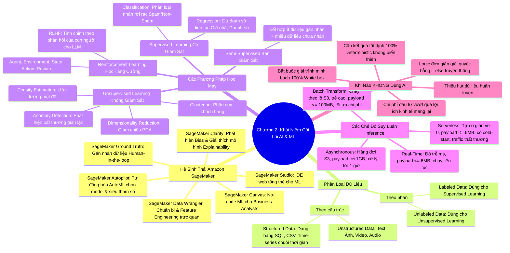

# CHƯƠNG 02: NẮM VỮNG CÁC KHÁI NIỆM CỐT LÕI VỀ AI VÀ MACHINE LEARNING
*(Section 2 - Domain 1: Fundamentals of AI and ML)*

---

## 🎯 MỤC TIÊU BÀI HỌC & TRỌNG TÂM THI (EXAM FOCUS)
- Hiểu tường tận quy trình học máy: **Training Data ➔ ML Algorithm ➔ Model**.
- Nắm chắc hệ sinh thái **Amazon SageMaker**: **Studio, Ground Truth, Data Wrangler, Autopilot, Clarify, Canvas**.
- Phân biệt các loại dữ liệu: **Dữ liệu có gán nhãn (Labeled)** vs **Không gán nhãn (Unlabeled)**; **Có cấu trúc (Structured / Tabular / Time-series)** vs **Phi cấu trúc (Unstructured)**.
- Phân biệt 4 mô hình học máy: **Học có giám sát (Supervised)**, **Không giám sát (Unsupervised)**, **Bán giám sát (Semi-supervised)**, và **Học tăng cường (Reinforcement Learning / RLHF)**.
- Phân biệt 4 hình thức suy luận (Inference): **Real-time, Batch Transform, Serverless, Asynchronous** (kích thước payload, độ trễ, trường hợp sử dụng).
- Nhận biết chính xác: **Khi nào KHÔNG NÊN sử dụng Trí tuệ nhân tạo (When NOT to use AI)**.

---

## 🧠 BẢN ĐỒ TƯ DUY (MINDMAP) CHƯƠNG 2

### Sơ đồ tư duy trực quan (Mermaid Diagram)

---

## 📚 KIẾN THỨC CỐT LÕI CHI TIẾT (DEEP DIVE)

### 1. Quy trình Machine Learning và Hệ sinh thái Amazon SageMaker

Quy trình cơ bản của ML gồm 3 bước:
$$\text{Training Data (Dữ liệu huấn luyện)} \xrightarrow{\text{ML Algorithm (Thuật toán học máy)}} \text{Model (Mô hình đã huấn luyện)}$$

**Amazon SageMaker** là nền tảng điện toán đám mây được quản lý hoàn toàn (Fully Managed Service) giúp lập trình viên và nhà khoa học dữ liệu xây dựng (Build), huấn luyện (Train) và triển khai (Deploy) các mô hình ML ở quy mô lớn.

#### Bảng tra cứu các tính năng trọng yếu của Amazon SageMaker:
| Tính năng SageMaker | Vai trò cốt lõi | Từ khóa nhận diện trong đề thi |
| :--- | :--- | :--- |
| **SageMaker Studio** | Giao diện phát triển tích hợp (Web-based IDE) duy nhất cho toàn bộ chu trình ML. | *"Single web-based interface", "Integrated IDE", "Build, train, deploy from one place"* |
| **SageMaker Ground Truth** | Dịch vụ gán nhãn dữ liệu (Data Labeling) tự động kết hợp con người (**Human-in-the-loop**), hỗ trợ cả đội ngũ nội bộ, đối tác AWS hoặc Amazon Mechanical Turk. | *"Label datasets", "Active learning", "Human-in-the-loop labeling"* |
| **SageMaker Data Wrangler** | Công cụ chuẩn bị dữ liệu trực quan: làm sạch, chuyển đổi định dạng và trích xuất đặc trưng (Feature Engineering) chỉ với vài thao tác kéo thả. | *"Prepare data visually", "Feature engineering without complex code", "Export pipelines"* |
| **SageMaker Autopilot** | Cơ chế **AutoML** hoàn toàn tự động: tự khám phá thuật toán, tinh chỉnh siêu tham số (Hyperparameters), so sánh các model và chọn ra model tốt nhất với tính minh bạch tuyệt đối (xuất code notebook). | *"Automated ML", "Explore algorithms automatically", "No ML expertise needed", "Generates full Python code"* |
| **SageMaker Clarify** | Phát hiện thiên kiến (**Bias detection**) trong dữ liệu trước huấn luyện và trong mô hình sau huấn luyện; giải thích tầm quan trọng của các thuộc tính (**Explainability** - SHAP values). | *"Detect bias", "Model explainability", "Feature attribution", "Transparency"* |
| **SageMaker Canvas** | Giao diện đồ họa không cần viết code (**Visual No-code interface**) dành riêng cho chuyên viên phân tích kinh doanh (Business Analysts) để dự đoán xu hướng. | *"No-code visual interface", "Business analysts", "Point-and-click ML"* |

---

### 2. Các loại dữ liệu trong Machine Learning

1. **Phân loại theo nhãn (Labeling):**
   - **Dữ liệu có gán nhãn (Labeled Data):** Mỗi điểm dữ liệu đi kèm với câu trả lời đúng (nhãn mục tiêu - Target/Ground Truth). *Ví dụ: Ảnh đi kèm nhãn "Chó" hoặc "Mèo"; email đi kèm nhãn "Spam" hoặc "Không Spam"*. Đây là nguyên liệu bắt buộc của **Supervised Learning**.
   - **Dữ liệu không gán nhãn (Unlabeled Data):** Chỉ có các đặc trưng thô, không có nhãn chỉ dẫn sẵn. Mô hình phải tự học để phát hiện cấu trúc ẩn. Dùng trong **Unsupervised Learning**.

2. **Phân loại theo cấu trúc (Structure):**
   - **Dữ liệu có cấu trúc (Structured Data):** Dữ liệu dạng bảng (Tabular), có hàng và cột xác định rõ ràng, lưu trữ trong cơ sở dữ liệu quan hệ (SQL, Amazon RDS) hoặc file CSV, Excel.
     - *Dữ liệu chuỗi thời gian (Time-series data):* Một dạng dữ liệu có cấu trúc đặc biệt được ghi nhận tuần tự theo các mốc thời gian đều đặn (như giá cổ phiếu từng phút, nhiệt độ cảm biến IoT hàng giờ).
   - **Dữ liệu phi cấu trúc (Unstructured Data):** Chiếm hơn 80% dữ liệu doanh nghiệp hiện nay (văn bản tự do, email, file ghi âm cuộc gọi, hình ảnh, video). Cần các kỹ thuật Deep Learning để xử lý.

---

### 3. Bốn phương pháp học máy (Machine Learning Paradigms)

#### A. Học có giám sát (Supervised Learning)
Huấn luyện mô hình trên dữ liệu có gán nhãn để dự đoán kết quả cho dữ liệu mới chưa từng thấy.
- **Phân loại (Classification):** Dự đoán một **nhãn rời rạc / phân loại hữu hạn** (Discrete categories).
  - *Nhị phân (Binary):* Gian lận hay Hợp lệ; Bệnh nhân mắc bệnh hay Không mắc bệnh.
  - *Đa lớp (Multiclass):* Phân loại email vào 5 hòm thư khác nhau; Nhận diện loài vật.
  - *Thuật toán phổ biến:* Decision Trees, Random Forest, Support Vector Machines (SVM), K-Nearest Neighbors (KNN), Logistic Regression.
- **Hồi quy (Regression):** Dự đoán một **giá trị số thực liên tục** (Continuous numerical values).
  - *Ví dụ:* Dự đoán giá bán nhà dựa trên diện tích, dự báo doanh thu quý tới, ước tính nhiệt độ ngày mai.
  - *Thuật toán phổ biến:* Linear Regression, Decision Tree Regressor, Random Forest Regressor.

#### B. Học không giám sát (Unsupervised Learning)
Hoạt động trên dữ liệu hoàn toàn không có nhãn. Mô hình tự động khai phá các quy luật ẩn sâu bên trong.
- **Phân cụm (Clustering):** Nhóm các đối tượng tương đồng vào cùng một cụm. *Ví dụ: Phân nhóm khách hàng theo hành vi mua sắm (Customer Segmentation).* Thuật toán: K-Means Clustering.
- **Giảm chiều dữ liệu (Dimensionality Reduction):** Giảm bớt số lượng thuộc tính phức tạp mà vẫn giữ lại phần lớn thông tin cốt lõi (Principal Component Analysis - PCA), giúp trực quan hóa dữ liệu và tăng tốc huấn luyện.
- **Phát hiện bất thường (Anomaly Detection):** Nhận diện các điểm dữ liệu dị biệt khác thường so với phần còn lại của tập hợp. *Ví dụ: Phát hiện giao dịch thẻ tín dụng bị hack, phát hiện máy móc nhà xưởng rung lắc bất thường.*
- **Ước lượng mật độ (Density Estimation):** Xác định các vùng tập trung cao hay thấp của dữ liệu để quy hoạch vị trí mở cửa hàng bán lẻ.

#### C. Học tăng cường (Reinforcement Learning - RL) & RLHF
- **Reinforcement Learning (RL):** Học thông qua tương tác thử - sai với môi trường theo chu trình:
  - **Tác tử (Agent):** Thực thể ra quyết định.
  - **Môi trường (Environment):** Thế giới nơi Agent hoạt động.
  - **Trạng thái (State):** Tình trạng hiện tại của môi trường.
  - **Hành động (Action):** Quyết định của Agent.
  - **Phần thưởng (Reward):** Tín hiệu thưởng (khi làm đúng) hoặc phạt (khi làm sai).
  - *Ứng dụng:* Xe tự hành (Self-driving cars), robot công nghiệp, AI chơi game (AlphaGo, Dota bot).
- **RLHF (Reinforcement Learning from Human Feedback):**
  - Kỹ thuật mang tính sống còn để đưa mô hình ngôn ngữ lớn (LLM) vào sử dụng an toàn.
  - **Quy trình:** Thu thập đánh giá xếp hạng của con người về các câu trả lời của mô hình ➔ Huấn luyện một mô hình chấm điểm thưởng (Reward Model) ➔ Tinh chỉnh mô hình bằng thuật toán tối ưu (như PPO) để kết quả trả về vừa thông minh, vừa hữu ích và an toàn.
  - *Mục tiêu:* Hạn chế hiện tượng ảo giác (hallucination), ngôn từ độc hại và hành vi thiên lệch.

#### D. Học bán giám sát (Semi-Supervised Learning)
- Kết hợp một lượng nhỏ dữ liệu đã gán nhãn với một lượng rất lớn dữ liệu chưa gán nhãn.
- *Lợi ích:* Tiết kiệm chi phí gán nhãn cực lớn vì gán nhãn thủ công bằng con người rất đắt đỏ và tốn thời gian.
- *Ứng dụng:* Phân tích cảm xúc bài đăng mạng xã hội, phân loại hồ sơ bệnh án, phát hiện gian lận.

---

### 4. Các chế độ suy luận mô hình (Model Inference Options) trong SageMaker

Suy luận (Inference) là quá trình đưa dữ liệu mới vào mô hình đã huấn luyện để nhận kết quả dự đoán. Trong SageMaker có 4 tùy chọn kiến trúc triển khai:

| Chế độ triển khai | Đặc tính độ trễ (Latency) | Kích thước Payload tối đa | Mô hình chi phí | Trường hợp ứng dụng chuẩn |
| :--- | :--- | :--- | :--- | :--- |
| **Real-Time Inference** | Cực thấp (Vài mili-giây) | **Lên đến 6 MB** | Tính tiền 24/7 theo instance đang chạy (Đắt hơn) | Ứng dụng tương tác trực tiếp: Chatbot, chấm điểm gian lận thẻ tín dụng khi quẹt thẻ, ứng dụng Web/Mobile trực tuyến. |
| **Batch Transform** | Trễ cao (Chạy định kỳ theo giờ/ngày) | **Lên đến 100 MB** cho mỗi mini-batch | Chỉ trả tiền cho thời gian chạy tính toán (Rất tiết kiệm) | Chấm điểm tín dụng cuối tuần, phân tích hồ sơ bảo hiểm định kỳ, dự báo doanh số tháng tới. |
| **Serverless Inference** | Thấp (Có Cold-start) | **Lên đến 6 MB** | Trả tiền theo thời gian xử lý và dữ liệu vào/ra; **Tự động scale về 0** | Lưu lượng truy cập thất thường, không dự đoán được, ứng dụng nội bộ có thời gian nhàn rỗi dài. |
| **Asynchronous Inference** | Chờ hàng đợi (Lên đến **1 giờ**) | **Lên đến 1 GB** (Lưu qua Amazon S3) | Tự động hạ instance về 0 khi hàng đợi rỗng | Xử lý file ảnh y tế độ phân giải cao, video dài nhiều phút, tài liệu PDF hàng trăm trang. |

---

### 5. Khi nào KHÔNG NÊN sử dụng Trí tuệ nhân tạo (When NOT to use AI)?

Đề thi AIF-C01 thường xuyên đưa ra các câu hỏi tình huống để kiểm tra xem bạn có hiểu đúng giới hạn của AI hay không:
1. **Khi bài toán yêu cầu kết quả tất định 100% (100% Deterministic & Reproducible):** AI bản chất hoạt động dựa trên xác suất và có độ biến thiên (variability). Tính toán sổ sách kế toán, bảng lương hay báo cáo thuế cần độ chính xác tuyệt đối từng xu thì phải dùng lập trình truyền thống.
2. **Khi bài toán đơn giản có thể giải quyết tốt bằng logic thông thường:** Nếu chỉ cần vài câu lệnh `if-else` hoặc một truy vấn SQL đơn giản, việc xây dựng mô hình AI chỉ gây lãng phí chi phí, độ trễ và phức tạp hóa hệ thống.
3. **Khi doanh nghiệp không có đủ dữ liệu huấn luyện:** Mô hình học máy chất lượng phụ thuộc vào dữ liệu ("Garbage in, garbage out"). Nếu không có dữ liệu chất lượng cao và đại diện, mô hình sẽ hoàn toàn vô dụng.
4. **Khi cần tính minh bạch tuyệt đối (Complete Explainability):** Với các quy định pháp luật khắt khe đòi hỏi phải giải trình chi tiết từng phép suy luận (như phê duyệt thuốc men khẩn cấp hoặc điều tra hình sự nghiêm ngặt), mô hình Deep Learning dạng "hộp đen" sẽ không đáp ứng được.
5. **Khi chi phí vượt xa lợi nhuận (ROI âm):** Chi phí thu thập dữ liệu, thuê chuyên gia, huấn luyện GPU và duy trì hạ tầng AI lớn hơn nhiều so với giá trị kinh doanh mang lại.

---

## ⚠️ MẸO THI & BẪY CẦN TRÁNH (EXAM TIPS & TRAPS)

> [!TIP]
> **Bộ từ khóa định danh nhanh dịch vụ SageMaker:**
> - *"Business analyst without coding"* ➔ **SageMaker Canvas**.
> - *"Automate algorithm and hyperparameter selection"* ➔ **SageMaker Autopilot**.
> - *"Detect bias and provide feature attribution"* ➔ **SageMaker Clarify**.
> - *"Data labeling with human review"* ➔ **SageMaker Ground Truth**.
> - *"Visual data preparation and transformation"* ➔ **SageMaker Data Wrangler**.

> [!TIP]
> **Bộ từ khóa định danh chế độ Inference:**
> - *"Predict continuous numbers (price, sales)"* ➔ **Regression** (Hồi quy).
> - *"Predict categories (yes/no, spam/ham)"* ➔ **Classification** (Phân loại).
> - *"Customer segmentation on unlabeled data"* ➔ **Clustering** (Phân cụm - Unsupervised).
> - *"Large payload up to 1GB, long processing time up to 1 hour"* ➔ **Asynchronous Inference**.
> - *"Process files in S3 in bulk, cost-efficient, can tolerate delay"* ➔ **Batch Transform**.
> - *"Intermittent traffic, scale down to zero when idle, low payload up to 6MB"* ➔ **Serverless Inference**.

> [!WARNING]
> **Cạm bẫy thi trắc nghiệm:**
> - **Nhầm lẫn giữa Autopilot và Canvas:** Cả hai đều hướng tới việc đơn giản hóa ML, nhưng **Canvas** là giao diện kéo thả **No-code dành cho dân kinh doanh (Business)**, trong khi **Autopilot** là công cụ **AutoML dành cho kỹ sư/nhà phát triển** muốn tự động hóa tạo mã và có thể trích xuất toàn bộ Notebook code để can thiệp.
> - **Nhầm lẫn giữa Batch Transform và Asynchronous Inference:** Batch Transform dùng để xử lý cả một tập dữ liệu lớn định kỳ từ S3. Asynchronous Inference dùng cho các lời gọi API đơn lẻ nhưng có tải trọng lớn (như gửi ảnh chụp CT 500MB và nhận kết quả sau 10 phút qua hàng đợi S3).

---

## 📝 BỘ CÂU HỎI ÔN TẬP MÔ PHỎNG (PRACTICE QUESTIONS)

#### Câu 1:
Một chuyên viên phân tích tài chính tại một ngân hàng không có kỹ năng lập trình Python muốn xây dựng mô hình dự đoán khả năng khách hàng rời bỏ dịch vụ (Customer Churn). Tính năng nào của Amazon SageMaker là lựa chọn tối ưu nhất?
- A. Amazon SageMaker Data Wrangler
- B. Amazon SageMaker Studio Classic
- C. Amazon SageMaker Canvas
- D. Amazon SageMaker Autopilot
> **Đáp án đúng: C**  
> *Giải thích:* SageMaker Canvas cung cấp giao diện trực quan No-code dạng kéo thả chuột (point-and-click) được thiết kế đặc thù cho người dùng kinh doanh (Business Analysts) tạo mô hình ML mà không cần viết một dòng code nào.

#### Câu 2:
Một công ty chẩn đoán hình ảnh cần triển khai một mô hình Deep Learning để phân tích các file quét MRI dung lượng lên tới 500 MB. Quá trình xử lý mỗi file mất khoảng 15 phút. Họ muốn một giải pháp tối ưu chi phí và tự động co giãn về 0 khi không có yêu cầu nào trong hàng đợi. Lựa chọn triển khai nào của SageMaker là chính xác?
- A. SageMaker Real-Time Inference
- B. SageMaker Serverless Inference
- C. SageMaker Asynchronous Inference
- D. SageMaker Batch Transform
> **Đáp án đúng: C**  
> *Giải thích:* SageMaker Asynchronous Inference hỗ trợ payload lên tới 1 GB và thời gian xử lý lên tới 1 giờ (60 phút), đồng thời tích hợp hàng đợi S3 và có khả năng tự động scale instance về 0 khi hàng đợi rỗng. Real-Time và Serverless chỉ hỗ trợ tối đa 6 MB payload.

#### Câu 3:
Trường hợp nào sau đây là tình huống mà một tổ chức **KHÔNG NÊN** ứng dụng Trí tuệ nhân tạo (AI)?
- A. Khi cần phân loại hàng triệu đánh giá của người dùng thành tích cực hoặc tiêu cực.
- B. Khi cần tính toán chính xác tiền thuế giá trị gia tăng và lập hóa đơn tài chính theo quy định nhà nước.
- C. Khi cần phát hiện các hành vi rửa tiền bất thường trong các luồng giao dịch ngân hàng.
- D. Khi cần dự đoán thời gian bảo trì định kỳ cho các động cơ máy bay.
> **Đáp án đúng: B**  
> *Giải thích:* Tính toán thuế và xuất hóa đơn tài chính đòi hỏi kết quả tất định 100% (100% deterministic), tuân thủ tuyệt đối các quy tắc logic toán học cố định không có sai số. AI hoạt động dựa trên xác suất và có thể gây biến thiên, do đó lập trình truyền thống là giải pháp bắt buộc.
