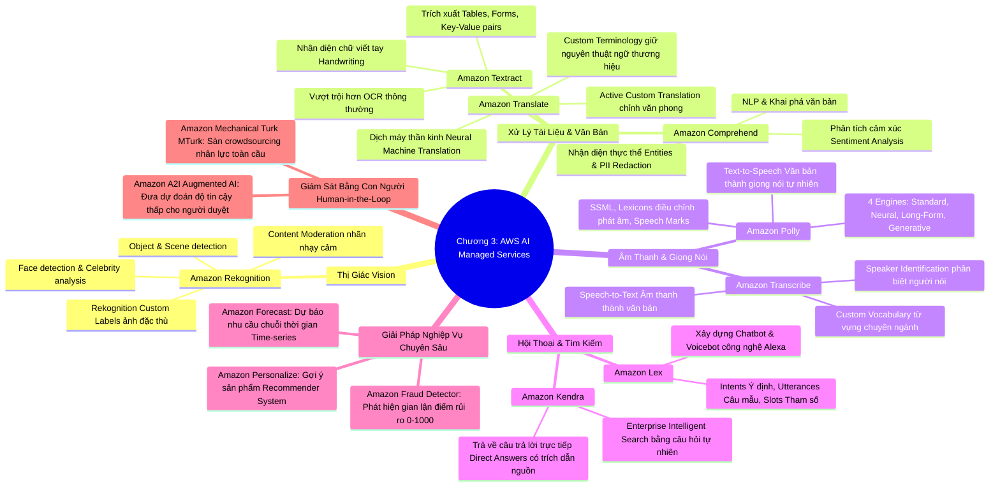

# CHƯƠNG 03: CHI TIẾT CÁC DỊCH VỤ AWS AI MANAGED SERVICES
*(Section 3 - Domain 1: Fundamentals of AI and ML)*

---

## 🎯 MỤC TIÊU BÀI HỌC & TRỌNG TÂM THI (EXAM FOCUS)
- Nắm vững đặc tính của nhóm **Managed AI Services**: Đã được huấn luyện sẵn (Pre-trained), gọi qua REST API, không cần kiến thức chuyên sâu về Machine Learning, chi phí theo lượng tiêu thụ (Pay-as-you-go).
- Phân biệt công dụng và từ khóa ăn điểm của 13 dịch vụ AI hàng đầu của AWS:
  1. **Thị giác (Vision):** Amazon Rekognition
  2. **Văn bản & Tài liệu (Text/Documents):** Amazon Textract, Amazon Comprehend, Amazon Translate
  3. **Âm thanh & Giọng nói (Speech):** Amazon Transcribe, Amazon Polly
  4. **Hội thoại (Conversational AI):** Amazon Lex
  5. **Tìm kiếm thông minh (Enterprise Search):** Amazon Kendra
  6. **Giải pháp nghiệp vụ (Business Solutions):** Amazon Personalize, Amazon Fraud Detector, Amazon Forecast
  7. **Đánh giá & Gán nhãn con người (Human Oversight):** Amazon Augmented AI (A2I), Amazon Mechanical Turk (MTurk)

---

## 🧠 BẢN ĐỒ TƯ DUY (MINDMAP) CHƯƠNG 3

### Sơ đồ tư duy trực quan (Mermaid Diagram)

---

## 📚 KIẾN THỨC CỐT LÕI CHI TIẾT (DEEP DIVE)

### 1. Nhóm Dịch Vụ Thị Giác Máy Tính (Vision)
#### **Amazon Rekognition**
- **Định nghĩa:** Dịch vụ thị giác máy tính được quản lý hoàn toàn, phân tích hình ảnh và video không cần chuyên môn ML.
- **Tính năng cốt lõi:**
  - **Object & Scene Detection:** Nhận diện đồ vật, phương tiện giao thông, phong cảnh kèm tọa độ khung chữ nhật (*Bounding Box*).
  - **Facial Analysis & Search:** Phân tích cảm xúc khuôn mặt (vui, buồn, ngạc nhiên), ước tính độ tuổi, phát hiện kính mắt, khẩu trang; so sánh khuôn mặt để xác thực danh tính.
  - **Content Moderation:** Tự động phát hiện và gắn cờ các hình ảnh/video có nội dung người lớn, bạo lực hoặc không phù hợp trên mạng xã hội.
  - **Text Detection:** Đọc biển số xe, chữ in trên biển hiệu xuất hiện trong ảnh.
  - **Rekognition Custom Labels:** Cho phép người dùng huấn luyện mô hình thị giác chuyên biệt chỉ với một số lượng nhỏ hình ảnh ví dụ (như phát hiện lỗi phụ tùng trên dây chuyền sản xuất cơ khí, nhận diện logo doanh nghiệp).

---

### 2. Nhóm Dịch Vụ Xử Lý Văn Bản & Tài Liệu (Document & Text)

#### **Amazon Textract**
- **Định nghĩa:** Dịch vụ xử lý tài liệu thông minh vượt xa các công cụ OCR (Optical Character Recognition) truyền thống.
- **Sự khác biệt vượt trội:** OCR thông thường chỉ đọc chuỗi chữ rời rạc, làm mất toàn bộ cấu trúc. Textract hiểu được **ngữ cảnh và cấu trúc không gian** của tài liệu.
- **Tính năng chủ chốt:**
  - **Key-Value Pairs Extraction:** Đọc chính xác các mẫu đơn (Form), ví dụ: "Họ và tên: [Nguyễn Văn A]", "Ngày sinh: [01/01/1990]".
  - **Table Extraction:** Giữ nguyên bảng biểu, hàng, cột và dữ liệu trong từng ô trong hóa đơn tài chính, sao kê ngân hàng.
  - **Queries API:** Cho phép đặt câu hỏi bằng ngôn ngữ tự nhiên để lấy thông tin cụ thể (ví dụ: *"Tổng số tiền thanh toán là bao nhiêu?"*).
  - Hỗ trợ chữ in máy lẫn chữ viết tay (**Handwriting**).

#### **Amazon Comprehend**
- **Định nghĩa:** Dịch vụ xử lý ngôn ngữ tự nhiên (NLP) phân tích ngữ nghĩa sâu trong văn bản.
- **Tính năng chủ chốt:**
  - **Sentiment Analysis:** Xác định cảm xúc bài viết: *Positive, Negative, Neutral, Mixed*.
  - **Named Entity Recognition (NER):** Tự động phát hiện các thực thể như Tên người, Địa điểm, Tổ chức, Ngày tháng.
  - **PII Detection & Redaction:** Tự động phát hiện và che giấu/lược bỏ các thông tin nhận dạng cá nhân nhạy cảm (Số CMND/CCCD, Số điện thoại, Email, Thẻ tín dụng).
  - **Keyphrase Extraction:** Trích xuất các cụm từ chủ đạo để tóm tắt nội dung.
  - **Custom Classification:** Huấn luyện mô hình phân loại email hỗ trợ khách hàng theo từng phòng ban nghiệp vụ riêng của công ty.

#### **Amazon Translate**
- **Định nghĩa:** Dịch vụ dịch máy thần kinh (Neural Machine Translation) hỗ trợ dịch tự nhiên giữa hàng chục ngôn ngữ.
- **Tính năng độc quyền cần nhớ trong bài thi:**
  - **Custom Terminology:** Cho phép người dùng tải lên danh từ điển riêng để đảm bảo các tên thương hiệu riêng, tên sản phẩm độc quyền (ví dụ: "Amazon Bedrock", "iPhone") không bị dịch sai nghĩa đen sang từ ngữ khác.
  - **Active Custom Translation:** Tự động điều chỉnh văn phong dịch thuật cho phù hợp với ngành nghề mà không cần train lại model.
  - Chế độ dịch: Thời gian thực (**Real-time**) cho live chat và theo lô (**Batch**) cho kho tài liệu lớn.

---

### 3. Nhóm Dịch Vụ Âm Thanh & Giọng Nói (Speech)

#### **Amazon Transcribe**
- **Chức năng:** Chuyển đổi âm thanh / tiếng nói thành văn bản (**Speech-to-Text - ASR**).
- **Tính năng cốt lõi:**
  - **Speaker Identification (Speaker Diarization):** Tự động nhận diện và tách biệt lời thoại của từng người tham gia cuộc trò chuyện (*Speaker 1, Speaker 2*).
  - **Custom Vocabulary:** Bổ sung danh sách từ vựng chuyên ngành y khoa, thuật ngữ công nghệ, tên riêng vào bộ từ vựng để tránh phiên âm sai.
  - **Custom Language Models (CLM):** Huấn luyện trên văn bản chuyên ngành để tăng độ chính xác trong ngữ cảnh đặc thù.
  - **Content Redaction:** Tự động lược bỏ PII trong file ghi âm cuộc gọi tổng đài.
  - Chế độ: Batch (file âm thanh ghi sẵn trong S3) hoặc Real-time Streaming qua WebSocket/HTTP2.

#### **Amazon Polly**
- **Chức năng:** Chuyển đổi văn bản thành giọng nói tự nhiên, truyền cảm (**Text-to-Speech - TTS**).
- **4 Loại công nghệ phát âm (Voice Engines):**
  1. *Standard Engine:* Cơ bản, phát âm nhanh.
  2. *Neural Engine:* Giọng đọc tự nhiên, mượt mà hơn.
  3. *Long-Form Engine:* Tối ưu hóa cho các bài đọc văn bản dài như sách nói (Audiobooks), bài báo.
  4. *Generative Engine:* Giọng đọc thế hệ mới nhất, mô phỏng cảm xúc con người chân thực nhất.
- **Công cụ tùy biến:**
  - **SSML (Speech Synthesis Markup Language):** Các thẻ XML điều khiển tốc độ đọc, ngắt nghỉ, thì thầm, cao độ giọng nói.
  - **Lexicons:** Từ điển quy định cách phát âm chuẩn cho các từ viết tắt hoặc từ nước ngoài.
  - **Speech Marks:** Cung cấp mốc thời gian (timestamp) của từng từ được đọc, giúp đồng bộ hóa chuyển động môi của nhân vật ảo hoạt hình.

---

### 4. Nhóm Dịch Vụ Hội Thoại & Tìm Kiếm Doanh Nghiệp

#### **Amazon Lex**
- **Chức năng:** Xây dựng giao diện trò chuyện đàm thoại thông minh (Chatbot và Voicebot), sử dụng công nghệ cốt lõi của **Amazon Alexa**.
- **Khái niệm cốt lõi bắt buộc phải thuộc:**
  - **Intent (Ý định):** Mục tiêu người dùng muốn thực hiện (ví dụ: `BookHotel`, `OrderPizza`).
  - **Utterance (Câu nói mẫu):** Các cách nói khác nhau mà người dùng có thể diễn đạt ý định đó (ví dụ: *"Tôi muốn đặt phòng khách sạn"*, *"Tìm cho tôi phòng ngủ"*).
  - **Slot (Tham số / Thông tin cần điền):** Các biến dữ liệu cần thu thập để hoàn thành ý định (ví dụ: `Location`, `CheckInDate`, `NumberOfGuests`).
  - **Prompt (Câu gợi ý):** Câu bot hỏi người dùng để lấy dữ liệu cho Slot (ví dụ: *"Bạn muốn nhận phòng vào ngày nào?"*).
  - **Fulfillment:** Hành động thực thi khi đã thu thập đủ Slot (thường tích hợp qua hàm **AWS Lambda** để gọi database hoặc hệ thống đặt chỗ).

#### **Amazon Kendra**
- **Chức năng:** Dịch vụ tìm kiếm thông minh cấp doanh nghiệp (**Intelligent Enterprise Search**) được cung cấp bởi NLP và Machine Learning.
- **Đặc điểm nổi trội:**
  - Thay vì chỉ tìm kiếm theo từ khóa rời rạc (Keyword match), Kendra hiểu câu hỏi bằng ngôn ngữ tự nhiên (ví dụ: *"Chính sách nghỉ thai sản kéo dài bao lâu?"*).
  - **Direct Answers:** Cung cấp câu trả lời chính xác, ngắn gọn được trích xuất trực tiếp từ tài liệu kèm trích dẫn đường link nguồn tài liệu gốc.
  - Hỗ trợ kết nối sẵn (Built-in Connectors) tới hàng chục nguồn dữ liệu: Amazon S3, Microsoft SharePoint, Salesforce, ServiceNow, Google Drive.
  - Phân quyền bảo mật: Người dùng chỉ tìm thấy tài liệu mà họ có quyền truy cập theo phân quyền IAM / Active Directory.

---

### 5. Nhóm Dịch Vụ Giải Pháp Nghiệp Vụ (Business AI)

| Dịch vụ | Mục đích sử dụng | Đặc điểm nổi bật |
| :--- | :--- | :--- |
| **Amazon Personalize** | Hệ thống gợi ý cá nhân hóa (Recommender System), thừa hưởng từ thuật toán đề xuất của Amazon.com. | Sử dụng dữ liệu tương tác người dùng (Clicks, Views, Purchases). Giải quyết bài toán **Cold-start** cho người dùng mới và sản phẩm mới. Hỗ trợ A/B testing. |
| **Amazon Fraud Detector** | Tự động phát hiện các hành vi gian lận trực tuyến (Tạo tài khoản ảo, quẹt thẻ gian lận). | Đưa ra thang điểm rủi ro từ **0 đến 1,000** (Risk Score). Kết hợp các luật nghiệp vụ (Rule engine) để tự động chấp nhận, từ chối hoặc chuyển duyệt tay. |
| **Amazon Forecast** | Dự báo chuỗi thời gian (Time-series forecasting) bằng ML. | Tự động lựa chọn thuật toán phù hợp nhất. Tích hợp dữ liệu thời tiết và lịch nghỉ lễ quốc gia để nâng cao độ chính xác dự báo tồn kho, chuỗi cung ứng. |

---

### 6. Nhóm Dịch Vụ Đánh Giá & Gán Nhãn Con Người (Human-in-the-loop)

#### **Amazon Augmented AI (Amazon A2I)**
- **Vai trò:** Tự động định tuyến các dự đoán của mô hình AI có độ tin cậy thấp (**Low confidence score**) hoặc các trường hợp nhạy cảm đến đội ngũ con người thẩm định lại (Human Review).
- **Tích hợp sẵn (Built-in workflows):**
  - Tích hợp với **Amazon Textract** (ví dụ: khi Textract không chắc chắn về chữ viết tay trên hóa đơn bảo hiểm).
  - Tích hợp với **Amazon Rekognition** (ví dụ: khi kiểm duyệt nội dung nhạy cảm có độ tin cậy ranh giới).
  - Có API để tích hợp vào bất kỳ mô hình Custom ML nào trên SageMaker.

#### **Amazon Mechanical Turk (MTurk)**
- **Vai trò:** Sàn giao dịch thị trường việc làm cộng đồng (Crowdsourcing Marketplace) kết nối doanh nghiệp với hàng trăm nghìn lao động tự do trên toàn thế giới để thực hiện các tác vụ đòi hỏi trí tuệ con người (Human Intelligence Tasks - HITs) như gán nhãn hàng triệu bức ảnh, khảo sát thị trường, làm sạch dữ liệu.

---

## ⚖️ BẢNG TRA CỨU & SO SÁNH CÁC DỊCH VỤ DỄ NHẦM LẪN

| Cặp dịch vụ dễ nhầm | Tiêu chí phân biệt mấu chốt |
| :--- | :--- |
| **Amazon Textract** vs **Amazon Rekognition** | • **Textract:** Chuyên sâu về **văn bản, hóa đơn, bảng biểu, hợp đồng, form** dạng PDF/ảnh scan. • **Rekognition:** Chuyên về **khuôn mặt, đồ vật, phong cảnh, kiểm duyệt video/ảnh**. Có nhận diện text trong ảnh nhưng chỉ đọc text thô dạng biển hiệu/biển số xe, không đọc bảng biểu cấu trúc. |
| **Amazon Transcribe** vs **Amazon Polly** | • **Transcribe:** Biến **Giọng nói ➔ Chữ viết** (Speech-to-Text). • **Polly:** Biến **Chữ viết ➔ Giọng đọc nói** (Text-to-Speech). |
| **Amazon Kendra** vs **Amazon OpenSearch Service** | • **Kendra:** Dịch vụ đóng gói sẵn, tìm kiếm văn bản doanh nghiệp bằng câu hỏi tự nhiên (NLP) cho người dùng cuối, có connectors sẵn. • **OpenSearch:** Nền tảng công cụ tìm kiếm và phân tích log kỹ thuật chuyên sâu, hỗ trợ Vector Search cho lập trình viên tùy biến. |
| **Amazon A2I** vs **SageMaker Ground Truth** | • **Ground Truth:** Tập trung vào việc **gán nhãn dữ liệu ban đầu** (Data Labeling) để chuẩn bị tập Dataset huấn luyện mô hình. • **Amazon A2I:** Tập trung vào việc **thẩm định lại kết quả suy luận** (Inference Review) của mô hình đang chạy khi độ tin cậy thấp. |

---

## ⚠️ MẸO THI & BẪY CẦN TRÁNH (EXAM TIPS & TRAPS)

> [!TIP]
> **Nhớ ngay các từ khóa "vàng":**
> - *"Speaker identification", "custom vocabulary"* ➔ Chọn ngay **Amazon Transcribe**.
> - *"SSML", "Speech Marks", "lifelike narration"* ➔ Chọn ngay **Amazon Polly**.
> - *"Extract tables and forms from PDF invoice"* ➔ Chọn ngay **Amazon Textract**.
> - *"Detect sentiment, extract entities, redact PII from text"* ➔ Chọn ngay **Amazon Comprehend**.
> - *"Brand name translation consistency"* ➔ Chọn ngay **Amazon Translate (Custom Terminology)**.
> - *"Intents, utterances, slots"* ➔ Chọn ngay **Amazon Lex**.
> - *"Search enterprise documents with natural language and get direct answers"* ➔ Chọn ngay **Amazon Kendra**.
> - *"Low confidence predictions need human review"* ➔ Chọn ngay **Amazon Augmented AI (A2I)**.

---

## 📝 BỘ CÂU HỎI ÔN TẬP MÔ PHỎNG (PRACTICE QUESTIONS)

#### Câu 1:
Một công ty tài chính đa quốc gia nhận được hàng nghìn mẫu đơn đăng ký vay vốn dưới dạng tệp PDF đã quét. Họ cần trích xuất thông tin người vay từ các bảng và cặp khóa-giá trị (key-value pairs) mà không làm mất cấu trúc tài liệu. Dịch vụ AWS nào phù hợp nhất?
- A. Amazon Rekognition
- B. Amazon Comprehend
- C. Amazon Textract
- D. Amazon Kendra
> **Đáp án đúng: C**  
> *Giải thích:* Amazon Textract được thiết kế chuyên biệt để trích xuất văn bản, bảng biểu (tables) và các cặp key-value từ các biểu mẫu và tài liệu quét. Rekognition chỉ trích xuất văn bản thô trên ảnh đồ vật, Comprehend phân tích ngữ nghĩa, Kendra là công cụ tìm kiếm.

#### Câu 2:
Một ứng dụng đặt xe taxi muốn xây dựng một hệ thống chatbot tự động đàm thoại cho phép khách hàng đặt xe qua tin nhắn. Nhà phát triển cần định nghĩa ý định của khách hàng (như "BookRide") và các thông tin cần thiết như "Điểm đón" và "Điểm đến". Dịch vụ AWS nào cung cấp các tính năng này?
- A. Amazon Lex
- B. Amazon Polly
- C. Amazon Transcribe
- D. Amazon Comprehend
> **Đáp án đúng: A**  
> *Giải thích:* Amazon Lex là dịch vụ xây dựng chatbot đàm thoại sử dụng các khái niệm Intent (Ý định), Utterance (Câu nói mẫu), và Slot (Tham số cần điền như điểm đón, điểm đến).

#### Câu 3:
Một trang thương mại điện tử sử dụng Machine Learning để tự động gắn cờ các bài đánh giá độc hại. Đối với các bài đánh giá mà mô hình AI chỉ có mức độ tin cậy (confidence score) dưới 70%, công ty muốn tự động chuyển hướng các bài này cho nhân viên kiểm duyệt nội dung con người xem xét. Dịch vụ nào nên được tích hợp vào quy trình?
- A. Amazon Mechanical Turk
- B. Amazon Augmented AI (Amazon A2I)
- C. Amazon SageMaker Ground Truth
- D. Amazon Rekognition Custom Labels
> **Đáp án đúng: B**  
> *Giải thích:* Amazon Augmented AI (Amazon A2I) cho phép thiết lập quy trình Human-in-the-loop tự động định tuyến các dự đoán có độ tin cậy thấp (low confidence) tới con người để thẩm duyệt. SageMaker Ground Truth dùng để gán nhãn dữ liệu trước huấn luyện.
