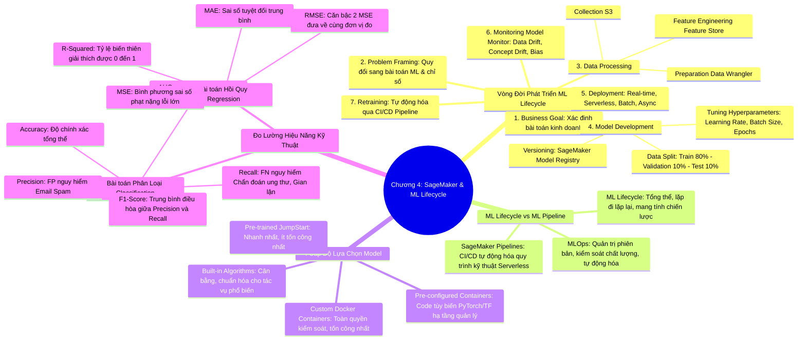

# CHƯƠNG 04: AMAZON SAGEMAKER AI VÀ VÒNG ĐỜI PHÁT TRIỂN MACHINE LEARNING
*(Section 4 - Domain 1: Fundamentals of AI and ML)*

---

## 🎯 MỤC TIÊU BÀI HỌC & TRỌNG TÂM THI (EXAM FOCUS)
- Nắm vững toàn bộ các giai đoạn trong **Vòng đời phát triển Machine Learning (ML Development Lifecycle)**: Từ xác định mục tiêu kinh doanh đến triển khai, giám sát và tái huấn luyện.
- Phân biệt bản chất giữa **Tham số mô hình (Model Parameters)** và **Siêu tham số (Hyperparameters)**: Learning rate, Batch size, Epochs.
- Phân biệt sự khác nhau giữa **ML Lifecycle** (chiến lược, "What/Why") và **ML Pipeline / SageMaker Pipelines** (chiến thuật, tự động hóa, "How").
- Hiểu rõ nguyên lý **MLOps** và bản đồ ánh xạ các tính năng của **Amazon SageMaker**: Ground Truth, Data Wrangler, Feature Store, Autopilot, MLflow, Model Registry, Model Monitor, Edge Manager.
- Nắm chắc thang 4 cấp độ lựa chọn mô hình (**Model Selection Spectrum**): *Pre-trained (JumpStart) ➔ Built-in Algorithms ➔ Pre-configured Frameworks ➔ Custom Docker Containers*.
- Làm chủ bộ chỉ số kỹ thuật (**Technical Performance Metrics**):
  - Phân loại: **Accuracy, Precision, Recall, F1-Score, AUC-ROC**.
  - Hồi quy: **MAE, MSE, RMSE, R-squared, MAPE**.
- Phân biệt hiện tượng **Data Drift** (lệch dữ liệu) và **Concept Drift** (lệch khái niệm).

---

## 🧠 BẢN ĐỒ TƯ DUY (MINDMAP) CHƯƠNG 4

### Sơ đồ tư duy trực quan (Mermaid Diagram)


---

## 📚 KIẾN THỨC CỐT LÕI CHI TIẾT (DEEP DIVE)

### 1. Phân biệt Siêu tham số (Hyperparameters) và Tham số (Parameters)

| Tiêu chí | Siêu tham số (Hyperparameters) | Tham số mô hình (Model Parameters) |
| :--- | :--- | :--- |
| **Thời điểm thiết lập** | Thiết lập **TRƯỚC** khi huấn luyện bắt đầu. | Được hình thành và cập nhật **TRONG** quá trình huấn luyện. |
| **Người quyết định** | Kỹ sư / Nhà khoa học dữ liệu (hoặc do SageMaker Autopilot tự tìm kiếm). | Thuật toán học máy tự động tính toán dựa trên dữ liệu. |
| **Ví dụ điển hình** | • **Learning rate** (tốc độ học)<br>• **Batch size** (kích thước lô mẫu)<br>• **Epochs** (số chu kỳ duyệt toàn bộ dữ liệu)<br>• Số tầng ẩn trong Neural Network | • Trọng số (Weights $W$)<br>• Độ lệch (Biases $b$) trong mạng nơ-ron |

#### Chi tiết 3 siêu tham số quan trọng nhất:
1. **Learning Rate (Tốc độ học):**
   - *Nếu quá nhỏ:* Mô hình học cực kỳ chậm, tốn thời gian và chi phí tính toán, có nguy cơ kẹt ở điểm cực tiểu địa phương.
   - *Nếu quá lớn:* Quá trình huấn luyện không hội tụ, mô hình nhảy vọt qua điểm tối ưu (overshooting).
2. **Batch Size (Kích thước lô):**
   - Số lượng mẫu dữ liệu được đưa vào mô hình trước khi trọng số được cập nhật.
   - *Batch nhỏ:* Cập nhật thường xuyên, tổng quát hóa tốt hơn nhưng tốn thời gian tính toán.
   - *Batch lớn:* Tận dụng tối đa sức mạnh song song của GPU, tăng tốc độ nhưng tốn nhiều bộ nhớ RAM/VRAM.
3. **Epochs:**
   - Một Epoch là một lần mô hình đọc qua toàn bộ tập dữ liệu huấn luyện.
   - *Quá ít Epochs:* Mô hình chưa kịp học hết mẫu ➔ **Underfitting (Chưa khớp)**.
   - *Quá nhiều Epochs:* Mô hình ghi nhớ vẹt dữ liệu huấn luyện, mất khả năng dự đoán dữ liệu mới ➔ **Overfitting (Quá khớp)**.

---

### 2. Vòng đời phát triển Machine Learning (7 giai đoạn)

Quy trình ML là một chu trình **lặp đi lặp lại (iterative, non-linear)**:
1. **Business Goal Identification:** Xác định rõ bài toán kinh doanh cần giải quyết, xem xét liệu ML có thực sự là công cụ phù hợp hay không.
2. **ML Problem Framing:** Chuyển đổi bài toán kinh doanh thành bài toán kỹ thuật ML (Supervised hay Unsupervised? Classification hay Regression? Định nghĩa các chỉ số thành công - KPI).
3. **Data Processing:**
   - *Data Collection:* Thu thập dữ liệu thô đưa vào Data Lake (**Amazon S3**).
   - *Data Preparation:* Làm sạch, xử lý giá trị khuyết thiếu (Null/NaN) với **SageMaker Data Wrangler**.
   - *Feature Engineering:* Tạo ra các biến đặc trưng có tính phân loại cao, lưu trữ tập trung trên **SageMaker Feature Store** để tái sử dụng giữa các nhóm.
4. **Model Development:**
   - *Chia tập dữ liệu:* **80% Training** (huấn luyện), **10% Validation** (tinh chỉnh siêu tham số và tránh overfitting), **10% Test** (kiểm định khách quan lần cuối).
   - *Huấn luyện quy mô lớn:* Sử dụng **SageMaker HyperPod** để huấn luyện phân tán trên hàng nghìn chip GPU/Trainium.
   - *Quản lý phiên bản:* Đăng ký mô hình đã huấn luyện vào **SageMaker Model Registry** để quản lý vòng đời và phê duyệt triển khai.
5. **Model Deployment:** Triển khai ra các đầu cuối suy luận (Real-time, Serverless, Asynchronous hoặc Batch Transform).
6. **Model Monitoring (SageMaker Model Monitor):**
   - **Data Quality Drift:** Dữ liệu đầu vào thực tế bị thay đổi cấu trúc, định dạng sai hoặc thiếu trường.
   - **Model Quality Drift:** Độ chính xác của mô hình suy giảm theo thời gian.
   - **Bias Drift:** Mô hình bắt đầu sinh ra sự thiên vị đối với một nhóm nhân khẩu học nhất định.
   - **Feature Attribution Drift:** Mức độ đóng góp của từng thuộc tính (SHAP) vào quyết định bị lệch so với dữ liệu gốc.
7. **Model Retraining:** Thiết lập quy trình tự động huấn luyện lại mô hình bằng dữ liệu mới thông qua CI/CD Pipeline.

---

### 3. Phân biệt ML Lifecycle và ML Pipeline (SageMaker Pipelines)

| Tiêu chí | ML Development Lifecycle | ML Pipeline (SageMaker Pipelines) |
| :--- | :--- | :--- |
| **Bản chất** | Khung chiến lược tổng thể (Strategic framework) | Quy trình kỹ thuật tự động hóa (Tactical automation) |
| **Câu hỏi cốt lõi** | Trả lời: **"Làm cái gì và Tại sao?" (What & Why)** | Trả lời: **"Thực thi như thế nào?" (How)** |
| **Tính chất can thiệp** | Chứa nhiều bước đánh giá định tính của con người và các bên liên quan (Stakeholders) | Chạy tự động không cần can thiệp (CI/CD Serverless) |
| **Công cụ AWS** | Amazon SageMaker Studio, Canvas, Catalog | **Amazon SageMaker Pipelines** |

---

### 4. Bốn cấp độ lựa chọn mô hình trong SageMaker (Model Selection Spectrum)

Đề thi thường hỏi về mức độ cân bằng giữa **Công sức triển khai (Effort/Overhead)** và **Khả năng kiểm soát (Control/Customization)**:

```
[Ít tốn công nhất, Triển khai nhanh nhất]                              [Kiểm soát tối đa, Tốn công nhất]
  Pre-trained Models  ───►  Built-in Algorithms  ───►  Pre-configured Frameworks  ───►  Custom Containers
  (SageMaker JumpStart)     (XGBoost, Linear Learner)   (PyTorch, TensorFlow)            (Docker BYOC)
```

1. **Pre-trained Models (Amazon SageMaker JumpStart):**
   - *Từ khóa đề thi:* *"Least operational effort", "Quickest time to deploy", "No training from scratch"*.
   - Hàng trăm mô hình mã nguồn mở và thương mại có sẵn, chỉ cần vài cú click chuột để triển khai hoặc tinh chỉnh nhẹ.
2. **Built-in Algorithms (Thuật toán tích hợp sẵn của SageMaker):**
   - *Từ khóa đề thi:* *"Standard ML tasks", "Optimized by AWS", "Balanced effort"*.
   - AWS đã tối ưu hóa hiệu năng tính toán cho các thuật toán kinh điển như XGBoost, K-Means, Image Classification. Bạn chỉ cần cung cấp dữ liệu huấn luyện dạng CSV hoặc RecordIO.
3. **Pre-configured Framework Containers:**
   - *Từ khóa đề thi:* *"Custom training script in PyTorch/TensorFlow", "AWS manages Docker environment"*.
   - Bạn tự viết script Python huấn luyện (`train.py`), AWS lo toàn bộ môi trường container Docker chuẩn chứa sẵn thư viện PyTorch, Hugging Face hoặc TensorFlow.
4. **Custom Docker Containers (Bring-Your-Own-Container - BYOC):**
   - *Từ khóa đề thi:* *"Complete control over dependencies", "Proprietary libraries", "Legacy code"*.
   - Doanh nghiệp tự đóng gói file `Dockerfile` riêng chứa mọi thư viện chuyên biệt. Độ phức tạp và chi phí bảo trì cao nhất.

---

### 5. Bộ chỉ số đo lường hiệu năng kỹ thuật (Technical Performance Metrics)

#### A. Chỉ số đánh giá bài toán Phân loại (Classification Metrics)
Ma trận nhầm lẫn (Confusion Matrix):
- **True Positive (TP):** Thực tế Đúng, Mô hình đoán Đúng.
- **True Negative (TN):** Thực tế Sai, Mô hình đoán Sai.
- **False Positive (FP - Lỗi Loại I):** Thực tế Sai, nhưng Mô hình báo Đúng (Báo động giả).
- **False Negative (FN - Lỗi Loại II):** Thực tế Đúng, nhưng Mô hình báo Sai (Bỏ sót).

1. **Accuracy (Độ chính xác tổng thể):**
   $$\text{Accuracy} = \frac{TP + TN}{TP + TN + FP + FN}$$
   *Lưu ý thi:* Chỉ hữu ích khi dữ liệu cân bằng (Balanced dataset). Nếu dữ liệu mất cân bằng (ví dụ 99% không gian lận, 1% gian lận), đoán bừa tất cả là không gian lận vẫn đạt Accuracy 99% nhưng mô hình hoàn toàn vô dụng!
2. **Precision (Độ chuẩn xác):**
   $$\text{Precision} = \frac{TP}{TP + FP}$$
   *Ý nghĩa:* Trong số tất cả những trường hợp mô hình đoán là Dương tính, có bao nhiêu phần trăm là đúng thật sự?
   *Khi nào cần tối ưu Precision?* Khi **False Positive gây hậu quả nghiêm trọng**. Ví dụ: Bộ lọc Email Spam (Nếu gắn nhầm một email công việc tối quan trọng của khách hàng vào hòm Spam thì hậu quả rất lớn).
3. **Recall / Sensitivity (Độ nhạy / Độ bao phủ):**
   $$\text{Recall} = \frac{TP}{TP + FN}$$
   *Ý nghĩa:* Trong số tất cả các trường hợp thực tế là Dương tính, mô hình đã tóm được bao nhiêu phần trăm?
   *Khi nào cần tối ưu Recall?* Khi **False Negative gây hậu quả chết người / cực kỳ nguy hiểm**. Ví dụ: Chẩn đoán ung thư (Thà bắt nhầm người khỏe mạnh đi xét nghiệm lại - FP, còn hơn bỏ sót một bệnh nhân ung thư về nhà - FN); hoặc Phát hiện gian lận thẻ tín dụng.
4. **F1-Score:**
   $$\text{F1} = 2 \times \frac{\text{Precision} \times \text{Recall}}{\text{Precision} + \text{Recall}}$$
   *Ý nghĩa:* Trung bình điều hòa giữa Precision và Recall. Là chỉ số hoàn hảo khi dữ liệu bị mất cân bằng (Imbalanced dataset).
5. **AUC-ROC (Area Under the ROC Curve):**
   - Đo lường khả năng phân biệt ranh giới giữa hai nhóm phân loại của mô hình ở mọi ngưỡng quyết định (threshold).
   - Thang điểm từ **0.5 (Đoán ngẫu nhiên / tung đồng xu)** đến **1.0 (Phân biệt hoàn hảo)**.

#### B. Chỉ số đánh giá bài toán Hồi quy (Regression Metrics)
1. **MAE (Mean Absolute Error):** Trung bình sai số tuyệt đối. Trực quan, cùng đơn vị với biến mục tiêu.
2. **MSE (Mean Squared Error):** Bình phương các sai số trước khi lấy trung bình. **Phạt rất nặng các sai số lớn (outliers)**.
3. **RMSE (Root Mean Squared Error):** Căn bậc hai của MSE. Vừa giữ nguyên tính chất phạt nặng sai số lớn, vừa đưa đơn vị quay về đúng đơn vị ban đầu của biến mục tiêu (ví dụ: Đô la, Mét vuông).
4. **R-Squared ($R^2$ - Coefficient of Determination):**
   - Đo lường mức độ mà mô hình giải thích được sự biến thiên của dữ liệu.
   - Thang điểm từ **0 đến 1** (càng gần 1 thì mô hình càng khớp tốt).
5. **MAPE (Mean Absolute Percentage Error):** Đo sai số theo tỷ lệ phần trăm trung bình.

---

### 6. Phân biệt Data Drift và Concept Drift

- **Data Drift (Lệch dữ liệu / Covariate Shift):**
  - Bản chất mối quan hệ không đổi, nhưng **phân phối của dữ liệu đầu vào ($X$) bị thay đổi**.
  - *Ví dụ:* Mô hình thẩm định vay vốn trước đây chỉ nhận hồ sơ khách hàng 30-40 tuổi, nay xuất hiện lượng lớn hồ sơ của Gen Z 18-22 tuổi với thói quen chi tiêu khác.
- **Concept Drift (Lệch khái niệm):**
  - Dữ liệu đầu vào giữ nguyên, nhưng **mối quan hệ thống kê giữa đầu vào ($X$) và đầu ra ($Y$) bị biến đổi do thế giới thực thay đổi**.
  - *Ví dụ:* Đại dịch COVID-19 diễn ra khiến thói quen mua sắm trực tuyến thay đổi hoàn toàn; hành vi giao dịch từng bị xem là gian lận nay trở thành bình thường.
- Dịch vụ phát hiện tự động: **Amazon SageMaker Model Monitor**.

---

## ⚠️ MẸO THI & BẪY CẦN TRÁNH (EXAM TIPS & TRAPS)

> [!TIP]
> **Quy tắc chọn Precision vs Recall trong đề thi:**
> - Nếu câu hỏi nhắc đến: *"Avoid false alarms", "Cost of False Positive is very high", "Spam email filter"* ➔ Chọn **Precision**.
> - Nếu câu hỏi nhắc đến: *"Do not miss any positive case", "Disease diagnosis", "Fraud detection", "Cost of False Negative is catastrophic"* ➔ Chọn **Recall**.
> - Nếu câu hỏi nhắc đến: *"Imbalanced dataset and balance both metrics"* ➔ Chọn **F1-Score**.

> [!TIP]
> **Quy tắc chọn cấp độ Container:**
> - *"Deploy an existing open-source FM with minimal effort"* ➔ **SageMaker JumpStart**.
> - *"Standard algorithms optimized for AWS infrastructure"* ➔ **SageMaker Built-in Algorithms**.
> - *"Custom training code using PyTorch script"* ➔ **SageMaker Pre-built Framework Containers**.
> - *"Legacy proprietary C++ libraries"* ➔ **Custom Docker Container (BYOC)**.

---

## 📝 BỘ CÂU HỎI ÔN TẬP MÔ PHỎNG (PRACTICE QUESTIONS)

#### Câu 1:
Một bệnh viện đang phát triển một mô hình Machine Learning để phát hiện sớm các khối u ác tính từ hình ảnh X-quang. Nhóm nghiên cứu xác định rằng việc bỏ sót một bệnh nhân có khối u ác tính (dự đoán âm tính trong khi thực tế có bệnh) sẽ dẫn đến hậu quả nghiêm trọng về tính mạng. Chỉ số kỹ thuật nào sau đây cần được nhóm ưu tiên tối ưu hóa nhất?
- A. Precision
- B. Recall
- C. Accuracy
- D. Mean Absolute Error (MAE)
> **Đáp án đúng: B**  
> *Giải thích:* Bỏ sót trường hợp dương tính chính là lỗi False Negative (FN). Chỉ số đo lường khả năng bắt trọn các ca dương tính thực tế và giảm thiểu tối đa FN chính là **Recall** (Sensitivity).

#### Câu 2:
Sau khi triển khai một mô hình dự báo doanh số bán lẻ vào môi trường sản xuất, đội ngũ kỹ sư nhận thấy độ chính xác của mô hình giảm sút đáng kể do thói quen mua sắm của người tiêu dùng thay đổi đột ngột sau một sự kiện kinh tế lớn, mặc dù định dạng dữ liệu đầu vào vẫn hoàn toàn hợp lệ. Hiện tượng này được gọi là gì và tính năng nào của SageMaker giúp phát hiện?
- A. Data Quality Drift, được phát hiện bởi SageMaker Data Wrangler
- B. Concept Drift, được phát hiện bởi SageMaker Model Monitor
- C. Underfitting, được phát hiện bởi SageMaker Clarify
- D. Cold-start, được phát hiện bởi SageMaker Feature Store
> **Đáp án đúng: B**  
> *Giải thích:* Khi mối quan hệ giữa biến đầu vào và biến mục tiêu thay đổi do yếu tố ngoại cảnh thế giới thực, đó là **Concept Drift**. Dịch vụ tự động theo dõi và phát hiện sự sụt giảm hiệu năng này là **SageMaker Model Monitor**.

#### Câu 3:
Một nhóm phân tích muốn triển khai nhanh một mô hình học máy phân loại văn bản mã nguồn mở phổ biến để thử nghiệm ý tưởng (PoC). Họ có thời gian rất gấp và muốn tiêu tốn ít công sức cấu hình hạ tầng nhất có thể. Lựa chọn nào sau đây là phù hợp nhất?
- A. Tự dựng Dockerfile và đẩy lên Amazon ECR để chạy Custom Container trên SageMaker
- B. Viết script huấn luyện từ đầu bằng PyTorch và dùng SageMaker Pre-configured Container
- C. Sử dụng một mô hình được huấn luyện sẵn (Pre-trained model) từ Amazon SageMaker JumpStart
- D. Sử dụng Amazon SageMaker HyperPod để phân tán trên cụm GPU
> **Đáp án đúng: C**  
> *Giải thích:* Amazon SageMaker JumpStart cung cấp quyền truy cập vào hàng trăm mô hình pre-trained có sẵn, cho phép triển khai ngay lập tức với công sức vận hành thấp nhất (least operational effort).
