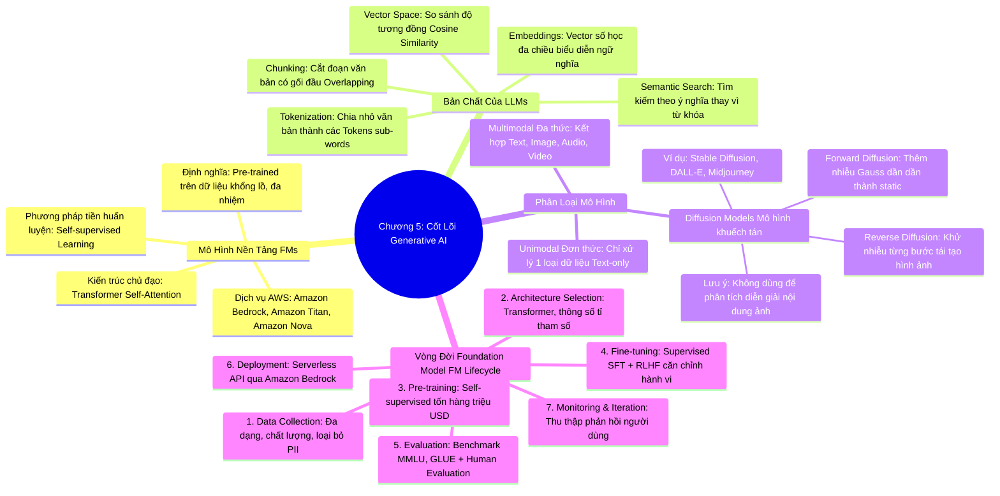

# CHƯƠNG 05: GENERATIVE AI - CÁC THÀNH PHẦN CỐT LÕI, CÁC LOẠI MÔ HÌNH VÀ VÒNG ĐỜI
*(Section 5 - Domain 2: Fundamentals of Generative AI)*

---

## 🎯 MỤC TIÊU BÀI HỌC & TRỌNG TÂM THI (EXAM FOCUS)
- Hiểu định nghĩa và đặc trưng của **Mô hình nền tảng (Foundation Models - FMs)** và **Mô hình ngôn ngữ lớn (Large Language Models - LLMs)**.
- Phân biệt mối quan hệ giữa **Tokens (Mã token)**, **Embeddings (Vector nhúng ngữ nghĩa)**, và **Không gian Vector (Vector Space)**.
- Nắm vững khái niệm **Phân đoạn văn bản (Chunking)** và cơ chế **Tìm kiếm ngữ nghĩa (Semantic Search)**.
- Phân biệt mô hình đơn phương thức (**Unimodal**) và mô hình đa phương thức (**Multimodal Models**).
- Hiểu sâu nguyên lý của **Mô hình khuếch tán (Diffusion Models)**: Quá trình khuếch tán xuôi (*Forward Diffusion - thêm nhiễu*) và khuếch tán ngược (*Reverse Diffusion - khử nhiễu*).
- Nắm trọn 7 giai đoạn trong **Vòng đời của Mô hình Nền tảng (FM Lifecycle)**: Từ Tiền huấn luyện tự giám sát (**Self-supervised Pre-training**) đến Tinh chỉnh (**Fine-tuning / RLHF**) và Đánh giá (**Evaluation**).

---

## 🧠 BẢN ĐỒ TƯ DUY (MINDMAP) CHƯƠNG 5

### Sơ đồ tư duy trực quan (Mermaid Diagram)


---

## 📚 KIẾN THỨC CỐT LÕI CHI TIẾT (DEEP DIVE)

### 1. Mô hình Nền tảng (Foundation Models - FMs) và LLMs

#### A. Khái niệm Foundation Models (FMs):
- **Định nghĩa:** Là các mô hình học máy quy mô siêu lớn, chứa hàng tỷ đến hàng nghìn tỷ tham số (Parameters), được huấn luyện trước (**Pre-trained**) trên các tập dữ liệu đa dạng khổng lồ ở quy mô Internet.
- **Tính chất "Nền tảng":** Thay vì xây dựng từng mô hình riêng cho từng tác vụ hẹp (như trước đây: một model dịch thuật riêng, một model tóm tắt riêng, một model chatbot riêng), một Foundation Model đóng vai trò làm bệ đỡ chung, có thể thích ứng (**Adaptable**) với hàng trăm tác vụ khác nhau thông qua kỹ thuật Prompting hoặc Fine-tuning.
- **Phương pháp huấn luyện:** **Học tự giám sát (Self-supervised Learning)** trên dữ liệu phi cấu trúc không gán nhãn. Mô hình tự che một phần dữ liệu và học cách dự đoán phần bị che (ví dụ: dự đoán từ tiếp theo trong câu).

#### B. Mô hình Ngôn ngữ Lớn (Large Language Models - LLMs):
- Là một nhánh chuyên sâu của Foundation Models chuyên về hiểu, dịch thuật, lập luận và tạo sinh ngôn ngữ tự nhiên của con người.
- **Cơ chế cốt lõi:** Dựa trên kiến trúc **Transformer** với cơ chế **Self-Attention** (Tự chú ý), cho phép mô hình tính toán mối liên hệ giữa tất cả các từ trong câu cùng một lúc, bất kể khoảng cách giữa chúng.
- **Ứng dụng tiêu biểu:**
  - Soạn thảo và tóm tắt văn bản.
  - Sinh mã nguồn lập trình (**Amazon Q Developer**, CodeWhisperer).
  - Trợ lý ảo đàm thoại thông minh.

---

### 2. Bộ ba then chốt: Tokens, Embeddings và Không gian Vector

```
[Văn bản gốc] ──(Tokenization)──► [Tokens] ──(Embedding Model)──► [Vectors: [0.24, -0.81, ...]]
                                                                          │
                                                                          ▼
                                                              [Không gian Vector đa chiều]
                                                                (Tìm kiếm ngữ nghĩa RAG)
```

1. **Token (Mã token):**
   - Là đơn vị cơ bản nhỏ nhất mà mô hình ngôn ngữ phân tích và xử lý.
   - Một token thường không phải là nguyên một từ hoàn chỉnh mà là một phần của từ (Sub-word piece).
   - *Quy tắc ước tính (Rule of thumb):* Trong tiếng Anh, 1 token xấp xỉ **4 ký tự** hoặc **0.75 từ**. (1,000 token ≈ 750 từ).
   - *Cách tính tiền trên AWS:* Dịch vụ như Amazon Bedrock tính phí theo số lượng **Input Tokens** và **Output Tokens**.

2. **Embedding (Vector nhúng ngữ nghĩa):**
   - Mô hình máy tính không hiểu được chữ cái, nó chỉ hiểu các con số.
   - Embedding là quá trình chuyển đổi một token hoặc một đoạn văn bản thành một **dãy số thực đa chiều (Vector)** (thường từ vài trăm đến hàng nghìn chiều).
   - **Đặc tính kỳ diệu:** Các từ hoặc câu có ý nghĩa tương đồng nhau trong ngữ cảnh thực tế sẽ có các vector nằm rất gần nhau trong không gian đa chiều.
   - *Mô hình tạo embedding trên AWS:* **Amazon Titan Text Embeddings**, Cohere Embed.

3. **Không gian Vector (Vector Space) & Tìm kiếm ngữ nghĩa (Semantic Search):**
   - Không gian hình học đa chiều nơi các vector tọa lạc.
   - Khoảng cách giữa các vector được tính bằng các công thức hình học như **Cosine Similarity** (Độ tương đồng Cosine) hoặc khoảng cách Euclid.
   - **Semantic Search:** Khác với tìm kiếm từ khóa truyền thống (Keyword match - chỉ tìm đúng từ ngữ xuất hiện), Semantic Search tìm các đoạn văn có cùng **ngữ nghĩa** ngay cả khi không dùng chung bất kỳ từ vựng nào. *(Ví dụ: Gõ tìm "thú cưng đáng yêu" hệ thống vẫn tìm ra văn bản nói về "chú cún con thân thiện")*.

4. **Kỹ thuật Cắt đoạn (Chunking):**
   - Các mô hình nhúng (Embedding models) và LLMs luôn có giới hạn độ dài ngữ cảnh tối đa (**Context Window** / Token Limit).
   - Chunking là kỹ thuật chia các tài liệu dài (như sách, hợp đồng PDF 100 trang) thành các đoạn văn bản nhỏ hơn có kích thước xác định (ví dụ: 500 tokens).
   - **Gối đầu (Chunk Overlap):** Giữa đoạn 1 và đoạn 2 luôn có một phần gối đầu lên nhau (ví dụ: 50 tokens trùng nhau) để đảm bảo không bị đứt gãy ngữ cảnh của câu văn nằm ở ranh giới cắt.

---

### 3. Phân biệt Mô hình Đơn thức, Đa thức và Mô hình Khuếch tán

#### A. Mô hình đơn phương thức (Unimodal) vs Đa phương thức (Multimodal):
- **Unimodal Models:** Chỉ xử lý và xuất ra một loại định dạng dữ liệu duy nhất. *(Ví dụ: LLM truyền thống chỉ nhận văn bản vào và trả lời bằng văn bản)*.
- **Multimodal Models:** Có khả năng hiểu, liên kết và chuyển đổi linh hoạt giữa nhiều định dạng thông tin khác nhau đồng thời: Văn bản (Text), Hình ảnh (Images), Âm thanh (Audio), Video, Mã lập trình (Code).
  - *Ví dụ:* Tải lên bức ảnh chụp biểu đồ doanh thu và hỏi: *"Tháng nào có doanh thu cao nhất?"* ➔ Mô hình đa phương thức sẽ phân tích hình ảnh và trả lời bằng văn bản.
  - *Đại diện AWS:* Dòng mô hình **Amazon Nova** (Nova Canvas, Nova Reel), Anthropic Claude 3 / 3.5 Sonnet trên Bedrock.

#### B. Mô hình khuếch tán (Diffusion Models):
- Dòng mô hình chuyên biệt để tạo ra các nội dung sáng tạo trực quan (Hình ảnh, Video, Âm thanh chất lượng cao).
- **Cơ chế hoạt động 2 bước:**
  1. **Khuếch tán xuôi (Forward Diffusion):** Thêm dần nhiễu ngẫu nhiên (Gaussian noise) vào bức ảnh gốc qua hàng trăm bước cho đến khi bức ảnh bị phá hủy hoàn toàn thành một màn hình nhiễu trắng tĩnh vô nghĩa (Pure noise).
  2. **Khuếch tán ngược (Reverse Diffusion):** Mô hình học cách đảo ngược quá trình này. Bắt đầu từ một ma trận nhiễu ngẫu nhiên thuần túy, dưới sự dẫn dắt của câu lệnh văn bản (Text Prompt), mô hình từng bước loại bỏ nhiễu và "vẽ" ra bức ảnh sắc nét hoàn toàn mới.
- *Ví dụ:* **Stable Diffusion** (Stability AI), DALL-E, Midjourney.
- ⚠️ **LƯU Ý CỰC KỲ QUAN TRỌNG CHO BÀI THI:** Diffusion Models được sinh ra để **tạo mới hình ảnh từ nhiễu (Image Generation)**. Chúng **KHÔNG PHẢI** là mô hình dùng để diễn giải, đọc hiểu hay phân loại nội dung ảnh (đó là vai trò của CNN hoặc Vision Transformer trong Computer Vision).

---

### 4. Bảy giai đoạn trong Vòng đời Mô hình Nền tảng (FM Lifecycle)

```
1. Thu thập & Tiền xử lý dữ liệu (Data Preprocessing)
   │
2. Lựa chọn kiến trúc & Cấu hình tham số (Architecture Selection)
   │
3. Tiền huấn luyện quy mô lớn (Self-Supervised Pre-training)
   │
4. Tinh chỉnh thích ứng nghiệp vụ (Fine-Tuning: SFT & RLHF)
   │
5. Đánh giá & Kiểm định an toàn (Evaluation: Benchmarks & Humans)
   │
6. Triển khai vào ứng dụng (Deployment via Bedrock / SageMaker)
   │
7. Giám sát & Lặp lại liên tục (Monitoring, Feedback & Iteration)
```

1. **Thu thập & Chuẩn bị dữ liệu (Data Collection & Preprocessing):**
   - Thu thập hàng terabyte văn bản từ web, sách báo, mã nguồn.
   - Làm sạch: Loại bỏ dữ liệu trùng lặp (Deduplication), lọc ngôn từ thù địch, loại bỏ thông tin định danh cá nhân (PII Redaction).
2. **Chọn kiến trúc mô hình (Model Architecture Selection):**
   - Quyết định số lượng tham số (7B, 13B, 70B parameters), số tầng attention, chiều không gian ẩn.
3. **Tiền huấn luyện (Pre-training):**
   - Đòi hỏi hàng nghìn GPU/Trainium chạy liên tục trong nhiều tháng với chi phí hàng triệu USD.
   - Mô hình học được ngữ pháp, tri thức phổ quát của nhân loại.
4. **Tinh chỉnh (Fine-tuning & Alignment):**
   - Sử dụng tập dữ liệu nhỏ có gán nhãn chuyên ngành (**Supervised Fine-Tuning - SFT**).
   - Kết hợp **RLHF (Reinforcement Learning from Human Feedback)** để huấn luyện mô hình biết từ chối các câu hỏi độc hại, nguy hiểm và trả lời đúng trọng tâm.
5. **Đánh giá mô hình (Evaluation & Validation):**
   - Chạy trên các bộ đề thi tiêu chuẩn (Benchmarks như MMLU, GSM8K, HumanEval).
   - Đánh giá mù đôi bởi chuyên gia con người (Human Blind Testing).
6. **Triển khai (Deployment):**
   - Đóng gói mô hình phục vụ suy luận qua API của **Amazon Bedrock**.
7. **Giám sát & Tiến hóa (Monitoring & Continuous Evolution):**
   - Lắng nghe phản hồi của người dùng cuối (Thumbs up / Thumbs down). Tái huấn luyện khi tri thức thế giới thay đổi.

---

## ⚠️ MẸO THI & BẪY CẦN TRÁNH (EXAM TIPS & TRAPS)

> [!TIP]
> **Từ khóa điểm nhấn trong đề thi:**
> - *"Numerical representation of text capturing semantic meaning"* ➔ **Embeddings**.
> - *"Smallest text units processed by LLMs"* ➔ **Tokens**.
> - *"Search based on meaning rather than keywords"* ➔ **Semantic Search (Vector Search)**.
> - *"Splitting long documents with overlapping text to preserve context"* ➔ **Chunking**.
> - *"Reverse noise process to generate images"* ➔ **Diffusion Models**.
> - *"Process text, images, and audio simultaneously"* ➔ **Multimodal Models**.

> [!WARNING]
> **Bẫy thi AIF-C01:**
> - **Bẫy chức năng của Diffusion Models:** Đề thi hỏi: *"Công ty cần phân loại các vết nứt trên đường băng sân bay từ ảnh camera chụp, mô hình nào phù hợp?"* Nếu chọn Diffusion Models ➔ **SAI NGAY LẬP TỨC**. Diffusion Model chỉ dùng để vẽ ảnh mới! Phân tích vết nứt phải dùng **CNN** hoặc **Amazon Rekognition**.
> - **Bẫy tiền huấn luyện (Pre-training) vs Tinh chỉnh (Fine-tuning):** Pre-training sử dụng phương pháp **Self-supervised (Tự giám sát)** trên dữ liệu KHÔNG gán nhãn. Còn Fine-tuning truyền thống là **Supervised Learning (Có giám sát)** trên tập dữ liệu CÓ gán nhãn cặp hỏi-đáp.

---

## 📝 BỘ CÂU HỎI ÔN TẬP MÔ PHỎNG (PRACTICE QUESTIONS)

#### Câu 1:
Một kỹ sư AI muốn xây dựng một hệ thống tìm kiếm tài liệu nội bộ công ty. Thay vì chỉ tìm kiếm dựa trên các từ khóa chính xác, hệ thống phải có khả năng hiểu được ngữ nghĩa của câu hỏi người dùng và trả về các đoạn tài liệu có nội dung liên quan nhất. Kỹ thuật nào sau đây là thành phần cốt lõi của giải pháp này?
- A. Chuyển đổi tài liệu thành các biểu diễn vector số học (Embeddings) và lưu vào cơ sở dữ liệu Vector để tìm kiếm ngữ nghĩa (Semantic Search).
- B. Huấn luyện một mô hình Diffusion Model từ đầu trên toàn bộ tài liệu công ty.
- C. Sử dụng kiến trúc mạng nơ-ron hồi quy RNN để ghi nhớ toàn bộ từ ngữ trong tài liệu.
- D. Tăng kích thước Batch Size và Learning Rate trong quá trình tiền huấn luyện.
> **Đáp án đúng: A**  
> *Giải thích:* Embeddings biến đổi văn bản thành các vector số học chứa ngữ nghĩa, cho phép thực hiện Semantic Search dựa trên khoảng cách vector mà không phụ thuộc vào từ khóa trùng khớp tuyệt đối.

#### Câu 2:
Khi chuẩn bị các tài liệu dài gồm hàng chục trang để đưa vào cơ sở dữ liệu vector nhằm phục vụ cho mô hình ngôn ngữ lớn, tại sao kỹ thuật "Chunking with Overlap" (phân đoạn có gối đầu) lại được áp dụng?
- A. Để tăng gấp đôi tốc độ suy luận của mô hình LLM.
- B. Để đảm bảo thông tin không vượt quá giới hạn token của mô hình và bảo toàn ngữ cảnh ngữ nghĩa tại ranh giới giữa các đoạn cắt.
- C. Để mã hóa dữ liệu văn bản thành định dạng nhị phân bảo mật.
- D. Để chuyển đổi mô hình từ đơn thức (Unimodal) sang đa thức (Multimodal).
> **Đáp án đúng: B**  
> *Giải thích:* Chunking giúp văn bản không bị vượt quá giới hạn ngữ cảnh (Token limit), và phần Overlap (gối đầu) giữ cho ngữ cảnh của các câu văn nằm ở điểm giao giữa 2 đoạn không bị cắt ngang làm mất ý nghĩa.

#### Câu 3:
Phát biểu nào sau đây là **CHÍNH XÁC** về Mô hình khuếch tán (Diffusion Models)?
- A. Chúng được thiết kế để phân loại nhãn và phát hiện vật thể trong video thời gian thực.
- B. Chúng tạo ra hình ảnh mới thông qua quá trình khử nhiễu dần dần (Reverse Diffusion) bắt đầu từ nhiễu ngẫu nhiên.
- C. Chúng là các mô hình đơn phương thức chỉ tiếp nhận và xuất ra văn bản thuần túy.
- D. Chúng được huấn luyện hoàn toàn bằng phương pháp học tăng cường từ phản hồi con người (RLHF).
> **Đáp án đúng: B**  
> *Giải thích:* Diffusion Models tạo ra nội dung (như hình ảnh) bằng cách loại bỏ dần nhiễu (Denoising / Reverse Diffusion) từ một trạng thái nhiễu ngẫu nhiên ban đầu theo sự hướng dẫn của câu lệnh.
