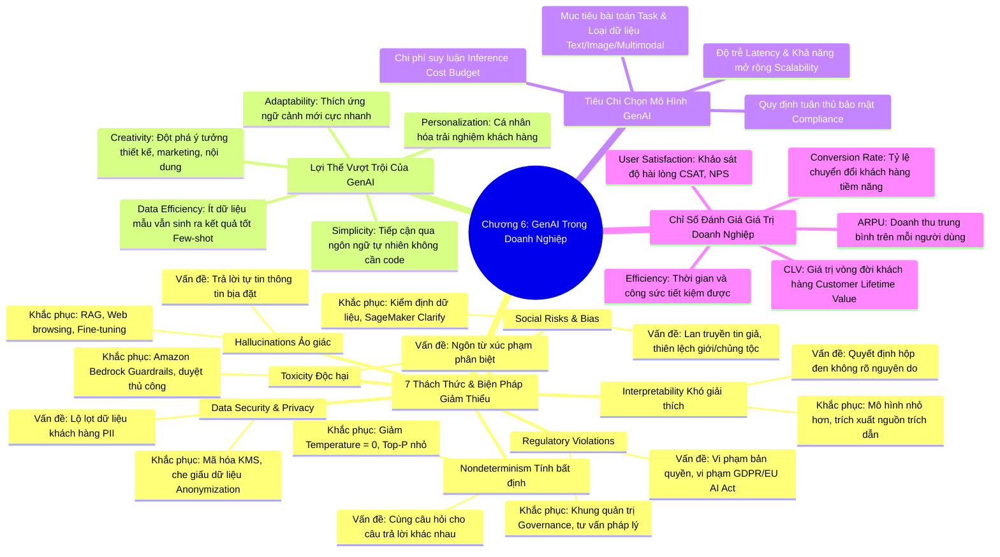

# CHƯƠNG 06: CÁC ỨNG DỤNG KINH DOANH CỦA GENERATIVE AI, RỦI RO VÀ ĐÁNH GIÁ GIÁ TRỊ
*(Section 6 - Domain 2: Fundamentals of Generative AI)*

---

## 🎯 MỤC TIÊU BÀI HỌC & TRỌNG TÂM THI (EXAM FOCUS)
- Nhận diện 7 rủi ro & bất lợi chính của Generative AI và **phương pháp giảm thiểu (Mitigation Strategies)** tương ứng:
  1. *Vi phạm pháp lý (Regulatory Violations)*
  2. *Rủi ro xã hội & Định kiến (Social Risks & Bias)*
  3. *An toàn dữ liệu & Quyền riêng tư (Data Security & Privacy)*
  4. *Nội dung độc hại (Toxicity)*
  5. *Hiện tượng ảo giác (Hallucinations)*
  6. *Tính khó giải thích (Interpretability)*
  7. *Tính bất định (Nondeterminism)*
- Nắm vững các lợi thế cạnh tranh của Generative AI trong doanh nghiệp.
- Các tiêu chí lựa chọn mô hình GenAI phù hợp nhất với bài toán thực tế.
- Các chỉ số đánh giá giá trị kinh doanh (**Business Value Assessment Metrics**): CSAT, NPS, ARPU, CLV, Tỷ lệ chuyển đổi (Conversion Rate).

---

## 🧠 BẢN ĐỒ TƯ DUY (MINDMAP) CHƯƠNG 6

### Sơ đồ tư duy trực quan (Mermaid Diagram)

---

## 📚 KIẾN THỨC CỐT LÕI CHI TIẾT (DEEP DIVE)

### 1. Bảy rủi ro lớn của Generative AI và Chiến lược khắc phục (Mitigations)

Đây là nội dung có tần suất xuất hiện rất cao trong bài thi AWS AIF-C01 dưới dạng các câu hỏi tình huống:

#### 1. Hiện tượng ảo giác (Hallucinations):
- **Bản chất:** Mô hình tự tin khẳng định những thông tin hoàn toàn sai lệch, bịa đặt số liệu thống kê hoặc bịa ra các tài liệu tham khảo không có thật trong thế giới thực. Nguyên nhân do LLM hoạt động dựa trên cơ chế thống kê dự đoán token tiếp theo, không có nhận thức chân lý thực sự.
- **Biện pháp khắc phục (Mitigations):**
  - Áp dụng kiến trúc **RAG (Retrieval-Augmented Generation)**: Buộc mô hình phải tra cứu và trả lời dựa trên kho tri thức doanh nghiệp chính xác.
  - Cung cấp dữ liệu thời gian thực thông qua kết nối Internet hoặc API.
  - Tinh chỉnh mô hình (**Fine-tuning**) trên bộ dữ liệu chuẩn xác của chuyên ngành.
  - Thiết lập hướng dẫn hệ thống (System Prompts) yêu cầu: *"Nếu không biết chắc, hãy trả lời là 'Tôi không biết', không được đoán mò"*.

#### 2. Ngôn từ độc hại (Toxicity) & Vi phạm thuần phong mỹ tục:
- **Bản chất:** Mô hình sinh ra những nội dung xúc phạm, miệt thị, thù hằn, khiêu dâm hoặc hướng dẫn hành vi phạm pháp (như chế tạo vũ khí).
- **Biện pháp khắc phục (Mitigations):**
  - Sử dụng **Guardrails for Amazon Bedrock** để lọc bỏ các chủ đề bị cấm (Denied Topics) và chặn các từ ngữ độc hại.
  - Sử dụng các công cụ kiểm duyệt nội dung tự động (**Amazon Rekognition Content Moderation**, **Amazon Comprehend Toxicity Detection**).
  - Tích hợp kiểm duyệt con người (**Amazon Augmented AI - A2I**) khi có nghi ngờ.

#### 3. Rò rỉ an toàn dữ liệu và Quyền riêng tư (Data Security & Privacy):
- **Bản chất:** Dữ liệu nhạy cảm của khách hàng, bí mật kinh doanh hoặc thông tin định danh cá nhân (PII) bị nhân viên đưa vào câu lệnh prompt và có nguy cơ bị mô hình công cộng học lại hoặc rò rỉ cho người khác.
- **Biện pháp khắc phục (Mitigations):**
  - Sử dụng các dịch vụ AI doanh nghiệp cam kết **không dùng dữ liệu khách hàng để huấn luyện lại mô hình công cộng** (như **Amazon Bedrock**).
  - Tự động phát hiện và che giấu PII bằng **Amazon Comprehend**.
  - Mã hóa dữ liệu cả khi lưu trữ (**Encryption at rest**) và khi truyền tải (**Encryption in transit**) bằng khóa quản lý bởi **AWS KMS**.

#### 4. Tính bất định (Nondeterminism):
- **Bản chất:** Cùng một câu hỏi prompt gửi đi vào 2 thời điểm khác nhau lại nhận về 2 câu trả lời khác nhau về mặt hành văn, số liệu hoặc định dạng.
- **Biện pháp khắc phục (Mitigations):**
  - Hạ thấp tham số **Temperature** về mức bằng `0` (hoặc rất gần 0) để mô hình luôn chọn các token có xác suất cao nhất (Greedy decoding).
  - Đặt tham số **Top P** ở mức nhỏ.
  - Áp dụng quy chuẩn định dạng đầu ra bắt buộc (Structured output / JSON mode).

#### 5. Rủi ro xã hội & Định kiến (Social Risks & Bias):
- **Bản chất:** Mô hình bị ảnh hưởng bởi những định kiến vô thức có trong dữ liệu văn bản Internet (ví dụ: mặc định bác sĩ là nam, y tá là nữ; thiên kiến sắc tộc khi thẩm định hồ sơ).
- **Biện pháp khắc phục (Mitigations):**
  - Kiểm tra và sàng lọc tập dữ liệu huấn luyện để loại bỏ mất cân bằng.
  - Sử dụng **Amazon SageMaker Clarify** để phát hiện thiên kiến trong dữ liệu và mô hình.
  - Thiết lập các nguyên tắc phát triển AI có trách nhiệm (Responsible AI Guidelines).

#### 6. Tính khó giải thích (Interpretability / Black-box):
- **Bản chất:** Không thể giải thích rõ ràng tại sao mô hình lại đưa ra câu trả lời đó vì nó được tổng hợp qua hàng trăm tỷ tham số nơ-ron phức tạp.
- **Biện pháp khắc phục (Mitigations):**
  - Yêu cầu mô hình cung cấp **trích dẫn nguồn tài liệu tham khảo (Citations / Attribution)** trong phản hồi (đặc biệt trong RAG).
  - Áp dụng kỹ thuật suy luận từng bước (**Chain-of-Thought Prompting**).

#### 7. Rủi ro pháp lý & Vi phạm bản quyền (Regulatory Violations):
- **Bản chất:** Mô hình có thể sao chép nguyên văn đoạn mã có bản quyền hoặc vi phạm các đạo luật khắt khe như EU AI Act, GDPR, HIPAA.
- **Biện pháp khắc phục (Mitigations):**
  - Sử dụng các mô hình có chứng chỉ tuân thủ và chính sách bảo vệ bản quyền rõ ràng (như các mô hình **Amazon Titan** đi kèm chính sách bồi thường bản quyền IP Indemnity của AWS).
  - Thiết lập khung giám sát pháp chế doanh nghiệp (Governance Framework).

---

### 2. Bảng tổng hợp Chiến lược giảm thiểu rủi ro (Risk Mitigation Matrix)

| Rủi ro GenAI | Hiện tượng nhận biết | Giải pháp công nghệ hàng đầu trên AWS |
| :--- | :--- | :--- |
| **Hallucination** | Bịa đặt dữ liệu, trích dẫn sai | **RAG (Amazon Bedrock Knowledge Bases)** + Giảm Temperature |
| **Toxicity / Harm** | Nội dung thù địch, chửi bới | **Guardrails for Amazon Bedrock** + Comprehend |
| **Data Leakage** | Lộ số thẻ tín dụng, CCCD, PII | **Amazon Comprehend PII Redaction** + Bedrock Privacy Boundary |
| **Nondeterminism** | Kết quả dao động lung tung | Thiết lập **Temperature = 0** |
| **Bias / Fairness** | Thiên vị một nhóm đối tượng | **Amazon SageMaker Clarify** |
| **Intellectual Property** | Kiện tụng bản quyền nội dung | **Amazon Titan** (AWS IP Indemnity protection) |

---

### 3. Tiêu chí lựa chọn mô hình GenAI cho doanh nghiệp

Khi lựa chọn mô hình GenAI trong các kịch bản thực tế, cần cân nhắc 7 yếu tố:
1. **Định nghĩa tác vụ (Task Definition):** Mô hình cần làm gì? Tóm tắt văn bản, dịch thuật, viết code hay đàm thoại?
2. **Phương thức dữ liệu (Modality):** Chỉ xử lý chữ (Text-only) hay cần hiểu cả hình ảnh, âm thanh, biểu đồ (Multimodal)?
3. **Hiệu năng & Độ trễ (Performance & Latency):** Ứng dụng có cần phản hồi ngay lập tức dưới 500ms (như live chat) hay có thể chờ vài giây để nhận câu trả lời có chiều sâu suy luận (như phân tích hợp đồng kinh tế)?
4. **Ràng buộc tài nguyên (Resource Constraints):** Ngân sách phần cứng, hạ tầng mạng, có cần mô hình nhỏ gọn chạy được trên thiết bị biên (Edge) hay không?
5. **Chi phí vận hành (Inference Cost):** Chi phí tính theo triệu token ($/1M tokens). Các mô hình siêu lớn (như Claude 3.5 Sonnet) thông minh hơn nhưng đắt hơn đáng kể so với các mô hình tinh gọn (như Claude 3 Haiku hay Amazon Nova Micro).
6. **Tuân thủ & Bảo mật (Compliance & Security):** Mô hình có đạt chuẩn HIPAA, SOC 2, ISO để lưu trữ dữ liệu y tế, tài chính hay không?
7. **Khả năng tùy biến (Customizability):** Mô hình có hỗ trợ Fine-tuning hoặc tiếp nhận Knowledge Bases hay không?

---

### 4. Đánh giá giá trị kinh doanh của dự án GenAI (Business Metrics)

Không chỉ đo lường chỉ số kỹ thuật (như Token/sec hay Loss), doanh nghiệp bắt buộc phải đo lường các giá trị kinh doanh thực tế (Business Value Assessment):
- **User Satisfaction (Mức độ hài lòng của người dùng):**
  - **CSAT (Customer Satisfaction Score):** Điểm đánh giá mức độ hài lòng trực tiếp sau khi tương tác với trợ lý AI.
  - **NPS (Net Promoter Score):** Mức độ khách hàng sẵn sàng giới thiệu dịch vụ cho người khác.
- **Efficiency (Hiệu suất vận hành):**
  - Số giờ lao động tiết kiệm được cho nhân viên chăm sóc khách hàng.
  - Tốc độ hoàn thành tác vụ (Task completion time).
- **Conversion Rate (Tỷ lệ chuyển đổi):**
  - Tỷ lệ người dùng quyết định mua hàng sau khi nhận được lời tư vấn từ chatbot AI bán hàng.
- **ARPU (Average Revenue Per User - Doanh thu trung bình trên mỗi người dùng):**
  - Mức độ gia tăng chi tiêu của khách hàng khi có sự hỗ trợ của các tính năng AI cá nhân hóa.
- **CLV (Customer Lifetime Value - Giá trị vòng đời khách hàng):**
  - Tổng lợi nhuận doanh nghiệp thu được từ một khách hàng trong suốt thời gian họ gắn bó, được cải thiện nhờ sự chăm sóc chu đáo của AI 24/7.

---

## ⚠️ MẸO THI & BẪY CẦN TRÁNH (EXAM TIPS & TRAPS)

> [!TIP]
> **Từ khóa phản xạ nhanh trong đề thi:**
> - *"AI generates completely fabricated or inaccurate facts"* ➔ **Hallucination** (Ảo giác).
> - *"How to prevent hallucinations using internal documents?"* ➔ **RAG (Retrieval-Augmented Generation)**.
> - *"Filter hate speech, profanity, and sensitive topics"* ➔ **Guardrails for Amazon Bedrock**.
> - *"Ensure outputs are reproducible and deterministic"* ➔ **Set Temperature = 0**.
> - *"Evaluate customer happiness with AI system"* ➔ **CSAT / NPS (User Satisfaction)**.

> [!WARNING]
> **Cạm bẫy bài thi:**
> - RAG không loại bỏ 100% ảo giác nhưng là kỹ thuật giảm ảo giác hiệu quả nhất cho tri thức doanh nghiệp mà không cần tốn hàng trăm nghìn USD để huấn luyện lại mô hình.
> - Temperature càng cao (gần 1.0) thì câu trả lời càng sáng tạo, bất ngờ nhưng rủi ro ảo giác càng tăng. Muốn thông tin chính xác, kỹ thuật, dữ liệu chuẩn xác thì luôn phải hạ Temperature xuống thấp (gần 0).

---

## 📝 BỘ CÂU HỎI ÔN TẬP MÔ PHỎNG (PRACTICE QUESTIONS)

#### Câu 1:
Một công ty luật muốn triển khai một chatbot nội bộ để trả lời các thắc mắc của luật sư về các bộ luật và tiền lệ tư pháp hiện hành. Trong các đợt thử nghiệm ban đầu, chatbot đôi khi trích dẫn các điều luật và số hiệu bản án hoàn toàn không có thật nhưng với giọng điệu rất thuyết phục. Giải pháp nào sau đây giúp khắc phục vấn đề này một cách hiệu quả và tiết kiệm chi phí nhất?
- A. Tăng tham số Temperature lên 1.0 để mô hình linh hoạt hơn.
- B. Xây dựng giải pháp Retrieval-Augmented Generation (RAG) kết nối chatbot với cơ sở dữ liệu văn bản pháp luật chính thức của công ty.
- C. Đào tạo lại toàn bộ một Foundation Model mới từ đầu trên dữ liệu luật.
- D. Chuyển đổi mô hình sang kiến trúc Diffusion Model.
> **Đáp án đúng: B**  
> *Giải thích:* Hiện tượng bịa đặt thông tin không có thật là **Hallucination**. Giải pháp chuẩn mực và hiệu quả nhất là sử dụng kiến trúc RAG để cung cấp ngữ cảnh từ kho văn bản pháp luật chính xác cho mô hình tham chiếu khi trả lời.

#### Câu 2:
Một ngân hàng muốn đảm bảo ứng dụng GenAI tương tác với khách hàng không vi phạm các chủ đề nhạy cảm như đưa ra lời khuyên đầu tư rủi ro, đồng thời tự động che mờ số an sinh xã hội và số tài khoản ngân hàng xuất hiện trong câu trả lời. Tính năng nào của AWS được thiết kế chuyên biệt cho yêu cầu này?
- A. Amazon Rekognition Custom Labels
- B. Guardrails for Amazon Bedrock
- C. Amazon SageMaker Data Wrangler
- D. Amazon Kendra Web Crawler
> **Đáp án đúng: B**  
> *Giải thích:* Guardrails for Amazon Bedrock cho phép thiết lập các rào chắn chính sách: chặn các chủ đề không mong muốn (Denied Topics), lọc từ ngữ độc hại, và tự động ẩn/chặn thông tin định danh cá nhân nhạy cảm (PII).

#### Câu 3:
Chỉ số nào sau đây đo lường trực tiếp mức độ hài lòng về mặt định tính của khách hàng sau khi trải nghiệm hệ thống hỗ trợ tự động bằng Generative AI?
- A. Mean Squared Error (MSE)
- B. Area Under the ROC Curve (AUC-ROC)
- C. Net Promoter Score (NPS) và Customer Satisfaction (CSAT)
- D. F1-Score
> **Đáp án đúng: C**  
> *Giải thích:* NPS và CSAT là các chỉ số đánh giá giá trị kinh doanh (Business Value Metrics) đo lường sự hài lòng của người dùng. Các chỉ số MSE, AUC-ROC, F1-Score là các chỉ số đo lường hiệu năng kỹ thuật của mô hình học máy.
