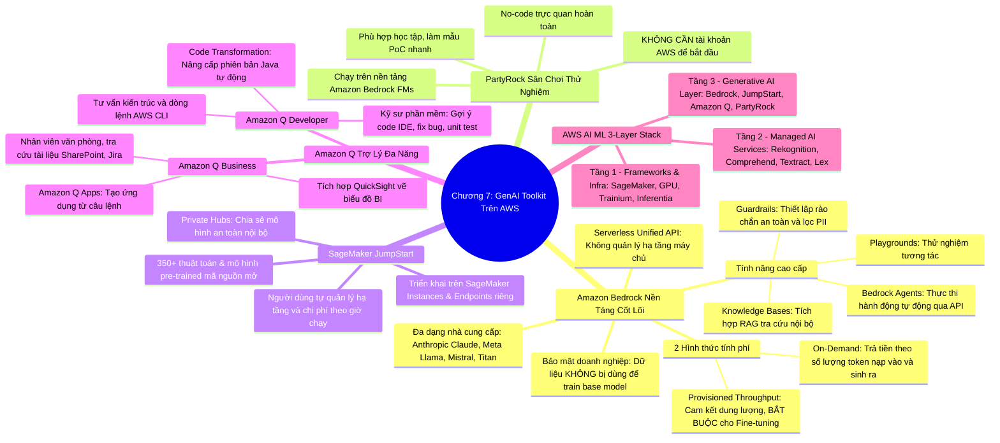

# CHƯƠNG 07: BỘ CÔNG CỤ GENERATIVE AI TRÊN AWS - BEDROCK, PARTYROCK, JUMPSTART VÀ AMAZON Q
*(Section 7 - Domain 2: Fundamentals of Generative AI)*

---

## 🎯 MỤC TIÊU BÀI HỌC & TRỌNG TÂM THI (EXAM FOCUS)
- Nắm vững vai trò và kiến trúc của **Amazon Bedrock**: Dịch vụ Serverless cung cấp một **Unified API** duy nhất để truy cập đa dạng các Foundation Models hàng đầu (Anthropic, Meta, Mistral, Cohere, AI21 Labs, Stability AI, Amazon Titan/Nova).
- Phân biệt 2 cơ chế tính giá của Bedrock: **On-demand** (theo token/image) và **Provisioned Throughput** (bắt buộc khi triển khai mô hình Fine-tuned).
- Hiểu rõ **PartyRock**: Môi trường No-code cho phép người dùng **không cần tài khoản AWS** vẫn có thể thử nghiệm xây dựng ứng dụng GenAI.
- Phân biệt sự khác biệt sống còn giữa **Amazon Bedrock** (Serverless API, không quản lý hạ tầng) và **Amazon SageMaker JumpStart** (triển khai trên EC2/Endpoints do người dùng tự quản lý).
- Phân biệt hai biến thể của **Amazon Q**: **Amazon Q Business** (dành cho nhân viên văn phòng, tích hợp Jira/SharePoint/QuickSight) và **Amazon Q Developer** (dành cho lập trình viên, viết code, sửa lỗi, nâng cấp Java).
- Nắm vững 3 tầng trong **Tháp dịch vụ AWS AI/ML Service Stack**.

---

## 🧠 BẢN ĐỒ TƯ DUY (MINDMAP) CHƯƠNG 7

### Sơ đồ tư duy trực quan (Mermaid Diagram)


---

## 📚 KIẾN THỨC CỐT LÕI CHI TIẾT (DEEP DIVE)

### 1. Amazon Bedrock - Trung tâm dịch vụ Generative AI

Amazon Bedrock là dịch vụ được quản lý hoàn toàn (**Fully Managed / Serverless**) cung cấp phương thức tiếp cận các Foundation Models (FMs) mạnh mẽ nhất thông qua **một giao diện lập trình ứng dụng duy nhất (Unified API)**.

#### A. Các nhà cung cấp mô hình (Model Providers) trên Bedrock:
- **Anthropic:** Claude 3 / 3.5 (Opus, Sonnet, Haiku) - Đỉnh cao về lập luận, suy nghĩ logic, viết code và phân tích đa phương thức.
- **Meta:** Llama 3 / 3.1 / 3.2 - Các mô hình mã nguồn mở hàng đầu thế giới.
- **Mistral AI:** Mistral 7B, Mistral Large - Nổi tiếng về hiệu năng cao, chi phí tối ưu và xử lý logic toán học.
- **Cohere:** Command, Cohere Embed - Chuyên gia về sinh văn bản doanh nghiệp và mô hình tạo vector nhúng đa ngôn ngữ.
- **AI21 Labs:** Jurassic-2 - Tối ưu cho việc tuân thủ cấu trúc ngữ pháp và viết văn phong phú.
- **Stability AI:** Stable Diffusion SDXL - Chuyên gia tạo hình ảnh trực quan từ văn bản.
- **Amazon:** 
  - *Amazon Titan:* Dòng mô hình độc quyền của AWS (Titan Text, Titan Image, Titan Embeddings).
  - *Amazon Nova:* Thế hệ mô hình đa phương thức mới nhất (Nova Micro, Nova Lite, Nova Pro, Nova Canvas).

#### B. Hai hình thức chi phí trong Amazon Bedrock:
1. **On-Demand (Theo nhu cầu):**
   - Không cần cam kết trước. Trả tiền chính xác theo số lượng **Input Tokens** (token câu hỏi) và **Output Tokens** (token câu trả lời) hoặc số lượng ảnh được tạo.
   - Thích hợp cho giai đoạn phát triển, thử nghiệm hoặc ứng dụng có lưu lượng truy cập thay đổi thất thường.
2. **Provisioned Throughput (Dung lượng được cấp phát trước):**
   - Cam kết mua một lượng đơn vị xử lý mô hình (**Model Units - MUs**) theo thời gian (cam kết 1 tháng hoặc 6 tháng) để đảm bảo mô hình luôn sẵn sàng với thông lượng cố định và độ trễ tối thiểu, không bị ảnh hưởng bởi tải chung của hệ thống.
   - ⚠️ **ĐIỂM THEN CHỐT CHO BÀI THI:** Để triển khai và phục vụ suy luận một mô hình tùy biến đã qua tinh chỉnh (**Custom Fine-tuned Model**), bạn **BẮT BUỘC** phải mua Provisioned Throughput. Không thể chạy mô hình Fine-tuned bằng chế độ On-demand!

#### C. Cam kết an toàn & quyền riêng tư của Bedrock:
- Dữ liệu của khách hàng (Prompts và Responses) **KHÔNG BAO GIỜ** được sử dụng để đào tạo lại các mô hình nền tảng gốc của nhà cung cấp.
- Mọi dữ liệu đều được mã hóa bằng AWS KMS và nằm trọn vẹn trong VPC riêng của khách hàng.

---

### 2. So sánh đối đầu: Amazon Bedrock vs Amazon SageMaker JumpStart

Đây là một trong những câu hỏi phân loại ứng viên nhiều nhất trong đề thi AIF-C01:

| Tiêu chí so sánh | Amazon Bedrock | Amazon SageMaker JumpStart |
| :--- | :--- | :--- |
| **Bản chất kiến trúc** | **Serverless API** hoàn toàn | **Hạ tầng máy chủ chuyên dụng** (Dedicated EC2 Instances) |
| **Quản lý máy chủ** | **Không quản lý** bất kỳ máy chủ nào | Bạn phải chọn loại Instance (ví dụ `ml.g5.2xlarge`) |
| **Cơ chế tính phí** | Trả theo Token vào/ra (On-demand) | Trả tiền theo **giờ chạy của Instance** (24/7 trừ khi xóa endpoint) |
| **Khả năng kiểm soát hạ tầng** | Thấp (AWS trừu tượng hóa toàn bộ) | **Rất cao** (Cấu hình sâu mạng, GPU, RAM, Docker, Auto-scaling) |
| **Mục tiêu ưu tiên** | Cần tích hợp nhanh qua API, ít tốn công vận hành nhất (**Least effort**) | Cần toàn quyền kiểm soát môi trường chạy mô hình hoặc chạy các model mã nguồn mở đặc thù |

---

### 3. PartyRock - Sân chơi GenAI No-code

- **Định nghĩa:** Là nền tảng trực quan không cần viết mã (No-code playground) do AWS phát triển dựa trên sức mạnh của Amazon Bedrock.
- **Đặc điểm "độc nhất vô nhị":**
  - **Không yêu cầu tài khoản AWS:** Người dùng có thể đăng nhập bằng tài khoản Google, Apple hoặc Amazon để bắt đầu ngay lập tức.
  - Cung cấp gói dùng thử miễn phí (Free Trial Credit) cho mọi người dùng mới.
  - Cho phép người dùng lắp ghép các khối chức năng (Widgets) bằng ngôn ngữ tự nhiên: Khối văn bản, Khối hình ảnh, Khối chatbot.
  - Đóng vai trò là cầu nối trực quan giúp người mới làm quen với Prompt Engineering và GenAI trước khi chuyển sang dự án sản xuất trên Amazon Bedrock.

---

### 4. Amazon Q - Trợ lý Trí tuệ Nhân tạo Doanh nghiệp

Amazon Q được xây dựng dựa trên Amazon Bedrock, có tính năng bảo mật cấp doanh nghiệp, tôn trọng triệt để quyền hạn truy cập của người dùng. Có 2 phiên bản độc lập:

#### A. Amazon Q Business:
- **Đối tượng:** Toàn thể nhân viên trong doanh nghiệp (HR, Kế toán, Bán hàng, Quản lý).
- **Chức năng:** Trợ lý tìm kiếm và tóm tắt thông tin trên toàn bộ kho tài liệu nội bộ.
- **Tích hợp:** Kết nối sẵn với hơn 40 ứng dụng doanh nghiệp: Microsoft SharePoint, Atlassian Jira, Salesforce, Google Drive, Amazon S3, Slack.
- **Bảo mật phân quyền:** Nếu một nhân viên không có quyền xem bảng lương trên SharePoint, Amazon Q Business sẽ **tuyệt đối không hiển thị** thông tin bảng lương khi người đó hỏi.
- **Amazon Q Apps:** Tính năng cho phép nhân viên văn phòng tạo một ứng dụng AI tự động hóa chỉ bằng cách mô tả bằng ngôn ngữ tự nhiên (ví dụ: *"Tạo app tự động viết email cảm ơn sau cuộc họp"*).
- **Amazon Q in QuickSight:** Hỗ trợ chuyên viên BI đặt câu hỏi ngôn ngữ tự nhiên để tự động sinh ra các biểu đồ trực quan hóa dữ liệu đẹp mắt.

#### B. Amazon Q Developer:
- **Đối tượng:** Lập trình viên, kỹ sư DevOps, kiến trúc sư giải pháp đám mây.
- **Chức năng:**
  - Viết code gợi ý trực tiếp trong IDE (VS Code, IntelliJ, JetBrains).
  - Tự động quét lỗi bảo mật trong mã nguồn và đề xuất đoạn code sửa chữa.
  - Tự động sinh ra các bài kiểm thử đơn vị (**Unit Tests**).
  - **Code Transformation:** Tự động nâng cấp phiên bản ứng dụng cũ (ví dụ: nâng cấp toàn bộ dự án từ Java 8/11 lên Java 17 trong vài phút).
  - Hỗ trợ giải thích và gợi ý lệnh trong môi trường dòng lệnh AWS CLI hoặc Console.

---

### 5. Tháp dịch vụ AWS AI/ML (3-Layer Stack)

```
┌────────────────────────────────────────────────────────────────────────┐
│ TẦNG 3: GENERATIVE AI & ỨNG DỤNG DOANH NGHIỆP                         │
│  Amazon Bedrock, SageMaker JumpStart, Amazon Q (Business/Developer),   │
│  PartyRock                                                             │
├────────────────────────────────────────────────────────────────────────┤
│ TẦNG 2: CÁC DỊCH VỤ AI ĐƯỢC QUẢN LÝ SẴN (PRE-TRAINED AI SERVICES)      │
│  • Vision: Rekognition                                                │
│  • Text & NLP: Textract, Comprehend, Translate                        │
│  • Speech: Transcribe, Polly                                          │
│  • Conversational: Lex                                                 │
│  • Search & Business: Kendra, Personalize, Forecast, Fraud Detector    │
├────────────────────────────────────────────────────────────────────────┤
│ TẦNG 1: KHUNG NỀN TẢNG & HẠ TẦNG CHUYÊN SÂU (FRAMEWORKS & INFRA)       │
│  Amazon SageMaker AI (Studio, Canvas, Training, Endpoints)            │
│  Hạ tầng phần cứng: EC2 G/P instances, AWS Trainium, AWS Inferentia   │
└────────────────────────────────────────────────────────────────────────┘
```

---

## ⚠️ MẸO THI & BẪY CẦN TRÁNH (EXAM TIPS & TRAPS)

> [!TIP]
> **Nhớ ngay các từ khóa quyết định đáp án:**
> - *"No-code GenAI tool without an AWS account"* ➔ **PartyRock**.
> - *"Access multiple third-party FMs via single unified serverless API"* ➔ **Amazon Bedrock**.
> - *"Deploy open-source FM on dedicated EC2 instances with full infrastructure control"* ➔ **SageMaker JumpStart**.
> - *"AI assistant for corporate employees integrating with SharePoint and Jira"* ➔ **Amazon Q Business**.
> - *"AI assistant for programmers to generate code and upgrade Java versions"* ➔ **Amazon Q Developer**.
> - *"Serving fine-tuned custom model on Bedrock requires"* ➔ **Provisioned Throughput**.

> [!WARNING]
> **Cạm bẫy bài thi:**
> - Không bao giờ được nhầm Bedrock và JumpStart: Nếu đề bài ghi *"cần tối ưu chi phí vận hành, không muốn quản lý máy chủ hay endpoint scaling"* ➔ Bắt buộc chọn **Bedrock**. Nếu đề bài ghi *"cần toàn quyền kiểm soát GPU instance và cấu hình network trong VPC"* ➔ Chọn **SageMaker JumpStart**.
> - Amazon Q Business tôn trọng danh tính người dùng: Nó sử dụng cơ chế truyền danh tính (Identity Propagation) để không bao giờ trả lời vượt quá thẩm quyền của tài khoản người hỏi.

---

## 📝 BỘ CÂU HỎI ÔN TẬP MÔ PHỎNG (PRACTICE QUESTIONS)

#### Câu 1:
Một giám đốc sản phẩm không có kiến thức kỹ thuật về lập trình và hiện chưa có tài khoản AWS muốn nhanh chóng xây dựng một ứng dụng thử nghiệm (prototype) sử dụng Generative AI để chia sẻ với các đồng nghiệp trong phòng ban. Công cụ nào sau đây là lựa chọn phù hợp nhất?
- A. Amazon SageMaker JumpStart
- B. PartyRock
- C. Amazon SageMaker Studio
- D. Amazon EC2 P4d Instances
> **Đáp án đúng: B**  
> *Giải thích:* PartyRock là công cụ No-code chạy trên nền tảng Amazon Bedrock cho phép người dùng thử nghiệm và tạo ứng dụng AI mà không cần tài khoản AWS (No AWS account required) và hoàn toàn miễn phí trong giai đoạn đầu.

#### Câu 2:
Một công ty tài chính muốn sử dụng mô hình Claude 3.5 Sonnet để tóm tắt các báo cáo đầu tư hàng ngày. Họ muốn một giải pháp serverless hoàn toàn, truy cập qua API và bảo đảm rằng các dữ liệu tài chính nhạy cảm sẽ không bị dùng để huấn luyện lại các mô hình công cộng. Dịch vụ AWS nào đáp ứng chính xác nhất các tiêu chí này?
- A. Amazon SageMaker JumpStart
- B. Amazon Bedrock
- C. Amazon Q Developer
- D. Amazon Rekognition
> **Đáp án đúng: B**  
> *Giải thích:* Amazon Bedrock cung cấp quyền truy cập Serverless vào các mô hình của Anthropic (như Claude 3.5 Sonnet) qua một API thống nhất, cam kết không sử dụng dữ liệu khách hàng để huấn luyện mô hình nền tảng.

#### Câu 3:
Một nhóm phát triển phần mềm đang chuẩn bị di chuyển một hệ thống backend lớn từ Java 8 lên Java 17. Họ muốn một công cụ AI hỗ trợ tự động đánh giá mã nguồn, tạo kế hoạch chuyển đổi và tự động sửa đổi code để tương thích với phiên bản Java mới. Dịch vụ nào nên được lựa chọn?
- A. Amazon Q Business
- B. Amazon Q Developer (Code Transformation)
- C. Amazon Bedrock Knowledge Bases
- D. Amazon CodeGuru Profiler
> **Đáp án đúng: B**  
> *Giải thích:* Amazon Q Developer cung cấp tính năng **Amazon Q Code Transformation**, có khả năng tự động phân tích và nâng cấp mã nguồn từ các phiên bản Java cũ (như Java 8 và 11) lên Java 17 một cách tự động.
