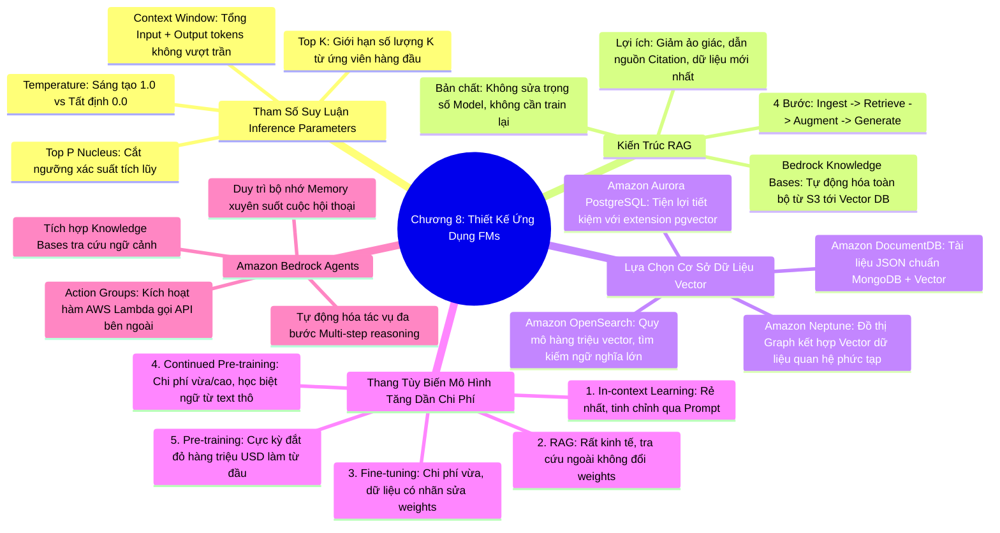

# CHƯƠNG 08: THIẾT KẾ ỨNG DỤNG FOUNDATION MODELS - RAG, AGENTS VÀ VECTOR DATABASES
*(Section 8 - Domain 3: Applications of Foundation Models)*

---

## 🎯 MỤC TIÊU BÀI HỌC & TRỌNG TÂM THI (EXAM FOCUS)
- Làm chủ bộ tham số suy luận điều khiển mô hình: **Temperature**, **Top P (Nucleus Sampling)**, **Top K**, và **Context Window (Độ dài ngữ cảnh)**.
- Hiểu thấu đáo bản chất của **RAG (Retrieval-Augmented Generation)**: Là một mô hình kiến trúc (**Architectural Pattern**), **KHÔNG** làm thay đổi trọng số mô hình (**No weight updates**), giúp cập nhật tri thức theo thời gian thực và triệt tiêu ảo giác.
- Nắm vững quy trình 4 bước chuẩn của RAG: **Ingest ➔ Retrieve ➔ Augment ➔ Generate**.
- Tận dụng **Amazon Bedrock Knowledge Bases** để tự động hóa toàn bộ quy trình RAG được quản lý hoàn toàn.
- Phân biệt các tùy chọn cơ sở dữ liệu Vector trên AWS: **Amazon OpenSearch Serverless**, **Amazon Aurora / RDS PostgreSQL (pgvector)**, **Amazon Neptune (Graph + Vector)**, **Amazon DocumentDB**.
- Xếp hạng 5 cấp độ tùy biến mô hình (**Model Customization Spectrum**) theo chi phí và độ phức tạp: *In-context Learning ➔ RAG ➔ Fine-tuning ➔ Continued Pre-training ➔ Pre-training from scratch*.
- Nắm cơ chế hoạt động của **Amazon Bedrock Agents** và nhóm hành động (**Action Groups**).

---

## 🧠 BẢN ĐỒ TƯ DUY (MINDMAP) CHƯƠNG 8

### Sơ đồ tư duy trực quan (Mermaid Diagram)


---

## 📚 KIẾN THỨC CỐT LÕI CHI TIẾT (DEEP DIVE)

### 1. Bộ tham số suy luận (Inference Parameters)

Khi gửi yêu cầu tới một LLM, bạn có thể điều chỉnh cách mô hình lựa chọn các từ ngữ tiếp theo thông qua các tham số suy luận:

```
Từ ứng viên:     [ "quả táo" (0.5), "trái cam" (0.3), "bàn phím" (0.15), "mặt trời" (0.05) ]
Top K = 2  ───►  [ "quả táo", "trái cam" ] (Chỉ lấy đúng 2 từ có điểm cao nhất)
Top P = 0.8 ──►  [ "quả táo", "trái cam" ] (Tổng xác suất 0.5 + 0.3 = 0.8 đạt ngưỡng)
Temperature ──►  Làm phẳng hoặc làm dốc phân phối xác suất
```

1. **Temperature (Nhiệt độ - Kiểm soát tính sáng tạo):**
   - Điều khiển mức độ ngẫu nhiên của các câu trả lời.
   - **Thấp (0.0 - 0.2):** Mô hình trở nên rất chặt chẽ, câu trả lời mang tính **tất định (deterministic)**, tập trung, có thể dự đoán trước. Phù hợp nhất cho: Báo cáo tài chính, tóm tắt hợp đồng pháp lý, trích xuất dữ liệu, viết code logic.
   - **Trung bình (0.7):** Cân bằng giữa tính sáng tạo và độ chính xác (soạn thảo email, trả lời khách hàng thông thường).
   - **Cao (0.9 - 1.0):** Mô hình phân bổ xác suất đều hơn cho các từ ít phổ biến, sinh ra câu trả lời giàu trí tưởng tượng, độc đáo, bất ngờ. Thích hợp cho: Viết truyện ngắn, làm thơ, brainstorm ý tưởng quảng cáo.
2. **Top P (Nucleus Sampling - Lấy mẫu hạt nhân):**
   - Mô hình chỉ xem xét các từ nằm trong **tổng xác suất tích lũy (Cumulative Probability)** đạt đến ngưỡng $P$.
   - *Top P = 0.3:* Chỉ chọn trong số các từ hàng đầu chiếm 30% tổng xác suất (kết quả an toàn, chuẩn mực).
   - *Top P = 0.9:* Mở rộng phạm vi lựa chọn cho đến khi đạt 90% tổng xác suất (kết quả đa dạng hơn).
3. **Top K:**
   - Giới hạn cứng số lượng $K$ từ ứng viên có xác suất cao nhất được đem ra cân nhắc.
   - *Top K = 1:* Chỉ lấy đúng 1 từ có xác suất cao nhất (Greedy Decoding).
   - *Top K = 50:* Cho phép mô hình chọn ngẫu nhiên trong top 50 từ tiềm năng nhất.
4. **Context Window (Độ dài cửa sổ ngữ cảnh) & Max Tokens:**
   - Cửa sổ ngữ cảnh là tổng số lượng tokens tối đa mà mô hình có thể tiếp nhận và sinh ra trong một phiên làm việc.
   - **Quy tắc bảo toàn:** $\text{Input Tokens (Prompt + History)} + \text{Output Tokens (Response)} \le \text{Context Window Limit}$.
   - Nếu tài liệu đầu vào quá dài, vượt quá cửa sổ ngữ cảnh, mô hình sẽ báo lỗi hoặc cắt bỏ (truncate) phần văn bản đầu tiên.

---

### 2. Kiến trúc Retrieval-Augmented Generation (RAG)

#### A. RAG là gì?
- **RAG** là một mẫu kiến trúc phần mềm kết hợp giữa **hệ thống truy xuất thông tin (Information Retrieval)** và **mô hình sinh ngôn ngữ (Generative LLM)**.
- ⚠️ **ĐIỂM SỐ 1 TRONG ĐỀ THI:** RAG **KHÔNG PHẢI** là phương pháp huấn luyện mô hình. RAG **KHÔNG** làm thay đổi bất kỳ trọng số (weights) nào của mô hình nền tảng.
- **Tại sao RAG là giải pháp số một cho doanh nghiệp?**
  1. *Triệt tiêu ảo giác (Grounding):* Mô hình chỉ trả lời dựa trên tài liệu thực tế được cung cấp.
  2. *Cập nhật thời gian thực:* Khi chính sách công ty thay đổi, chỉ cần cập nhật file trong S3, không cần bỏ tiền triệu train lại mô hình.
  3. *Trích dẫn minh bạch (Citations / Attribution):* Cung cấp chính xác tên tài liệu và số trang tham chiếu.
  4. *Tiết kiệm chi phí:* Rẻ hơn hàng trăm lần so với Fine-tuning.

#### B. Quy trình 4 bước chuẩn của RAG:

```
[1. INGEST]
  Tài liệu nội bộ (PDF/Word) ──► Chunking ──► Embedding Model ──► Lưu vào Vector DB

[2. RETRIEVE]
  Câu hỏi người dùng ──► Chuyển thành Vector ──► Similarity Search trên Vector DB ──► Lấy Top N Chunks liên quan nhất

[3. AUGMENT]
  Ghép: [Câu hỏi người dùng] + [Nội dung các Chunks liên quan] ──► Tạo thành Prompt hoàn chỉnh có ngữ cảnh

[4. GENERATE]
  Prompt hoàn chỉnh ──► Foundation Model (Bedrock) ──► Trả về câu trả lời chính xác có trích dẫn nguồn
```

---

### 3. Amazon Bedrock Knowledge Bases

Amazon Bedrock Knowledge Bases là dịch vụ quản lý toàn trình (Fully Managed) tự động hóa toàn bộ quy trình RAG chỉ với vài thao tác cấu hình:
- **Nguồn dữ liệu (Data Sources):** Tự động đồng bộ từ **Amazon S3**, Atlassian Confluence, Salesforce, Microsoft SharePoint, Web Crawler.
- **Tự động tiền xử lý (Preprocessing):** Tự động phân đoạn (Chunking) và gọi mô hình **Amazon Titan Text Embeddings** để mã hóa vector.
- **Lưu trữ vector:** Tự động tạo và kết nối với cơ sở dữ liệu vector.

---

### 4. So sánh các lựa chọn Cơ sở dữ liệu Vector (Vector Databases) trên AWS

| Dịch vụ AWS | Khi nào nên chọn trong bài thi? | Đặc tính nổi bật |
| :--- | :--- | :--- |
| **Amazon OpenSearch Service / Serverless** | Cần tìm kiếm vector **quy mô lớn (hàng triệu vector)**, hiệu năng cao, độ trễ thấp, tìm kiếm lai (Hybrid Search: Vector + Keyword). | Lựa chọn mặc định và tối ưu nhất của Amazon Bedrock Knowledge Bases. Serverless không cần quản trị cụm. |
| **Amazon Aurora / RDS PostgreSQL (`pgvector`)** | Doanh nghiệp **đã sử dụng sẵn PostgreSQL** cho dữ liệu quan hệ và muốn bổ sung tính năng tìm kiếm vector để tiết kiệm chi phí mà không muốn dựng thêm cụm CSDL mới. | Sử dụng extension `pgvector` ngay trong bảng dữ liệu SQL hiện có. |
| **Amazon Neptune** | Bài toán cần **kết hợp dữ liệu đồ thị quan hệ phức tạp (Knowledge Graph)** với tìm kiếm vector tương đồng (ví dụ: phát hiện đường dây lừa đảo xuyên quốc gia, mạng lưới xã hội). | Cơ sở dữ liệu đồ thị chuyên dụng đầu tiên hỗ trợ Vector Search. |
| **Amazon DocumentDB** | Ứng dụng chạy trên kiến trúc tài liệu JSON (tương thích MongoDB) cần tích hợp thêm khả năng tìm kiếm vector. | Phù hợp với các ứng dụng web hướng tài liệu. |

---

### 5. Thang 5 cấp độ tùy biến Foundation Model (Customization Spectrum)

Đề thi thường yêu cầu sắp xếp hoặc lựa chọn phương án tùy biến tối ưu theo tiêu chí **Chi phí (Cost)**, **Thời gian (Time)** và **Mức độ can thiệp trọng số (Weights alteration)**:

```
[Chi phí thấp nhất, Không đổi trọng số]                                   [Chi phí cao nhất, Huấn luyện lại từ đầu]
  1. In-context Learning ──► 2. RAG ──► 3. Fine-tuning ──► 4. Continued Pre-training ──► 5. Pre-training from scratch
```

1. **In-context Learning (Prompt Engineering / Zero-shot / Few-shot):**
   - Cung cấp hướng dẫn và ví dụ mẫu ngay trong câu lệnh Prompt.
   - *Chi phí:* Rẻ nhất (chỉ trả tiền token).
   - *Thay đổi trọng số:* **Không (0%)**.
2. **Retrieval-Augmented Generation (RAG):**
   - Đưa tri thức nội bộ từ cơ sở dữ liệu vector vào ngữ cảnh câu hỏi.
   - *Chi phí:* Rất thấp (chỉ tốn chi phí lưu trữ vector và số token mở rộng).
   - *Thay đổi trọng số:* **Không (0%)**.
3. **Fine-Tuning (Tinh chỉnh mô hình):**
   - Huấn luyện mô hình trên tập dữ liệu có gán nhãn gồm các cặp câu hỏi - câu trả lời mẫu (**Prompt-Response Pairs**) theo phong cách, định dạng hoặc văn phong riêng của doanh nghiệp.
   - *Chi phí:* Vừa phải (cần máy chủ tính toán để chạy tinh chỉnh và cần mua Provisioned Throughput để chạy suy luận trên Bedrock).
   - *Thay đổi trọng số:* **CÓ (Cập nhật một phần hoặc toàn bộ trọng số)**.
4. **Continued Pre-training (Tiền huấn luyện tiếp tục / Domain Adaptation):**
   - Huấn luyện mô hình nền tảng sẵn có trên lượng lớn **dữ liệu phi cấu trúc KHÔNG gán nhãn (Unlabeled raw text)** của một chuyên ngành rất hẹp (như hàng vạn văn bản giải phẫu y học hoặc biệt ngữ tài chính hiếm gặp) để mô hình học bổ sung từ vựng chuyên ngành.
   - *Chi phí:* Khá cao.
   - *Thay đổi trọng số:* **CÓ**.
5. **Pre-training from scratch (Huấn luyện từ con số 0):**
   - Tự thu thập hàng nghìn tỷ token văn bản toàn cầu và huấn luyện mô hình hoàn toàn mới.
   - *Chi phí:* Khổng lồ (hàng triệu đến hàng chục triệu USD).
   - *Thay đổi trọng số:* Khởi tạo toàn bộ mạng nơ-ron mới.

---

### 6. Amazon Bedrock Agents (Tác tử tự động hóa)

- **Khái niệm:** Bedrock Agents giúp mô hình không chỉ dừng lại ở việc "trò chuyện" mà có thể **"thực thi hành động" (Take actions)** trong thế giới thực thông qua các quy trình nghiệp vụ nhiều bước phức tạp.
- **Cơ chế suy luận:** Sử dụng mô hình lập luận ReAct (Reasoning + Acting) để tự chia nhỏ mục tiêu của người dùng thành các bước logic:
  - *Ví dụ:* Người dùng yêu cầu: *"Kiểm tra lượng tồn kho của áo sơ mi cỡ L và gửi email đặt thêm 50 chiếc nếu số lượng dưới 10"*.
  - Tác tử sẽ tự động: Bước 1: Tra cứu DB tồn kho ➔ Bước 2: So sánh số lượng ➔ Bước 3: Gọi API gửi email đặt hàng.
- **Các thành phần cốt lõi:**
  - **Action Groups (Nhóm hành động):** Kết nối Agent với các hàm **AWS Lambda** để gọi các API nội bộ hoặc hệ thống bên thứ ba.
  - **Knowledge Bases:** Kết nối với kho tri thức nội bộ để tra cứu thông tin chính sách khi cần thiết.
  - **Memory Retention:** Lưu trữ ngữ cảnh xuyên suốt nhiều phiên đàm thoại của người dùng.

---

## ⚠️ MẸO THI & BẪY CẦN TRÁNH (EXAM TIPS & TRAPS)

> [!TIP]
> **Nhận diện nhanh bài thi:**
> - *"Ground model responses in proprietary data without modifying model weights"* ➔ **RAG (Amazon Bedrock Knowledge Bases)**.
> - *"Automate multi-step tasks by invoking APIs and Lambda functions"* ➔ **Amazon Bedrock Agents (Action Groups)**.
> - *"Existing PostgreSQL database needs vector search capabilities"* ➔ **Amazon Aurora with `pgvector`**.
> - *"Millions of vector embeddings, high-throughput semantic search"* ➔ **Amazon OpenSearch Service / Serverless**.
> - *"Teach the model domain-specific jargon using massive unlabeled documents"* ➔ **Continued Pre-training**.
> - *"Teach the model a specific tone, style, or output format using labeled prompt-response pairs"* ➔ **Fine-tuning**.

---

## 📝 BỘ CÂU HỎI ÔN TẬP MÔ PHỎNG (PRACTICE QUESTIONS)

#### Câu 1:
Một tổ chức y tế muốn tích hợp các hướng dẫn điều trị lâm sàng mới nhất được cập nhật hàng tuần vào chatbot hỗ trợ bác sĩ. Họ muốn đảm bảo mô hình luôn cung cấp thông tin mới nhất, có kèm đường link trích dẫn tới văn bản hướng dẫn gốc và không làm thay đổi các trọng số toán học của mô hình nền tảng. Phương pháp tùy biến nào là tối ưu nhất?
- A. Continued Pre-training hàng tuần trên Amazon SageMaker
- B. Retrieval-Augmented Generation (RAG) sử dụng Amazon Bedrock Knowledge Bases
- C. Fine-tuning mô hình hàng đêm bằng tập dữ liệu hỏi đáp có gán nhãn
- D. Tăng giá trị tham số Temperature lên 1.0 trong mỗi lời gọi API
> **Đáp án đúng: B**  
> *Giải thích:* RAG là phương pháp duy nhất cho phép cập nhật tri thức mới liên tục mà không cần thay đổi trọng số mô hình (no weight updates), đồng thời cung cấp khả năng trích dẫn nguồn văn bản gốc (citations) rõ ràng.

#### Câu 2:
Một kỹ sư AI muốn xây dựng một giải pháp cho phép trợ lý ảo không chỉ trả lời câu hỏi của khách hàng mà còn có khả năng tự động thực hiện việc hủy vé máy bay và hoàn tiền vào tài khoản ngân hàng thông qua việc gọi các REST API nội bộ của hãng. Tính năng nào của Amazon Bedrock được thiết kế cho mục đích này?
- A. Amazon Bedrock Guardrails
- B. Amazon Bedrock Knowledge Bases
- C. Amazon Bedrock Agents kết hợp với Action Groups
- D. Amazon Bedrock Model Evaluation
> **Đáp án đúng: C**  
> *Giải thích:* Amazon Bedrock Agents giúp tự động hóa các tác vụ phức tạp nhiều bước bằng cách phân tích yêu cầu người dùng và kích hoạt các Action Groups (thông qua AWS Lambda) để tương tác với các hệ thống và REST API bên ngoài.

#### Câu 3:
Khi cấu hình suy luận cho một mô hình ngôn ngữ lớn nhằm tạo ra các câu trả lời ngắn gọn, chuẩn xác, mang tính kỹ thuật và có độ nhất quán cao giữa các lần truy vấn, nhóm phát triển nên thiết lập các tham số như thế nào?
- A. Đặt Temperature ở mức cao (gần 1.0) và Top P ở mức cao (0.9)
- B. Đặt Temperature ở mức thấp (gần 0.0) và Top P ở mức thấp (0.2 - 0.3)
- C. Tăng kích thước Context Window lên mức tối đa mà không điều chỉnh Temperature
- D. Đặt Top K = 100 và Temperature = 0.95
> **Đáp án đúng: B**  
> *Giải thích:* Để có câu trả lời tất định, chuẩn xác, ít biến thiên và mang tính kỹ thuật, cần hạ thấp Temperature (về gần 0.0) và giảm Top P (xuống mức thấp như 0.2 - 0.3) để mô hình tập trung vào các từ có xác suất cao nhất.
