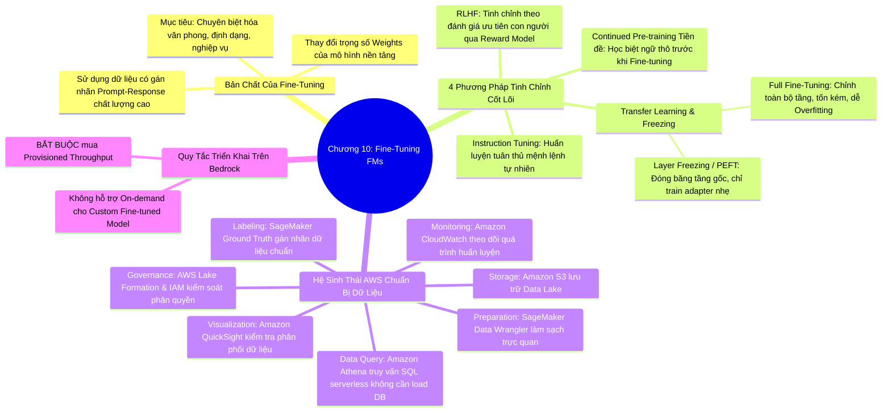

# CHƯƠNG 10: TINH CHỈNH MÔ HÌNH NỀN TẢNG (FINE-TUNING FMS DEEP DIVE)
*(Section 10 - Domain 3: Applications of Foundation Models)*

---

## 🎯 MỤC TIÊU BÀI HỌC & TRỌNG TÂM THI (EXAM FOCUS)
- Hiểu rõ bản chất của **Fine-Tuning**: Quá trình huấn luyện tiếp tục có giám sát (**Supervised Fine-Tuning - SFT**) làm thay đổi các trọng số của mô hình nền tảng.
- Phân biệt 4 phương pháp tinh chỉnh mô hình:
  1. **Instruction Tuning** (Huấn luyện tuân thủ mệnh lệnh)
  2. **RLHF (Reinforcement Learning from Human Feedback)** (Căn chỉnh theo phản hồi con người)
  3. **Transfer Learning & Kỹ thuật đóng băng tầng (Layer Freezing / PEFT)**
  4. **Continued Pre-training** (Tiền huấn luyện tiếp tục trên dữ liệu thô không nhãn làm bước đệm)
- Nắm vững chuỗi công cụ AWS trong **Quy trình chuẩn bị dữ liệu tinh chỉnh (Data Preparation Pipeline)**:
  - *Lưu trữ:* Amazon S3
  - *Làm sạch & Biến đổi:* Amazon SageMaker Data Wrangler
  - *Truy vấn phân tích dữ liệu lớn:* Amazon Athena
  - *Gán nhãn chất lượng cao:* Amazon SageMaker Ground Truth
  - *Quản trị truy cập:* AWS Lake Formation & IAM
  - *Trực quan hóa phân phối:* Amazon QuickSight
  - *Giám sát vận hành:* Amazon CloudWatch
- Nhớ quy tắc bài thi về **Provisioned Throughput** khi triển khai mô hình Fine-tuned trên Amazon Bedrock.

---

## 🧠 BẢN ĐỒ TƯ DUY (MINDMAP) CHƯƠNG 10

### Sơ đồ tư duy trực quan (Mermaid Diagram)


---

## 📚 KIẾN THỨC CỐT LÕI CHI TIẾT (DEEP DIVE)

### 1. Bản chất của Fine-Tuning và khi nào nên áp dụng

- **Khái niệm:** Fine-Tuning (Tinh chỉnh mô hình) là quá trình lấy một Foundation Model đã được đào tạo trước (Pre-trained) và tiếp tục huấn luyện trên một tập dữ liệu nhỏ hơn nhưng có tính mục tiêu cao gồm các cặp câu lệnh - câu trả lời mẫu (**Prompt-Response Pairs**) được gán nhãn cẩn thận.
- **Sự thay đổi bên trong:** Khác với RAG và Prompt Engineering (không làm thay đổi mô hình), Fine-Tuning **trực tiếp cập nhật các trọng số nơ-ron (Model Weights)** để thích ứng với phong cách hoặc nhiệm vụ mới.
- **Khi nào nên chọn Fine-Tuning thay vì RAG?**
  - Khi cần mô hình thay đổi **giọng điệu, văn phong (Tone & Style)** (ví dụ: luôn nói chuyện bằng văn phong pháp lý trang trọng hoặc phong cách thương hiệu riêng).
  - Khi cần mô hình luôn xuất ra một **cấu trúc định dạng dữ liệu đặc thù rất nghiêm ngặt** (ví dụ: một cấu trúc JSON/XML độc quyền mà Prompt Engineering không thể đảm bảo 100%).
  - Khi cần cải thiện độ chính xác cho một tác vụ ngôn ngữ chuyên sâu rất hẹp.

---

### 2. Bốn phương pháp tinh chỉnh mô hình nền tảng

#### 1. Instruction Tuning (Tinh chỉnh theo chỉ thị):
- Huấn luyện mô hình trên các tập dữ liệu có cấu trúc: `Chỉ thị (Instruction)` ➔ `Đầu vào (Input)` ➔ `Đầu ra mong muốn (Target Output)`.
- *Mục tiêu:* Giúp mô hình hiểu rõ ý định của con người khi ra lệnh và có khả năng **tổng quát hóa (Generalize)** sang các tác vụ mới tương tự mà không bị bỡ ngỡ.

#### 2. RLHF (Reinforcement Learning from Human Feedback):
- Phương pháp lý tưởng khi **không thể định nghĩa được hàm mục tiêu bằng công thức toán học**, ví dụ: "Thế nào là một bài thơ hay?", "Thế nào là câu trả lời lịch sự, không xúc phạm?".
- Quy trình gồm 3 bước:
  1. Cho mô hình sinh ra nhiều câu trả lời khác nhau cho cùng một câu hỏi.
  2. Người thẩm định con người xếp hạng các câu trả lời từ tốt nhất đến kém nhất.
  3. Huấn luyện một **Mô hình phần thưởng (Reward Model)** để tự động chấm điểm và dùng thuật toán tối ưu hóa (PPO) điều chỉnh trọng số mô hình gốc.

#### 3. Transfer Learning & Kỹ thuật đóng băng tầng (Layer Freezing / PEFT):
- Khi tinh chỉnh mô hình, bạn có 2 chiến lược điều chỉnh trọng số:
  - **Full Fine-Tuning (Tinh chỉnh toàn bộ):** Cập nhật toàn bộ các trọng số ở tất cả các tầng. Cho độ thích ứng tối đa nhưng tốn rất nhiều tài nguyên tính toán (GPU), chi phí đắt đỏ và tiềm ẩn nguy cơ **Hiện tượng quên lãng tai hại (Catastrophic Forgetting)** - mô hình học cái mới nhưng quên sạch các kiến thức tổng quát đã học trước đó!
  - **Parameter-Efficient Fine-Tuning (PEFT / LoRA) & Layer Freezing (Đóng băng tầng):** Đóng băng (Freeze) hầu hết các tầng nơ-ron ban đầu (vốn chứa tri thức ngữ pháp và ngôn ngữ tổng quát) và chỉ mở khóa huấn luyện một số ít tầng trên cùng hoặc gắn thêm các bộ chuyển đổi tham số siêu nhẹ (**Adapters / LoRA**). Tiết kiệm tới 90% chi phí tính toán và ngăn ngừa overfitting.

#### 4. Continued Pre-training làm bước đệm (Precursor):
- Nếu doanh nghiệp sở hữu lượng lớn văn bản chuyên ngành thô **KHÔNG gán nhãn** (như hàng triệu trang tài liệu kỹ thuật viễn thông), chiến lược tốt nhất là chạy **Continued Pre-training** trước để mô hình ngấm toàn bộ vốn từ vựng và ngữ cảnh chuyên ngành, sau đó mới dùng tập dữ liệu gán nhãn nhỏ để chạy **Fine-tuning**.

---

### 3. Quy trình chuẩn bị dữ liệu tinh chỉnh trên AWS (Data Preparation Pipeline)

Chất lượng của dữ liệu tinh chỉnh quyết định 99% thành công của mô hình (*"Data quality beats model size"*). AWS cung cấp một hệ sinh thái đồng bộ cho từng bước chuẩn bị dữ liệu:

```
[Amazon S3] ──► [Amazon Athena] ──► [Data Wrangler] ──► [Ground Truth] ──► [QuickSight] ──► [Bedrock Fine-tuning]
(Lưu Data Lake) (Lọc & Phân tích)   (Làm sạch & Chuẩn hóa) (Gán nhãn chuyên gia) (Kiểm định phân phối) (Huấn luyện mô hình)
```

1. **Lưu trữ tập trung (Storage):**
   - **Amazon S3:** Nơi lưu trữ an toàn toàn bộ tập dữ liệu huấn luyện thô và tập dữ liệu mẫu sau khi đã format thành file JSON Lines (`.jsonl`).
2. **Khám phá và truy vấn dữ liệu lớn (Data Size & Exploration):**
   - **Amazon Athena:** Công cụ truy vấn SQL Serverless tương tác trực tiếp trên các file dữ liệu nằm trong S3 mà không cần nạp vào Database, giúp lọc ra các tập dữ liệu tiềm năng nhất.
3. **Làm sạch và tiền xử lý trực quan (Data Curation):**
   - **Amazon SageMaker Data Wrangler:** Chuẩn hóa định dạng văn bản, xử lý các ký tự đặc biệt, loại bỏ khoảng trắng thừa chỉ bằng giao diện đồ họa kéo thả.
4. **Gán nhãn dữ liệu chuẩn xác (Data Labeling):**
   - **Amazon SageMaker Ground Truth:** Quản lý quy trình gán nhãn cặp hỏi-đáp chất lượng cao, phân chia công việc cho chuyên gia nội bộ hoặc đối tác thẩm định.
5. **Quản trị an toàn và phân quyền (Governance & Access Control):**
   - **AWS Lake Formation & AWS IAM:** Thiết lập chính sách kiểm soát quyền truy cập chi tiết tới từng cột/bảng dữ liệu, bảo đảm dữ liệu nhạy cảm không bị lộ trong quá trình chuẩn bị.
6. **Kiểm tra tính đại diện của dữ liệu (Data Representativeness):**
   - **Amazon QuickSight:** Trực quan hóa tỷ lệ phân bổ các chủ đề, bảo đảm tập dữ liệu huấn luyện không bị lệch quá nhiều về một nhóm câu hỏi cụ thể.
7. **Theo dõi quá trình huấn luyện (Feedback & Monitoring):**
   - **Amazon CloudWatch:** Ghi nhận log huấn luyện, theo dõi đồ thị hàm mất mát (Training Loss / Validation Loss) theo thời gian thực để phát hiện sớm nguy cơ Overfitting.

---

### 4. Triển khai mô hình Fine-tuned trên Amazon Bedrock

- Sau khi quá trình Fine-tuning trên Amazon Bedrock hoàn tất thành công, mô hình tùy biến này được lưu trữ riêng biệt trong tài khoản AWS của bạn.
- ⚠️ **QUY TẮC BÀI THI BẮT BUỘC:** Mô hình tùy biến (Custom Model) trên Amazon Bedrock **KHÔNG THỂ gọi theo cơ chế On-demand**. Bạn bắt buộc phải mua **Provisioned Throughput** (cấp phát Model Units) để triển khai endpoint phục vụ dự đoán.

---

## ⚠️ MẸO THI & BẪY CẦN TRÁNH (EXAM TIPS & TRAPS)

> [!TIP]
> **Từ khóa kích hoạt đáp án:**
> - *"Fine-tuning modifies model weights"* ➔ Đúng.
> - *"Serverless SQL queries directly on S3 training files"* ➔ **Amazon Athena**.
> - *"Visual data preparation and transformation for ML"* ➔ **Amazon SageMaker Data Wrangler**.
> - *"Human-in-the-loop high quality dataset labeling for fine-tuning"* ➔ **Amazon SageMaker Ground Truth**.
> - *"Deploy custom fine-tuned model on Amazon Bedrock requires"* ➔ **Provisioned Throughput**.
> - *"Align model with human values where objective is hard to quantify mathematically"* ➔ **RLHF**.
> - *"Freeze earlier layers and adjust only top layers to prevent overfitting and save cost"* ➔ **Layer Freezing / PEFT / Transfer Learning**.

---

## 📝 BỘ CÂU HỎI ÔN TẬP MÔ PHỎNG (PRACTICE QUESTIONS)

#### Câu 1:
Một công ty tài chính muốn tinh chỉnh (fine-tune) một mô hình nền tảng trên Amazon Bedrock để đảm bảo mô hình luôn trả lời theo phong cách chuyên môn và định dạng báo cáo rủi ro đặc thù của công ty. Sau khi mô hình tinh chỉnh được tạo thành công, bước cấu hình nào là bắt buộc để ứng dụng có thể gửi yêu cầu suy luận tới mô hình này?
- A. Kích hoạt tính năng On-demand Inference trong Amazon Bedrock console.
- B. Mua và liên kết mô hình tùy biến với một đơn vị Provisioned Throughput.
- C. Cấu hình một Amazon SageMaker Ground Truth job để kiểm tra mô hình.
- D. Tạo một Amazon Kendra Index để lưu trữ mô hình tùy biến.
> **Đáp án đúng: B**  
> *Giải thích:* Trên Amazon Bedrock, các mô hình tùy biến (Custom models) được tinh chỉnh thông qua Fine-tuning bắt buộc phải được triển khai bằng cơ chế **Provisioned Throughput**. Chế độ On-demand chỉ áp dụng cho các mô hình cơ sở mặc định (Base models).

#### Câu 2:
Trong quá trình chuẩn bị tập dữ liệu gồm hàng triệu bản ghi lưu trữ trên Amazon S3 để phục vụ cho việc tinh chỉnh mô hình học máy, các nhà khoa học dữ liệu cần nhanh chóng chạy các truy vấn SQL để lọc và kiểm tra chất lượng dữ liệu mà không muốn tốn công sức dựng một cụm cơ sở dữ liệu quan hệ phức tạp. Dịch vụ AWS nào phù hợp nhất?
- A. Amazon Redshift Spectrum
- B. Amazon Athena
- C. Amazon DynamoDB
- D. Amazon RDS for MySQL
> **Đáp án đúng: B**  
> *Giải thích:* Amazon Athena là dịch vụ truy vấn tương tác Serverless cho phép phân tích dữ liệu trực tiếp trong Amazon S3 bằng cú pháp SQL chuẩn một cách nhanh chóng và tiết kiệm chi phí nhất.

#### Câu 3:
Kỹ thuật nào sau đây giúp giảm đáng kể chi phí tính toán phần cứng và hạn chế hiện tượng quá khớp (Overfitting) khi thực hiện tinh chỉnh một Foundation Model có kích thước lớn?
- A. Tinh chỉnh toàn bộ trọng số của tất cả các tầng trong mô hình (Full Fine-tuning).
- B. Tăng số lượng Epochs lên mức tối đa có thể.
- C. Đóng băng các tầng dưới của mô hình và chỉ cập nhật trọng số của các tầng trên cùng hoặc sử dụng kỹ thuật PEFT/Adapters.
- D. Chuyển toàn bộ dữ liệu huấn luyện từ có gán nhãn sang không gán nhãn.
> **Đáp án đúng: C**  
> *Giải thích:* Kỹ thuật đóng băng các tầng (Layer Freezing) và tinh chỉnh tham số hiệu quả (PEFT / Parameter-Efficient Fine-Tuning) giúp giữ nguyên các trọng số tổng quát đã học, chỉ huấn luyện một số lượng nhỏ tham số mới, từ đó giảm chi phí GPU và chống overfitting.
