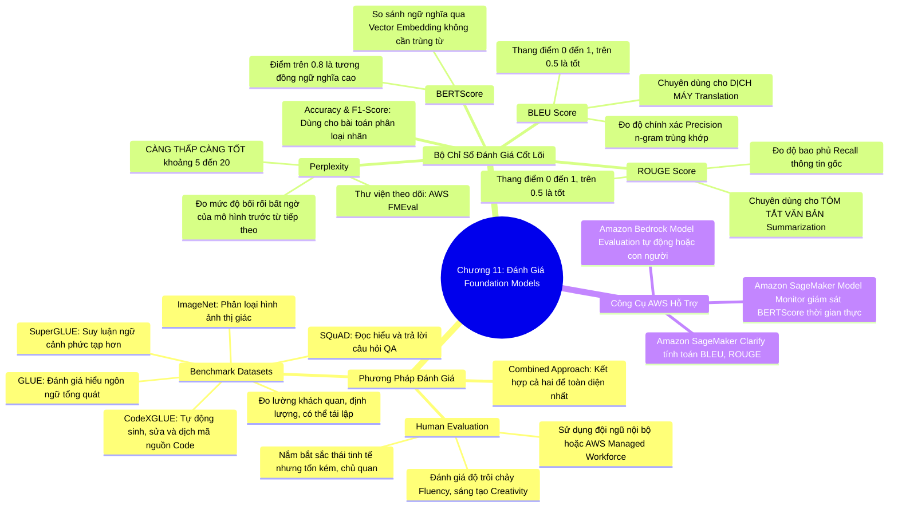

# CHƯƠNG 11: ĐÁNH GIÁ MÔ HÌNH NỀN TẢNG - PHƯƠNG PHÁP VÀ BỘ CHỈ SỐ ĐO LƯỜNG
*(Section 11 - Domain 3: Applications of Foundation Models)*

---

## 🎯 MỤC TIÊU BÀI HỌC & TRỌNG TÂM THI (EXAM FOCUS)
- Phân biệt hai phương pháp đánh giá Foundation Models (FMs): **Đánh giá bằng con người (Human Evaluation)** và **Bộ dữ liệu chuẩn hóa (Benchmark Datasets)**.
- Ghi nhớ các bộ Benchmarks kinh điển trong ngành AI: **GLUE, SuperGLUE, SQuAD, ImageNet, CodeXGLUE**.
- Nắm vững định nghĩa, cơ chế và thang điểm của 5 chỉ số đánh giá LLM quan trọng nhất trong đề thi:
  1. **Perplexity** (Độ bối rối - *Càng thấp càng tốt*)
  2. **BLEU** (Đánh giá dịch máy - *Dựa trên n-gram precision*)
  3. **ROUGE** (Đánh giá tóm tắt văn bản - *Dựa trên recall*)
  4. **BERTScore** (Đo độ tương đồng ngữ nghĩa bằng embedding)
  5. **Accuracy & F1-Score** (Đánh giá khi FM được tinh chỉnh cho bài toán phân loại)
- Nắm tính năng **Amazon Bedrock Model Evaluation** (Hỗ trợ đánh giá tự động và đánh giá bằng con người).

---

## 🧠 BẢN ĐỒ TƯ DUY (MINDMAP) CHƯƠNG 11

### Sơ đồ tư duy trực quan (Mermaid Diagram)


---

## 📚 KIẾN THỨC CỐT LÕI CHI TIẾT (DEEP DIVE)

### 1. Hai phương pháp đánh giá mô hình nền tảng

Việc đánh giá một mô hình ngôn ngữ lớn khó khăn hơn nhiều so với mô hình ML truyền thống vì đầu ra của LLM là văn bản tự do, sáng tạo và mở. Hai phương pháp chính bổ trợ cho nhau:

#### A. Đánh giá bằng con người (Human Evaluation):
- **Cơ chế:** Các chuyên gia con người đọc và chấm điểm các câu trả lời do mô hình sinh ra dựa trên các tiêu chí định tính:
  - *Tính trôi chảy (Fluency):* Câu văn có tự nhiên, đúng ngữ pháp không?
  - *Tính chính xác (Factual Accuracy):* Thông tin có đúng sự thật không hay bị ảo giác?
  - *Tính mạch lạc (Coherence) & Độ liên quan (Relevance).*
  - *Độ an toàn & Độc hại (Safety & Toxicity).*
- **Ưu điểm:** Nắm bắt được ngữ cảnh tinh tế, sự hài hước, văn phong mà máy móc không đo lường được.
- **Nhược điểm:** Tốn kém chi phí, mất nhiều thời gian và mang tính chủ quan cá nhân.
- **Triển khai trên AWS:** **Amazon Bedrock Model Evaluation** hỗ trợ tích hợp đội ngũ đánh giá con người từ nhân viên nội bộ công ty hoặc thuê đội ngũ được quản lý của AWS (**AWS-managed workforce**).

#### B. Đánh giá bằng bộ dữ liệu chuẩn hóa (Benchmark Datasets):
- **Cơ chế:** Cho mô hình giải các bộ đề thi trắc nghiệm hoặc bài tập chuẩn mực đã có sẵn đáp án chính xác.
- **Ưu điểm:** Khách quan, tự động hóa 100%, đo lường định lượng được và dễ dàng so sánh điểm số giữa các mô hình (Leaderboards).
- **5 Bộ Benchmark chuẩn cần nhớ trong bài thi:**
  1. **GLUE (General Language Understanding Evaluation):** Bộ benchmark kinh điển kiểm tra khả năng hiểu ngôn ngữ tổng quát qua 9 tác vụ (phân loại câu, phân tích cảm xúc, suy luận quan hệ logic giữa 2 câu).
  2. **SuperGLUE:** Phiên bản nâng cấp nâng cao của GLUE với độ khó vượt trội, đòi hỏi suy luận logic sâu và hiểu ngữ cảnh đa câu phức tạp.
  3. **SQuAD (Stanford Question Answering Dataset):** Bộ dữ liệu chuyên biệt cho bài toán Đọc hiểu và Trả lời câu hỏi (Reading Comprehension / Question Answering). Đoạn văn bản chứa sẵn câu trả lời và mô hình phải chỉ ra chính xác vị trí câu trả lời đó.
  4. **ImageNet:** Bộ dữ liệu hơn 14 triệu hình ảnh có gán nhãn, là tiêu chuẩn vàng đánh giá mô hình phân loại ảnh và nhận diện đối tượng (Computer Vision).
  5. **CodeXGLUE:** Bộ benchmark chuyên dùng cho các mô hình sinh code (như Amazon Q Developer), kiểm tra khả năng hoàn thành mã, phát hiện lỗi (bug detection), và dịch giữa các ngôn ngữ lập trình (Java sang Python).

---

### 2. Bộ chỉ số đo lường hiệu năng LLMs (Chắc chắn thi)

Bảng so sánh 5 chỉ số vàng đánh giá Foundation Model:

| Chỉ số | Tên đầy đủ & Bản chất | Lĩnh vực ứng dụng chuyên biệt | Quy tắc thang điểm | Công cụ AWS hỗ trợ |
| :--- | :--- | :--- | :--- | :--- |
| **Perplexity (PPL)** | Đo lường mức độ **"bối rối / bất ngờ"** của mô hình khi dự đoán từ tiếp theo trong chuỗi. | Đánh giá chất lượng mô hình ngôn ngữ tổng quát trong giai đoạn Pre-training. | **CÀNG THẤP CÀNG TỐT** *(Lower is better)*. Điểm tốt: 5 - 20. PPL cao nghĩa là mô hình không hiểu văn bản. | **AWS FMEval** (Thư viện mã nguồn mở tích hợp trong Bedrock và SageMaker). |
| **BLEU** | **Bilingual Evaluation Understudy**: Đo tỷ lệ trùng khớp chính xác của các cụm từ (*n-gram precision*) so với văn bản dịch mẫu của con người. | **Dịch máy (Machine Translation)**. | Thang điểm từ **0 đến 1** *(Higher is better)*. Điểm $> 0.5$ được coi là bản dịch rất chất lượng. | **Amazon SageMaker Clarify**. |
| **ROUGE** | **Recall-Oriented Understudy for Gisting Evaluation**: Đo mức độ bao phủ thông tin (*Recall-focused*) của văn bản tóm tắt so với văn bản tóm tắt gốc. | **Tóm tắt văn bản (Text Summarization)**. | Thang điểm từ **0 đến 1** *(Higher is better)*. Điểm $> 0.5$ thể hiện bản tóm tắt đầy đủ ý chính. | **Amazon SageMaker Clarify**. |
| **BERTScore** | Tính toán độ tương đồng giữa các vector nhúng (**Contextual Embeddings**) của văn bản sinh ra và văn bản tham chiếu. | Đánh giá ngữ nghĩa tổng quát khi **từ ngữ khác nhau nhưng mang cùng ý nghĩa**. | Thang điểm từ **0 đến 1**. Điểm $> 0.8$ chứng minh sự tương đồng ngữ nghĩa rất cao. | **Amazon SageMaker Model Monitor**. |
| **Accuracy & F1-Score** | Đo độ chính xác và trung bình điều hòa của các nhãn dự đoán. | Áp dụng khi Foundation Model được tinh chỉnh để thực hiện **tác vụ phân loại (Classification)**. | Thang điểm từ **0 đến 1** (1 là hoàn hảo). | **Amazon SageMaker Model Monitor**. |

---

### 3. Phân biệt sâu sắc giữa BLEU, ROUGE và BERTScore

Đây là điểm cốt lõi giúp bạn đạt điểm tuyệt đối ở phần Đánh giá mô hình:

```
Văn bản gốc con người viết: "Chiếc xe hơi này màu đỏ rực rỡ."
Văn bản mô hình AI sinh ra: "Phương tiện giao thông này có màu đỏ tươi."
```

1. **BLEU (Precision-based):**
   - Đếm xem có bao nhiêu từ của mô hình trùng khít từng chữ với bản gốc.
   - Các từ *"Chiếc xe hơi"* $\ne$ *"Phương tiện giao thông"*, *"rực rỡ"* $\ne$ *"tươi"*. ➔ Điểm BLEU sẽ **RẤT THẤP** dù câu dịch không hề sai nghĩa!
2. **ROUGE (Recall-based):**
   - Đếm xem mô hình có bỏ sót ý nào của bản gốc không.
   - Vì chú trọng vào Recall, ROUGE cực kỳ hoàn hảo cho bài toán **Tóm tắt văn bản (Summarization)** để chắc chắn rằng mô hình không bỏ quên các sự kiện mấu chốt của bài viết dài.
3. **BERTScore (Semantic Embedding-based):**
   - Không so sánh từng chữ cái bề mặt. Nó đưa cả 2 câu vào mạng Transformer BERT để tạo ra vector nhúng ngữ nghĩa.
   - Mô hình nhận ra vector của *"chiếc xe hơi"* và *"phương tiện giao thông"* nằm rất gần nhau trong không gian vector. ➔ Điểm BERTScore sẽ **RẤT CAO (> 0.85)**!
   - Đây là chỉ số thông minh nhất để đánh giá sự hiểu biết ngữ nghĩa thực chất của LLM.

---

## ⚠️ MẸO THI & BẪY CẦN TRÁNH (EXAM TIPS & TRAPS)

> [!TIP]
> **Quy tắc phản xạ 3 giây trong phòng thi:**
> - *"Evaluate machine translation quality"* ➔ Chọn ngay **BLEU**.
> - *"Evaluate text summarization quality focusing on recall"* ➔ Chọn ngay **ROUGE**.
> - *"Semantic similarity between generated and reference text using embeddings"* ➔ Chọn ngay **BERTScore**.
> - *"Measures how surprised the model is by next words"* ➔ Chọn ngay **Perplexity** (Nhớ kỹ: **Lower is better**!).
> - *"Evaluate reading comprehension and passage question answering"* ➔ **SQuAD**.
> - *"Evaluate coding capabilities of FM"* ➔ **CodeXGLUE**.

> [!WARNING]
> **Cạm bẫy thi trắc nghiệm:**
> - Tất cả các chỉ số BLEU, ROUGE, BERTScore, Accuracy, F1-Score đều có nguyên lý **"Càng cao càng tốt (Higher is better)"**, DUY NHẤT chỉ số **Perplexity** là **"CÀNG THẤP CÀNG TỐT (Lower is better)"**. Đề thi rất thích lừa chỗ này!

---

## 📝 BỘ CÂU HỎI ÔN TẬP MÔ PHỎNG (PRACTICE QUESTIONS)

#### Câu 1:
Một kỹ sư Machine Learning đang đánh giá hiệu năng của hai mô hình ngôn ngữ lớn phục vụ cho tính năng tự động dịch tài liệu kỹ thuật từ tiếng Anh sang tiếng Nhật. Chỉ số đánh giá tự động nào sau đây là tiêu chuẩn được ngành công nghiệp sử dụng rộng rãi nhất cho tác vụ dịch máy này?
- A. ROUGE
- B. BLEU
- C. SQuAD
- D. ImageNet
> **Đáp án đúng: B**  
> *Giải thích:* BLEU (Bilingual Evaluation Understudy) là chỉ số tiêu chuẩn hàng đầu để đánh giá chất lượng của các mô hình dịch máy (Machine Translation) thông qua việc so sánh mức độ trùng khớp n-gram với các bản dịch tham chiếu chuẩn.

#### Câu 2:
Khi đánh giá một mô hình ngôn ngữ lớn bằng chỉ số Perplexity, kết quả đo lường nào sau đây thể hiện mô hình có khả năng dự đoán từ ngữ tự nhiên và mạch lạc nhất?
- A. Mô hình A có Perplexity = 150
- B. Mô hình B có Perplexity = 8.5
- C. Mô hình C có Perplexity = 0.001
- D. Mô hình D có Perplexity = -5.0
> **Đáp án đúng: B**  
> *Giải thích:* Đối với Perplexity, điểm số càng thấp thể hiện mô hình càng ít bị "bối rối" trước các từ ngữ tiếp theo. Một mô hình ngôn ngữ tốt thường có Perplexity dao động trong khoảng từ 5 đến 20. (Perplexity không bao giờ nhận giá trị âm).

#### Câu 3:
Một nhóm nghiên cứu muốn đánh giá một hệ thống tóm tắt biên bản cuộc họp. Họ muốn sử dụng một chỉ số có khả năng đo lường độ tương đồng về mặt ngữ nghĩa (semantic similarity) giữa bản tóm tắt do AI sinh ra và bản tóm tắt của thư ký con người, ngay cả khi AI sử dụng các từ đồng nghĩa khác biệt hoàn toàn với từ vựng trong văn bản gốc. Nhóm nghiên cứu nên sử dụng chỉ số nào?
- A. BLEU-1
- B. ROUGE-N
- C. BERTScore
- D. Precision
> **Đáp án đúng: C**  
> *Giải thích:* BERTScore sử dụng các vector nhúng ngữ cảnh (contextual embeddings) để so sánh ý nghĩa sâu của câu chữ thay vì so khớp từ vựng bề mặt chính xác, giúp ghi nhận đúng ngay cả khi mô hình sử dụng các từ đồng nghĩa khác nhau.
