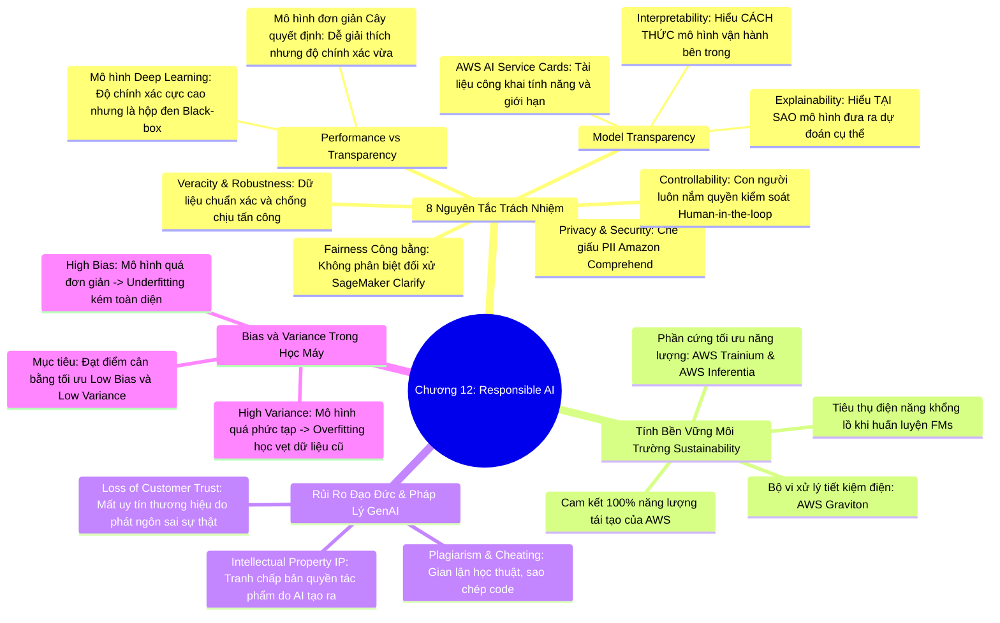

# CHƯƠNG 12: PHÁT TRIỂN AI CÓ TRÁCH NHIỆM (RESPONSIBLE AI DEVELOPMENT)
*(Section 12 - Domain 4: Guidelines for Responsible AI)*

---

## 🎯 MỤC TIÊU BÀI HỌC & TRỌNG TÂM THI (EXAM FOCUS)
- Nắm vững 8 nguyên tắc cốt lõi của **Phát triển AI có trách nhiệm (Responsible AI)**:
  1. *Tính công bằng (Fairness)*
  2. *Tính minh bạch (Model Transparency: Interpretability vs Explainability)*
  3. *Sự đánh đổi giữa Hiệu năng và Minh bạch (Performance-Transparency Trade-off)*
  4. *Quyền riêng tư & Bảo mật (Privacy & Security: PII Redaction)*
  5. *Tính chân thực & Độ bền vững (Veracity & Robustness)*
  6. *Quản trị (Governance)*
  7. *An toàn (Safety)*
  8. *Khả năng kiểm soát & Giám sát con người (Controllability & Human Oversight)*
- Hiểu các yếu tố **Bền vững môi trường (Environmental Sustainability)** trong AI: Tiêu thụ năng lượng, sử dụng chip chuyên biệt tiết kiệm điện (**AWS Trainium**, **AWS Inferentia**, **AWS Graviton**).
- Nhận diện các rủi ro pháp lý & đạo đức của GenAI: Bản quyền trí tuệ (**Intellectual Property - IP**), đạo văn, độc hại.
- Phân biệt sâu sắc bài toán **Đánh đổi Độ lệch và Phương sai (Bias-Variance Tradeoff)**:
  - **High Bias (Độ lệch cao)** ➔ **Underfitting (Chưa khớp)**: Mô hình quá đơn giản, kém trên cả tập train lẫn test.
  - **High Variance (Phương sai cao)** ➔ **Overfitting (Quá khớp)**: Mô hình học vẹt, rất tốt trên train nhưng kém trên test.

---

## 🧠 BẢN ĐỒ TƯ DUY (MINDMAP) CHƯƠNG 12

### Sơ đồ tư duy trực quan (Mermaid Diagram)


---

## 📚 KIẾN THỨC CỐT LÕI CHI TIẾT (DEEP DIVE)

### 1. Tám trụ cột của Trí tuệ Nhân tạo có Trách nhiệm (Responsible AI)

#### 1. Tính công bằng (Fairness):
- Hệ thống AI không được phép đưa ra các quyết định phân biệt đối xử hoặc thiên vị bất công đối với bất kỳ nhóm người dùng nào dựa trên các thuộc tính nhạy cảm như giới tính, chủng tộc, tôn giáo, độ tuổi.
- **Công cụ AWS:** **Amazon SageMaker Clarify** tự động phân tích dữ liệu trước khi huấn luyện (Pre-training bias) và phân tích các dự đoán của mô hình sau khi huấn luyện (Post-training bias) để phát hiện sự mất cân bằng.

#### 2. Tính minh bạch (Transparency): Phân biệt Interpretability và Explainability
Đây là cặp khái niệm rất dễ nhầm lẫn trong bài thi:
- **Tính khả diễn giải (Interpretability):**
  - Trả lời câu hỏi: **"Mô hình hoạt động như thế nào từ bên trong?" (How does it work?)**.
  - Đề cập đến mức độ mà con người có thể hiểu được cơ chế toán học nội tại của thuật toán mà không cần giải thích thêm.
  - *Ví dụ:* Cây quyết định (Decision Tree) hoặc Hồi quy tuyến tính có tính Interpretability rất cao vì nhìn vào các nhánh hoặc hệ số là hiểu ngay logic.
- **Tính khả giải thích (Explainability):**
  - Trả lời câu hỏi: **"Tại sao mô hình lại đưa ra quyết định cụ thể này?" (Why did it make this specific prediction?)**.
  - Đề cập đến khả năng diễn giải nguyên nhân sau khi mô hình phức tạp (như Deep Learning) đã ra quyết định.
  - *Ví dụ:* Mô hình từ chối cho khách hàng vay tiền, công cụ giải thích sẽ chỉ rõ: *"Quyết định này bị ảnh hưởng 60% bởi lịch sử nợ xấu và 30% bởi thu nhập thấp"* (Sử dụng giá trị SHAP values).
- **AWS AI Service Cards:** Là các tài liệu công khai do AWS phát hành cung cấp thông tin minh bạch về mục đích sử dụng dự kiến, các giới hạn kỹ thuật và các thực hành tốt nhất cho từng dịch vụ AI được quản lý (như Rekognition, Comprehend).

#### 3. Sự đánh đổi giữa Hiệu năng và Tính minh bạch (Performance-Transparency Trade-off):
- Trong thế giới Machine Learning luôn tồn tại sự đánh đổi:
  - **Mô hình có tính minh bạch cao** (Hồi quy, Cây quyết định): Dễ giải thích cho cơ quan quản lý nhà nước nhưng hiệu năng xử lý dữ liệu phức tạp kém hơn.
  - **Mô hình có hiệu năng siêu việt** (Deep Learning, Transformers): Dự đoán cực kỳ chính xác các mẫu phức tạp nhưng tính minh bạch thấp (dạng "hộp đen" - Black box).

#### 4. Quyền riêng tư và Bảo mật (Privacy & Security):
- Bảo vệ dữ liệu cá nhân nhạy cảm (Personally Identifiable Information - PII) không bị mô hình ghi nhớ hoặc để lộ ra ngoài.
- Tự động nhận diện và che giấu PII bằng **Amazon Comprehend** và **Guardrails for Amazon Bedrock**.

#### 5. Tính chân thực (Veracity) và Độ bền vững (Robustness):
- **Veracity (Tính chân thực):** Dữ liệu đưa vào mô hình phải chính xác, đáng tin cậy để tránh hiện tượng "Rác vào rác ra" (Garbage in, garbage out).
- **Robustness (Độ bền vững/chống chịu):** Hệ thống AI phải có khả năng chống chịu tốt trước các dữ liệu đầu vào bất thường, nhiễu loạn hoặc các cuộc tấn công cố ý của tin tặc (Adversarial attacks, Prompt injection).

#### 6. Khả năng kiểm soát (Controllability) & Giám sát con người (Human Oversight):
- Con người phải luôn giữ quyền kiểm soát cao nhất (**Human-in-the-loop**). Các quyết định quan trọng (sinh tử, tự do, tài chính lớn) không được tự động hóa hoàn toàn mà phải có sự phê duyệt của chuyên gia con người (**Amazon Augmented AI - A2I**).

---

### 2. Tiêu chuẩn Bền vững Môi trường (Environmental Sustainability in AI)

Huấn luyện và vận hành các mô hình Foundation Models quy mô lớn tiêu thụ một lượng điện năng và tài nguyên làm mát khổng lồ:
1. **Lựa chọn phần cứng chuyên dụng tiết kiệm năng lượng:**
   - **AWS Trainium:** Chip silicon chuyên dụng do AWS tự thiết kế tối ưu riêng cho việc huấn luyện mô hình học sâu, giảm tới **50% chi phí năng lượng** so với các GPU thông thường tương đương.
   - **AWS Inferentia:** Chip chuyên dụng cho tác vụ suy luận (Inference), mang lại hiệu suất năng lượng trên mỗi watt điện cao nhất.
   - **AWS Graviton:** Bộ vi xử lý dựa trên kiến trúc ARM mang lại hiệu năng cao với mức tiêu thụ điện năng thấp hơn 60% cho các tác vụ tiền xử lý dữ liệu.
2. **Cam kết năng lượng xanh của AWS:**
   - AWS đã hoàn thành mục tiêu vận hành 100% bằng nguồn năng lượng tái tạo (Điện gió, điện mặt trời).
   - Di chuyển khối lượng công việc AI từ các trung tâm dữ liệu tại chỗ (On-premises) lên AWS Cloud giúp giảm tới gần 80% lượng phát thải carbon nhờ tính quy mô và hiệu quả năng lượng cao của hạ tầng đám mây.

---

### 3. Cân bằng Độ lệch (Bias) và Phương sai (Variance) trong Học máy

Hiểu bản chất của hiện tượng **Underfitting** và **Overfitting**:

```
┌────────────────────────────────────────────────────────────────────────┐
│                   BIAS - VARIANCE TRADEOFF                             │
├──────────────────────────┬─────────────────────────────────────────────┤
│ HIGH BIAS (Độ lệch cao)  │ • Mô hình đưa ra các giả định quá ngây thơ. │
│ = UNDERFITTING           │ • Bỏ lỡ các quy luật phức tạp trong data.   │
│                          │ • Dự đoán KÉM trên cả tập Train lẫn Test.   │
├──────────────────────────┼─────────────────────────────────────────────┤
│ HIGH VARIANCE            │ • Mô hình quá phức tạp, ghi nhớ cả tiếng ồn │
│ = OVERFITTING            │   (noise) của tập huấn luyện.               │
│                          │ • Dự đoán RẤT TỐT trên tập Train nhưng      │
│                          │   DỰ ĐOÁN TỆ HẠI trên tập Test/Unseen data. │
├──────────────────────────┼─────────────────────────────────────────────┤
│ MỤC TIÊU LÝ TƯỞNG        │ • LOW BIAS + LOW VARIANCE                   │
│ = OPTIMAL FIT            │ • Mô hình tổng quát hóa tốt trên dữ liệu mới│
└──────────────────────────┴─────────────────────────────────────────────┘
```

#### Phương pháp khắc phục:
- **Khắc phục Underfitting (High Bias):**
  - Tăng độ phức tạp của mô hình (thêm tầng nơ-ron, chọn thuật toán phi tuyến tính mạnh hơn).
  - Bổ sung thêm nhiều đặc trưng có ý nghĩa (Feature Engineering).
  - Tăng thời gian huấn luyện (tăng số lượng Epochs).
- **Khắc phục Overfitting (High Variance):**
  - Thu thập thêm nhiều dữ liệu huấn luyện mới.
  - Giảm bớt số lượng tham số hoặc độ sâu của mô hình.
  - Sử dụng các kỹ thuật điều chuẩn (**Regularization**, Dropout, Early Stopping).
  - Đơn giản hóa các đặc trưng thông qua chọn lọc đặc trưng.

---

## ⚠️ MẸO THI & BẪY CẦN TRÁNH (EXAM TIPS & TRAPS)

> [!TIP]
> **Từ khóa ăn điểm ngay trong bài thi:**
> - *"Understand HOW a model works internally"* ➔ **Interpretability**.
> - *"Understand WHY a model made a specific prediction"* ➔ **Explainability**.
> - *"Transparency documentation for AWS AI managed services"* ➔ **AWS AI Service Cards**.
> - *"Detect pre-training and post-training bias in ML models"* ➔ **Amazon SageMaker Clarify**.
> - *"Energy-efficient custom AWS chips for deep learning training"* ➔ **AWS Trainium**.
> - *"Energy-efficient custom AWS chips for inference"* ➔ **AWS Inferentia**.
> - *"Model performs extremely well on training data but poorly on test data"* ➔ **High Variance / Overfitting**.
> - *"Model performs poorly on both training and test data"* ➔ **High Bias / Underfitting**.

---

## 📝 BỘ CÂU HỎI ÔN TẬP MÔ PHỎNG (PRACTICE QUESTIONS)

#### Câu 1:
Một tổ chức tài chính đang phát triển một mô hình học máy để duyệt hồ sơ vay tiền. Theo yêu cầu của cơ quan quản lý ngân hàng, tổ chức này phải có khả năng giải thích rõ ràng cho khách hàng lý do chính xác tại sao đơn đăng ký của họ bị từ chối và những yếu tố nào đóng góp nhiều nhất vào quyết định đó. Yêu cầu này đề cập đến khái niệm nào trong Responsible AI và dịch vụ AWS nào có thể hỗ trợ?
- A. Interpretability, được hỗ trợ bởi Amazon CloudWatch
- B. Explainability, được hỗ trợ bởi Amazon SageMaker Clarify
- C. High Variance, được hỗ trợ bởi Amazon QuickSight
- D. Robustness, được hỗ trợ bởi AWS WAF
> **Đáp án đúng: B**  
> *Giải thích:* Giải thích lý do tại sao một quyết định cụ thể được đưa ra (Why a specific prediction was made) chính là **Explainability**, và **Amazon SageMaker Clarify** cung cấp tính năng phân tích tầm quan trọng của thuộc tính (feature attribution) để phục vụ giải trình.

#### Câu 2:
Sau khi huấn luyện một mô hình mạng nơ-ron phân loại ảnh, nhóm kỹ sư nhận thấy mô hình đạt độ chính xác lên tới 99.5% trên tập dữ liệu huấn luyện (Training Set). Tuy nhiên, khi đưa vào kiểm thử trên tập dữ liệu thực tế mới (Test Set), độ chính xác sụt giảm nghiêm trọng xuống chỉ còn 62%. Mô hình này đang gặp phải vấn đề gì?
- A. High Bias và đang bị Underfitting
- B. High Variance và đang bị Overfitting
- C. Lỗi tấn công Prompt Injection
- D. Mô hình đạt trạng thái cân bằng hoàn hảo
> **Đáp án đúng: B**  
> *Giải thích:* Hiện tượng mô hình hoạt động cực kỳ hoàn hảo trên tập dữ liệu huấn luyện nhưng lại thể hiện rất kém trên dữ liệu mới chưa từng thấy được gọi là **Overfitting** (Quá khớp), xuất phát từ **High Variance** (Phương sai cao).

#### Câu 3:
Để tối ưu hóa chi phí năng lượng và giảm thiểu lượng phát thải carbon khi triển khai các tác vụ suy luận (inference) của các mô hình học sâu quy mô lớn trên đám mây AWS, tổ chức nên ưu tiên sử dụng dòng vi xử lý chuyên biệt nào sau đây?
- A. AWS Trainium
- B. AWS Inferentia
- C. Ổ cứng Amazon EBS gp3
- D. Amazon Kendra Connector
> **Đáp án đúng: B**  
> *Giải thích:* **AWS Inferentia** là chip chuyên dụng do AWS thiết kế đặc thù để cung cấp hiệu năng suy luận (Inference) cao nhất với mức tiêu thụ điện năng và chi phí thấp nhất trên mỗi tác vụ. (AWS Trainium chuyên dùng cho Training).
