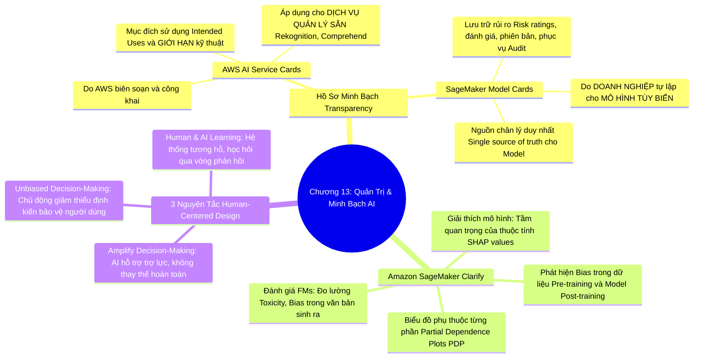

# CHƯƠNG 13: QUẢN TRỊ AI - AWS AI SERVICE CARDS, SAGEMAKER MODEL CARDS, CLARIFY VÀ THIẾT KẾ LẤY CON NGƯỜI LÀM TRUNG TÂM
*(Section 13 - Domain 4: Guidelines for Responsible AI)*

---

## 🎯 MỤC TIÊU BÀI HỌC & TRỌNG TÂM THI (EXAM FOCUS)
- Phân biệt sự khác nhau mang tính bản chất giữa **AWS AI Service Cards** (do AWS cung cấp cho các dịch vụ đóng gói sẵn) và **Amazon SageMaker Model Cards** (do doanh nghiệp tự tạo cho các mô hình tùy biến của mình).
- Nắm vững 3 chức năng cốt lõi của **Amazon SageMaker Clarify**:
  1. *Phát hiện thiên kiến (Bias Detection: Trước và sau huấn luyện)*
  2. *Giải thích mô hình (Model Explainability: Giá trị SHAP & Tầm quan trọng của thuộc tính)*
  3. *Đánh giá mô hình nền tảng (Foundation Model Evaluation: Độ độc hại, định kiến giới tính, tính xác thực)*
- Hiểu rõ **3 Nguyên tắc Thiết kế lấy con người làm trung tâm (Human-Centered Design Principles)** trong Responsible AI:
  1. *Thiết kế nhằm khuếch đại năng lực ra quyết định của con người (Amplified Decision-Making)*
  2. *Thiết kế nhằm loại bỏ thiên vị (Unbiased Decision-Making)*
  3. *Thiết kế nhằm thúc đẩy sự học hỏi song phương giữa người và máy (Human and AI Learning)*

---

## 🧠 BẢN ĐỒ TƯ DUY (MINDMAP) CHƯƠNG 13

### Sơ đồ tư duy trực quan (Mermaid Diagram)


---

## 📚 KIẾN THỨC CỐT LÕI CHI TIẾT (DEEP DIVE)

### 1. Phân biệt đối đầu: AWS AI Service Cards vs SageMaker Model Cards

Đây là một câu hỏi phân loại quen thuộc trong Domain 4 của kỳ thi AIF-C01:

| Tiêu chí so sánh | AWS AI Service Cards | Amazon SageMaker Model Cards |
| :--- | :--- | :--- |
| **Bản chất** | Tài liệu minh bạch công khai do **AWS** phát hành và duy trì. | Hồ sơ tài liệu quản trị nội bộ do **Chính người dùng/Doanh nghiệp** khởi tạo. |
| **Đối tượng áp dụng** | Áp dụng cho các **Dịch vụ AI được quản lý sẵn của AWS** (như Amazon Rekognition, Amazon Transcribe, Amazon Textract). | Áp dụng cho từng **Mô hình học máy tùy biến (Custom Models)** được huấn luyện bên trong Amazon SageMaker. |
| **Nội dung bao gồm** | • Trường hợp sử dụng dự kiến (Intended use cases).<br>• Các giới hạn và ranh giới không nên dùng.<br>• Hướng dẫn triển khai có trách nhiệm và bảo vệ đạo đức. | • Nguồn gốc dữ liệu huấn luyện và phiên bản code.<br>• Đánh giá mức độ rủi ro nghiệp vụ (Risk ratings).<br>• Các chỉ số hiệu năng (Accuracy, F1, Loss).<br>• Lịch sử phê duyệt triển khai (Audit logs). |
| **Mục đích chính** | Giúp khách hàng hiểu rõ năng lực và giới hạn của dịch vụ AWS để sử dụng đúng luật. | Đóng vai trò là **"Nguồn chân lý duy nhất" (Single source of truth)** phục vụ thanh tra, kiểm toán (Auditing) và giao tiếp giữa các bên liên quan (Stakeholders). |

---

### 2. Amazon SageMaker Clarify - Công cụ Quản trị và Minh bạch toàn diện

Amazon SageMaker Clarify cung cấp một bộ công cụ mạnh mẽ tích hợp sâu trong SageMaker Studio giúp trả lời các câu hỏi hóc búa về tính công bằng và giải trình của mô hình:

```
                                  AMAZON SAGEMAKER CLARIFY
                                             │
         ┌───────────────────────────────────┼───────────────────────────────────┐
         ▼                                   ▼                                   ▼
 [1. BIAS DETECTION]               [2. MODEL EXPLAINABILITY]            [3. FM EVALUATION]
 • Đo độ lệch dữ liệu thô          • Phân tích SHAP Values              • Đo độ độc hại (Toxicity)
 • Đo độ lệch dự đoán mô hình      • Partial Dependence Plots (PDP)     • Đo định kiến giới tính/sắc tộc
 • Đánh giá công bằng đa nhóm      • Giải thích từng dự đoán đơn lẻ     • Đánh giá tính chân thực (Factual)
```

#### A. Phát hiện thiên kiến (Bias Detection):
- **Pre-training Bias:** Quét tập dữ liệu trước khi huấn luyện để phát hiện xem một nhóm nhân khẩu học nào đó có bị đại diện quá ít hoặc mang các nhãn tiêu cực bất thường hay không.
- **Post-training Bias:** Kiểm tra kết quả dự đoán của mô hình trên tập kiểm thử để xem tỷ lệ phê duyệt hoặc sai số có bị lệch nghiêm trọng giữa các nhóm hay không (ví dụ: tỷ lệ duyệt vay của nam giới so với nữ giới).

#### B. Khả năng giải thích mô hình (Model Explainability):
- **SHAP (Shapley Additive exPlanations):** Clarify sử dụng lý thuyết trò chơi toán học SHAP để gán một con số chính xác đại diện cho mức độ đóng góp (Feature Importance) của từng trường dữ liệu vào kết quả dự đoán.
  - *Ví dụ:* Trong dự đoán khả năng gian lận thẻ tín dụng: Thuộc tính "Địa điểm giao dịch bất thường" đóng góp +45%, "Số tiền giao dịch lớn" đóng góp +30%, "Thời gian giao dịch lúc nửa đêm" đóng góp +15%.
- **Partial Dependence Plots (PDP):** Vẽ biểu đồ trực quan hóa mối quan hệ phi tuyến tính giữa sự thay đổi của một thuộc tính đơn lẻ và đầu ra dự đoán của mô hình.

#### C. Đánh giá chuyên biệt cho Mô hình Nền tảng (FM Evaluation in Clarify):
- Clarify mở rộng tính năng hỗ trợ trực tiếp các Foundation Models và LLMs:
  - Tự động kiểm tra tỷ lệ sinh ra ngôn từ độc hại (**Toxicity**).
  - Kiểm tra mức độ thiên kiến trong câu trả lời văn bản (Stereotyping / Bias).
  - Kiểm tra tính xác thực (Factual Accuracy) để đo lường nguy cơ ảo giác.

---

### 3. Ba nguyên tắc Thiết kế lấy con người làm trung tâm (Human-Centered Design)

Thiết kế lấy con người làm trung tâm đảm bảo hệ thống AI phục vụ và tôn trọng lợi ích cao nhất của con người:

1. **Thiết kế nhằm khuếch đại năng lực ra quyết định (Design for Amplified Decision-Making):**
   - AI không bao giờ được thiết kế để tước đoạt hoàn toàn quyền tự quyết và trách nhiệm của con người trong các lĩnh vực sinh tử hoặc nhạy cảm.
   - AI đóng vai trò như một "trợ lý đắc lực" (Co-pilot), cung cấp thông tin tổng hợp, phân tích xác suất và gợi ý giải pháp nhằm giúp bác sĩ chẩn đoán nhanh hơn, giúp luật sư tra cứu án lệ chuẩn hơn, nhưng quyền ký duyệt cuối cùng luôn thuộc về con người.
2. **Thiết kế nhằm đưa ra quyết định không định kiến (Design for Unbiased Decision-Making):**
   - Chủ động tích hợp các cơ chế kiểm tra và giảm thiểu định kiến vào quy trình vận hành thực tế.
   - Thường xuyên rà soát lại các quy tắc ra quyết định tự động để bảo đảm các nhóm thiểu số hoặc yếu thế không bị thiệt thòi.
3. **Thiết kế nhằm thúc đẩy sự học hỏi song phương (Design for Human and AI Learning):**
   - Tạo ra một hệ thống có vòng phản hồi hai chiều (**Bidirectional feedback loop**):
     - Con người học hỏi từ những phân tích dữ liệu sâu sắc và các góc nhìn mới mà AI gợi mở.
     - Đồng thời, AI học hỏi và tự hoàn thiện liên tục thông qua các sửa đổi, góp ý và đánh giá đúng/sai từ chuyên gia con người (như cơ chế RLHF hoặc gắn nhãn chỉnh sửa).

---

## ⚠️ MẸO THI & BẪY CẦN TRÁNH (EXAM TIPS & TRAPS)

> [!TIP]
> **Nhớ nhanh từ khóa:**
> - *"Official documentation from AWS explaining limitations and intended uses of AWS AI services"* ➔ **AWS AI Service Cards**.
> - *"Single source of truth documenting custom models in SageMaker for governance and auditability"* ➔ **Amazon SageMaker Model Cards**.
> - *"Calculate SHAP values to explain individual predictions"* ➔ **Amazon SageMaker Clarify**.
> - *"AI augments human judgment rather than replacing accountability"* ➔ **Amplified Decision-Making (Human-Centered Design)**.

> [!WARNING]
> **Cạm bẫy thi:**
> - Nếu câu hỏi hỏi về tài liệu quản trị dành cho dịch vụ **Amazon Rekognition** ➔ Phải chọn **AWS AI Service Cards** (vì Rekognition là dịch vụ có sẵn của AWS).
> - Nếu câu hỏi hỏi về việc nhóm phát triển muốn lập tài liệu lưu lại các thông số đánh giá cho **mô hình dự đoán churn do công ty tự huấn luyện** ➔ Phải chọn **SageMaker Model Cards**.

---

## 📝 BỘ CÂU HỎI ÔN TẬP MÔ PHỎNG (PRACTICE QUESTIONS)

#### Câu 1:
Một công ty viễn thông đã tự huấn luyện một mô hình Machine Learning tùy biến trên Amazon SageMaker để đánh giá điểm tín dụng khách hàng. Đội ngũ kiểm toán và tuân thủ nội bộ yêu cầu phải có một kho lưu trữ tập trung đóng vai trò là "nguồn chân lý duy nhất" ghi lại mục đích thiết kế mô hình, các giả định, đánh giá rủi ro và các chỉ số hiệu năng qua từng phiên bản. Tính năng nào của SageMaker đáp ứng trực tiếp yêu cầu này?
- A. AWS AI Service Cards
- B. Amazon SageMaker Model Cards
- C. Amazon SageMaker Feature Store
- D. Amazon CloudWatch Logs
> **Đáp án đúng: B**  
> *Giải thích:* Amazon SageMaker Model Cards được thiết kế để làm nguồn chân lý duy nhất (single source of truth) ghi lại toàn bộ tài liệu quản trị, chỉ số kỹ thuật và đánh giá rủi ro cho các mô hình tùy biến trong SageMaker phục vụ kiểm toán. AWS AI Service Cards là tài liệu của AWS dành cho các dịch vụ đóng gói sẵn.

#### Câu 2:
Một công ty bảo hiểm muốn hiểu rõ hơn lý do tại sao một mô hình học máy phân loại hồ sơ bồi thường lại gắn cờ một yêu cầu chi trả cụ thể là có dấu hiệu trục lợi. Họ muốn biết mức độ đóng góp (feature attribution) của từng thông tin như số tiền yêu cầu, thời gian tham gia bảo hiểm vào dự đoán đó. Công cụ nào sau đây cung cấp tính năng này?
- A. Amazon SageMaker Clarify sử dụng giá trị SHAP
- B. Amazon SageMaker Data Wrangler
- C. Amazon Rekognition Custom Labels
- D. AWS Trusted Advisor
> **Đáp án đúng: A**  
> *Giải thích:* Amazon SageMaker Clarify cung cấp tính năng giải thích mô hình (Model Explainability) bằng cách tính toán các giá trị SHAP để chỉ rõ mức độ đóng góp của từng đặc trưng vào một dự đoán cụ thể.

#### Câu 3:
Khi áp dụng các nguyên tắc Thiết kế lấy con người làm trung tâm (Human-Centered Design) cho một hệ thống AI hỗ trợ chẩn đoán hình ảnh y tế, cách tiếp cận nào sau đây là phù hợp nhất?
- A. Cho phép hệ thống AI tự động đưa ra kết luận bệnh án và gửi đơn thuốc trực tiếp cho bệnh nhân mà không cần bác sĩ xem qua.
- B. Thiết kế hệ thống AI hoạt động như một công cụ hỗ trợ khuếch đại năng lực ra quyết định (Amplified Decision-Making), cung cấp các vùng nghi ngờ tổn thương cho bác sĩ thẩm định và bác sĩ là người chịu trách nhiệm ra quyết định cuối cùng.
- C. Ẩn toàn bộ cơ chế giải thích của mô hình để bác sĩ không bị phân tâm bởi các thông số kỹ thuật.
- D. Tắt tính năng thu thập phản hồi của bác sĩ để đảm bảo mô hình giữ nguyên tính nhất quán ban đầu.
> **Đáp án đúng: B**  
> *Giải thích:* Nguyên tắc cốt lõi của Human-Centered Design là "Design for Amplified Decision-Making" - AI hỗ trợ và tăng cường năng lực nhận định của chuyên gia con người chứ không thay thế hoàn toàn vai trò và trách nhiệm của con người trong các quyết định quan trọng.
