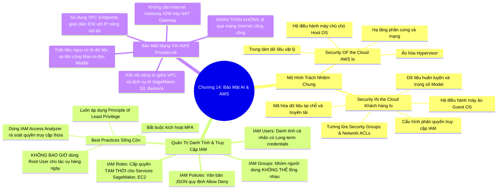

# CHƯƠNG 14: CÁC THỰC HÀNH BẢO MẬT CỐT LÕI TRÊN AWS - SHARED RESPONSIBILITY, IAM VÀ PRIVATELINK
*(Section 14 - Domain 5: Security, Compliance, and Governance for AI Solutions)*

---

## 🎯 MỤC TIÊU BÀI HỌC & TRỌNG TÂM THI (EXAM FOCUS)
- Nắm vững **Mô hình Trách nhiệm Chung của AWS (AWS Shared Responsibility Model)** áp dụng riêng cho các khối lượng công việc AI/ML:
  - Phân định rõ: **Security OF the Cloud (AWS chịu trách nhiệm)** vs **Security IN the Cloud (Khách hàng chịu trách nhiệm)**.
- Hiểu các mối đe dọa an ninh mạng đối với LLM theo bảng xếp hạng **OWASP Top 10 for LLMs**.
- Nắm vững kiến trúc và các thực hành tốt nhất về **AWS Identity and Access Management (IAM)**:
  - Phân biệt: *IAM Users, IAM Groups (không được lồng nhau), IAM Policies (cú pháp JSON), IAM Roles (ủy quyền tạm thời)*.
  - Các quy tắc vàng: **Nguyên tắc đặc quyền tối thiểu (Least Privilege)**, **Bật MFA**, **Tuyệt đối không dùng Root User**.
- Bảo mật mạng lưới AI với **AWS PrivateLink** và **VPC Endpoints**: Cho phép giao tiếp nội bộ giữa VPC và dịch vụ AI (SageMaker, S3, Bedrock) mà **không đi qua mạng Internet công cộng**.

---

## 🧠 BẢN ĐỒ TƯ DUY (MINDMAP) CHƯƠNG 14

### Sơ đồ tư duy trực quan (Mermaid Diagram)


---

## 📚 KIẾN THỨC CỐT LÕI CHI TIẾT (DEEP DIVE)

### 1. Mô hình Trách nhiệm Chung của AWS (AWS Shared Responsibility Model)

Bảo mật trên đám mây là một sự hợp tác phân chia trách nhiệm rõ ràng:

```
┌────────────────────────────────────────────────────────────────────────┐
│ KHÁCH HÀNG CHỊU TRÁCH NHIỆM BẢO MẬT "BÊN TRONG ĐÁM MÂY" (IN THE CLOUD) │
│ • Dữ liệu của khách hàng (Dataset, Model weights, Prompts, Logs)       │
│ • Cấu hình phân quyền truy cập (IAM Policies, Roles)                   │
│ • Cấu hình tường lửa mạng (Security Groups, VPC Network ACLs)          │
│ • Hệ điều hành máy khách (Guest OS trên EC2/SageMaker instances)       │
│ • Mã hóa dữ liệu (Client-side & Server-side KMS)                       │
├────────────────────────────────────────────────────────────────────────┤
│ AWS CHỊU TRÁCH NHIỆM BẢO MẬT "TOÀN BỘ ĐÁM MÂY" (OF THE CLOUD)          │
│ • Bảo vệ vật lý các Data Centers (Camera, Bảo vệ, Chữa cháy)           │
│ • Phần cứng máy chủ, ổ đĩa lưu trữ, hệ thống mạng toàn cầu             │
│ • Hệ điều hành máy chủ chủ (Host OS) và lớp phần mềm ảo hóa Hypervisor │
│ • Quản lý hạ tầng của các Managed Services (Bedrock, Rekognition)       │
└────────────────────────────────────────────────────────────────────────┘
```

#### Phân biệt mức độ trách nhiệm theo loại dịch vụ AI:
- **Dịch vụ hạ tầng IaaS (như Amazon EC2 chạy huấn luyện ML):** Khách hàng chịu trách nhiệm từ cấu hình hệ điều hành Linux/Windows, cập nhật bản vá bảo mật (OS patching), thư viện Python/PyTorch, cho tới cấu hình mạng và dữ liệu.
- **Dịch vụ nền tảng PaaS (như Amazon SageMaker Studio, Training Jobs):** AWS tự động cập nhật và bảo trì hệ điều hành máy chủ và container; khách hàng chịu trách nhiệm viết code script huấn luyện, kiểm soát dữ liệu trong S3 và cấu hình IAM Roles.
- **Dịch vụ phần mềm Serverless / SaaS (như Amazon Bedrock, Rekognition):** AWS chịu trách nhiệm toàn bộ hạ tầng, mô hình nền tảng, tính sẵn sàng cao; khách hàng chỉ chịu trách nhiệm bảo mật khóa API, dữ liệu prompt gửi lên và cấu hình Bedrock Guardrails.

---

### 2. Quản trị Danh tính và Truy cập (AWS IAM) cho khối lượng công việc AI

IAM là trung tâm bảo mật điều khiển quyền truy cập của mọi người dùng và dịch vụ trong AWS:

1. **Các thực thể IAM cốt lõi:**
   - **IAM Users (Người dùng):** Đại diện cho một con người hoặc một ứng dụng cụ thể. Đi kèm với thông tin xác thực dài hạn (Mật khẩu console hoặc Access Key/Secret Access Key).
   - **IAM Groups (Nhóm người dùng):** Tập hợp nhiều IAM User để phân quyền hàng loạt (ví dụ: nhóm `DataScientists`, nhóm `MLOpsEngineers`). ⚠️ **LƯU Ý THI:** Các nhóm IAM **KHÔNG THỂ lồng nhau** (Groups cannot be nested - không thể chứa một nhóm khác bên trong).
   - **IAM Policies (Chính sách):** Tài liệu văn bản định dạng JSON quy định cụ thể hành động nào được phép (`Allow`) hoặc bị cấm (`Deny`) trên tài nguyên nào (`Resource`). **Quy tắc vàng:** Một lệnh cấm tường minh (**Explicit Deny**) luôn ghi đè và vô hiệu hóa mọi lệnh cho phép (**Allow**).
   - **IAM Roles (Vai trò):** Cung cấp quyền hạn **tạm thời** (**Temporary credentials**) không cần mật khẩu cố định. Được sử dụng để cấp quyền cho chính các dịch vụ AWS thực hiện tác vụ thay bạn *(ví dụ: cấp quyền cho Amazon SageMaker Training Job đọc dữ liệu từ một bucket Amazon S3 cụ thể)*.

2. **Các nguyên tắc bảo mật IAM bắt buộc phải tuân thủ (Best Practices):**
   - **Principle of Least Privilege (Nguyên tắc đặc quyền tối thiểu):** Chỉ cấp đúng các quyền hạn tối thiểu cần thiết để người dùng/dịch vụ hoàn thành công việc của họ trong khoảng thời gian cần thiết, không cấp thừa quyền `AdministratorAccess`.
   - **Multi-Factor Authentication (MFA):** Bắt buộc kích hoạt xác thực đa yếu tố cho mọi tài khoản người dùng, đặc biệt là người dùng có quyền quản trị.
   - **Tuyệt đối KHÔNG sử dụng tài khoản Root (Root User) cho các công việc hàng ngày:** Tài khoản Root chỉ dùng để thiết lập ban đầu và phải được khóa lại trong két an toàn sau khi kích hoạt MFA. Tạo từng IAM User riêng biệt cho từng kỹ sư.
   - **IAM Access Analyzer:** Sử dụng công cụ này để tự động quét và phân tích các chính sách, phát hiện các tài nguyên (như S3 buckets hoặc KMS keys) đang bị chia sẻ công khai hoặc chia sẻ ngoài ý muốn ra bên ngoài tổ chức.

---

### 3. An toàn Mạng cho AI Workloads: Amazon VPC và AWS PrivateLink

Khi huấn luyện các mô hình Machine Learning lớn hoặc xử lý hồ sơ y tế/tài chính nhạy cảm, dữ liệu không bao giờ được phép đi qua mạng Internet công cộng:

```
[VPC CỦA DOANH NGHIỆP]
  │
  ├─ [Subnet Riêng (Private Subnet)]
  │     └─ Amazon SageMaker Notebook / Training Cluster (Không có Public IP)
  │            │
  │            ▼ (Giao tiếp hoàn toàn nội bộ qua mạng backbone AWS)
  ├─ [VPC Interface Endpoint (AWS PrivateLink)] (Có địa chỉ IP Private trong Subnet)
  │            │
  └────────────┼─────────────────────────────────────────────────────────────┐
               ▼ (Băng thông riêng tốc độ cao, mã hóa, KHÔNG qua Internet)   │
      [DỊCH VỤ AWS NỘI BỘ]                                                   │
      • Amazon S3 (Lưu trữ Dataset huấn luyện)                               │
      • Amazon Bedrock (Gọi Foundation Model API)                            │
      • Amazon SageMaker API                                                 │
```

#### A. AWS PrivateLink là gì?
- Là công nghệ mạng của AWS cho phép kết nối riêng tư (Private connectivity) giữa mạng **Amazon VPC** của bạn với các dịch vụ AWS được hỗ trợ (như SageMaker, S3, Bedrock) hoặc các dịch vụ do đối tác lưu trữ mà **hoàn toàn không cần dữ liệu phải đi qua mạng Internet công cộng**.

#### B. Cơ chế hoạt động của VPC Interface Endpoint:
- PrivateLink tạo ra các **VPC Endpoints (Interface Endpoints)**. Đây thực chất là các card mạng ảo (**Elastic Network Interfaces - ENI**) được cấp phát một địa chỉ IP nội bộ riêng (**Private IP**) nằm ngay trong chính dải mạng con (Private Subnet) của bạn.
- Mọi lưu lượng dữ liệu trao đổi giữa cụm huấn luyện SageMaker và Amazon S3 hay Bedrock chỉ di chuyển trong mạng đường trục ngầm bảo mật của AWS.

#### C. Lợi ích tối thượng:
- **Triệt tiêu nguy cơ an ninh mạng:** Loại bỏ hoàn toàn nguy cơ bị nghe lén (Eavesdropping), tấn công Man-in-the-Middle hoặc quét cổng từ Internet.
- **Đơn giản hóa kiến trúc:** Không cần cài đặt và bảo trì Internet Gateway (IGW), NAT Gateway hay thiết lập các bảng định tuyến (Route tables) phức tạp.
- **Đáp ứng các tiêu chuẩn tuân thủ nghiêm ngặt:** Các quy chuẩn như HIPAA, PCI-DSS, FedRAMP yêu cầu dữ liệu nhạy cảm không được chạm vào Internet.

---

## ⚠️ MẸO THI & BẪY CẦN TRÁNH (EXAM TIPS & TRAPS)

> [!TIP]
> **Nhớ nhanh từ khóa:**
> - *"AWS manages physical data center security"* ➔ **Security OF the Cloud**.
> - *"Customer manages IAM, guest OS, encryption, customer data"* ➔ **Security IN the Cloud**.
> - *"Grant temporary permissions to SageMaker to read S3"* ➔ **IAM Role**.
> - *"IAM Groups"* ➔ **Cannot be nested within other groups**.
> - *"Grant only minimum necessary permissions"* ➔ **Principle of Least Privilege**.
> - *"Connect SageMaker to S3/Bedrock privately without traversing the public internet"* ➔ **AWS PrivateLink / VPC Endpoints**.

> [!WARNING]
> **Cạm bẫy bài thi:**
> - Khách hàng không bao giờ được phép dùng Access Keys của tài khoản Root để chạy ứng dụng. Luôn phải dùng IAM Role gắn vào máy chủ EC2 hoặc SageMaker instance.
> - PrivateLink không cần Internet Gateway! Bất kỳ đáp án nào đề cập đến *"Cấu hình NAT Gateway hoặc Internet Gateway để kết nối PrivateLink"* đều là **ĐÁP ÁN SAI**.

---

## 📝 BỘ CÂU HỎI ÔN TẬP MÔ PHỎNG (PRACTICE QUESTIONS)

#### Câu 1:
Theo Mô hình Trách nhiệm Chung của AWS (AWS Shared Responsibility Model), trách nhiệm nào sau đây thuộc về phía KHÁCH HÀNG khi xây dựng một mô hình Machine Learning tùy biến trên dịch vụ Amazon SageMaker?
- A. Bảo vệ an ninh vật lý cho các tòa nhà trung tâm dữ liệu chứa máy chủ huấn luyện.
- B. Cập nhật các bản vá lỗi bảo mật cho lớp phần mềm ảo hóa Hypervisor của AWS.
- C. Cấu hình các chính sách IAM và kiểm soát quyền truy cập của người dùng vào tập dữ liệu huấn luyện lưu trong Amazon S3.
- D. Xử lý tiêu hủy an toàn các ổ đĩa cứng bị hỏng vật lý trong trung tâm dữ liệu.
> **Đáp án đúng: C**  
> *Giải thích:* Quản lý phân quyền truy cập người dùng (IAM), cấu hình mã hóa và bảo vệ dữ liệu khách hàng thuộc trách nhiệm "Security IN the Cloud" của khách hàng. Tất cả các phương án còn lại (an ninh vật lý, hypervisor, phần cứng) thuộc trách nhiệm "Security OF the Cloud" của AWS.

#### Câu 2:
Một cụm máy chủ huấn luyện SageMaker đặt trong một Private Subnet của VPC cần tải một tập dữ liệu lớn từ Amazon S3. Yêu cầu của công ty là toàn bộ lưu lượng dữ liệu không được phép đi qua mạng Internet công cộng và không muốn phát sinh chi phí duy trì NAT Gateway. Giải pháp nào sau đây đáp ứng chính xác nhất?
- A. Gắn Internet Gateway vào VPC và cấp Public IP cho cụm máy chủ.
- B. Cấu hình một VPC Endpoint (thông qua AWS PrivateLink) để kết nối trực tiếp từ VPC tới Amazon S3.
- C. Mở cổng 0.0.0.0/0 trong Security Group của cụm SageMaker.
- D. Sử dụng tài khoản Root User để ủy quyền kết nối từ xa.
> **Đáp án đúng: B**  
> *Giải thích:* VPC Endpoints (AWS PrivateLink) cho phép các tài nguyên trong VPC kết nối riêng tư với các dịch vụ AWS như S3 mà không cần Internet Gateway hay NAT Gateway, đảm bảo dữ liệu không bao giờ rời khỏi mạng nội bộ của AWS.

#### Câu 3:
Thực hành bảo mật nào sau đây là KHÔNG ĐÚNG khi thiết lập quyền hạn người dùng trên AWS IAM cho một nhóm kỹ sư khoa học dữ liệu mới gia nhập công ty?
- A. Cấp quyền truy cập bằng cách gán IAM User vào một IAM Group thích hợp.
- B. Bắt buộc kích hoạt xác thực đa yếu tố (MFA) cho mọi tài khoản người dùng.
- C. Cung cấp thông tin đăng nhập của tài khoản AWS Root User cho trưởng nhóm để thuận tiện phân chia quyền hạn cho các thành viên.
- D. Áp dụng nguyên tắc đặc quyền tối thiểu (Principle of Least Privilege) khi gán Policy.
> **Đáp án đúng: C**  
> *Giải thích:* Chia sẻ thông tin đăng nhập của tài khoản Root User là một vi phạm nghiêm trọng các thực hành bảo mật của AWS. Tài khoản Root tuyệt đối không được sử dụng cho công việc hàng ngày và phải được bảo vệ nghiêm ngặt.
