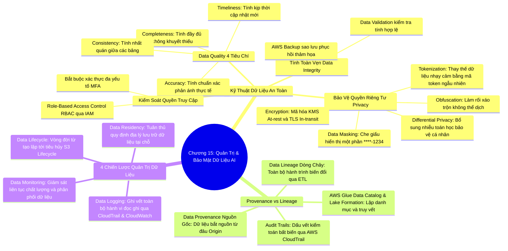

# CHƯƠNG 15: BẢO MẬT DỮ LIỆU VÀ QUẢN TRỊ DỮ LIỆU CHO HỆ THỐNG AI (DATA GOVERNANCE & LINEAGE)
*(Section 15 - Domain 5: Security, Compliance, and Governance for AI Solutions)*

---

## 🎯 MỤC TIÊU BÀI HỌC & TRỌNG TÂM THI (EXAM FOCUS)
- Nắm vững 4 trụ cột của **Kỹ thuật dữ liệu an toàn (Secure Data Engineering)**: *Chất lượng dữ liệu (Quality), Quyền riêng tư (Privacy), Kiểm soát truy cập (Access Control), và Tính toàn vẹn (Integrity)*.
- Phân biệt các kỹ thuật bảo vệ quyền riêng tư dữ liệu: **Data Masking, Obfuscation, Differential Privacy, Encryption, và Tokenization**.
- Phân biệt rành mạch giữa **Nguồn gốc dữ liệu (Data Provenance)** và **Hành trình dữ liệu (Data Lineage)**.
- Hiểu vai trò của **AWS Glue Data Catalog** và **AWS Lake Formation** trong việc theo dõi dòng chảy dữ liệu (Lineage tracking).
- Nắm vững 4 chiến lược **Quản trị dữ liệu (Data Governance Strategies)**: *Vòng đời dữ liệu (Data Lifecycle & Retention), Ghi nhật ký kiểm toán (Data Logging & Audit Trails qua CloudTrail), Lưu trú dữ liệu (Data Residency), và Giám sát dữ liệu (Data Monitoring)*.

---

## 🧠 BẢN ĐỒ TƯ DUY (MINDMAP) CHƯƠNG 15

### Sơ đồ tư duy trực quan (Mermaid Diagram)


---

## 📚 KIẾN THỨC CỐT LÕI CHI TIẾT (DEEP DIVE)

### 1. Kỹ thuật Dữ liệu An toàn (Secure Data Engineering)

Một hệ thống AI đáng tin cậy phụ thuộc hoàn toàn vào nền tảng kỹ thuật dữ liệu sạch, an toàn và có kiểm soát:

#### A. Bốn tiêu chuẩn vàng đo lường Chất lượng dữ liệu (Data Quality):
1. **Completeness (Tính đầy đủ):** Tập dữ liệu không bị khuyết thiếu các trường thông tin quan trọng.
2. **Accuracy (Tính chuẩn xác):** Dữ liệu phản ánh đúng sự thật khách quan (số điện thoại đúng định dạng, ngày tháng hợp lệ).
3. **Timeliness (Tính kịp thời):** Dữ liệu được cập nhật mới nhất, không sử dụng dữ liệu lỗi thời để huấn luyện AI.
4. **Consistency (Tính nhất quán):** Cùng một thông tin khách hàng phải đồng nhất trên tất cả các bảng dữ liệu và hệ thống con.

#### B. Các kỹ thuật bảo vệ quyền riêng tư dữ liệu (Privacy Preservation Techniques):
Đây là nhóm khái niệm thường xuyên xuất hiện trong các câu hỏi tình huống:

| Kỹ thuật bảo mật | Cơ chế hoạt động | Trường hợp ứng dụng điển hình |
| :--- | :--- | :--- |
| **Data Masking (Che giấu dữ liệu)** | Thay thế một phần dữ liệu nhạy cảm bằng các ký tự ẩn (như dấu hoa thị `*` hoặc `X`). | Hiển thị 4 số cuối thẻ tín dụng trên hóa đơn (`****-****-****-5678`) cho nhân viên chăm sóc khách hàng. |
| **Data Obfuscation (Làm rối dữ liệu)** | Làm xáo trộn có chủ đích dữ liệu nhạy cảm để con người không thể đọc hiểu được nhưng vẫn giữ được cấu trúc kỹ thuật cho môi trường thử nghiệm. | Tạo dữ liệu giả lập có cấu trúc giống thật để kiểm thử phần mềm (Testing/Staging). |
| **Differential Privacy (Quyền riêng tư vi sai)** | Bổ sung một lượng **nhiễu toán học có kiểm soát (Mathematical Noise)** vào tập dữ liệu. | Cho phép nhà nghiên cứu thực hiện các phép phân tích thống kê tổng thể trên toàn bộ tập dữ liệu y tế mà **tuyệt đối không thể đảo ngược** để suy ra danh tính của bất kỳ cá nhân cụ thể nào. |
| **Tokenization (Thay thế mã token)** | Thay thế dữ liệu nhạy cảm thực tế bằng một chuỗi định danh ngẫu nhiên (Token) không có mối liên hệ toán học nào với dữ liệu gốc. | Hệ thống thanh toán quẹt thẻ lưu trữ token đại diện thay vì lưu trữ số thẻ thực tế. |
| **Data Encryption (Mã hóa dữ liệu)** | Sử dụng các thuật toán mật mã học mạnh (như AES-256) với các khóa mã hóa được quản lý bởi **AWS KMS**. | Mã hóa toàn bộ dữ liệu khi lưu trữ tĩnh (**Encryption at rest**) trong S3 và khi truyền qua mạng (**Encryption in transit**) bằng giao thức TLS. |

---

### 2. Phân biệt sâu sắc: Data Provenance và Data Lineage

Đề thi AIF-C01 rất chú trọng kiểm tra sự phân biệt giữa 2 thuật ngữ này:

```
[DATA PROVENANCE] ──► "Dữ liệu này sinh ra từ đâu? Ai là chủ sở hữu ban đầu?"
  (Nguồn gốc)          Ví dụ: Dữ liệu lấy từ cảm biến IoT Nhà máy X vào ngày 01/10/2026

        │
        ▼ (Hành trình biến đổi qua thời gian)
[DATA LINEAGE]    ──► "Dữ liệu đã đi qua những đâu? Bị biến đổi như thế nào? Mô hình nào đang dùng?"
  (Dòng chảy)          Ví dụ: S3 Raw ──► Glue ETL (Lọc Null) ──► Athena ──► SageMaker Model v2
```

1. **Data Provenance (Nguồn gốc xuất xứ dữ liệu):**
   - Tập trung vào **điểm khởi đầu ban đầu** của dữ liệu (Origin / Source).
   - Trả lời các câu hỏi: Dữ liệu này được thu thập từ đâu? Ai là tác giả hoặc thiết bị tạo ra nó? Dữ liệu có bản quyền hay được thu thập hợp pháp không?
   - Đóng vai trò quyết định trong việc bảo vệ hệ thống khỏi các cuộc tấn công **Data Poisoning** (Đầu độc dữ liệu).

2. **Data Lineage (Hành trình / Dòng chảy dữ liệu):**
   - Tập trung vào **toàn bộ vòng đời và các bước biến đổi (Transformations)** của dữ liệu từ nguồn tới đích cuối cùng.
   - Trả lời các câu hỏi: Dữ liệu đã được làm sạch bằng những thuật toán nào? Ai đã can thiệp chỉnh sửa? Tập dữ liệu phái sinh này đang được dùng để huấn luyện mô hình học máy nào?
   - **Công cụ AWS hỗ trợ:**
     - **AWS Glue Data Catalog:** Lưu trữ siêu dữ liệu (Metadata) và lược đồ (Schema) của các bảng dữ liệu.
     - **AWS Lake Formation:** Quản trị quyền truy cập tập trung và theo dõi luồng dữ liệu trong Data Lake.
     - **Amazon SageMaker ML Lineage Tracking:** Tự động ghi nhận mối liên kết chặt chẽ giữa: *Dữ liệu đầu vào S3 ➔ Thông số huấn luyện ➔ Trọng số mô hình cuối cùng*.

---

### 3. Bốn chiến lược Quản trị Dữ liệu (Data Governance Strategies) cho AI

1. **Quản lý Vòng đời dữ liệu (Data Lifecycles & Retention):**
   - Thiết lập các quy định rõ ràng về thời hạn lưu trữ dữ liệu (Data Retention Policies).
   - Sử dụng **Amazon S3 Lifecycle Rules** để tự động chuyển dữ liệu cũ từ `S3 Standard` sang các lớp lưu trữ giá rẻ như `S3 Glacier Flexible Retrieval` hoặc tự động xóa vĩnh viễn sau 3 năm để giảm thiểu rủi ro pháp lý và tiết kiệm chi phí.
2. **Ghi nhật ký kiểm toán bất biến (Data Logging & Audit Trails):**
   - **AWS CloudTrail:** Ghi nhận lại mọi hành động gọi API trên tài khoản AWS (*Ai đã truy cập vào bucket S3 chứa dữ liệu y tế? Gọi lúc mấy giờ? Từ địa chỉ IP nào?*). Đây là bằng chứng pháp lý bắt buộc khi cơ quan nhà nước kiểm toán.
   - **Amazon CloudWatch Logs:** Lưu trữ và giám sát các file nhật ký hoạt động của ứng dụng, thiết lập cảnh báo (Alarms) khi phát hiện hành vi truy xuất bất thường.
3. **Quy định Lưu trú Dữ liệu (Data Residency / Sovereignty):**
   - Nhiều quốc gia có các đạo luật an ninh mạng khắt khe (như GDPR tại Châu Âu) cấm chuyển dữ liệu công dân ra khỏi biên giới lãnh thổ.
   - Chiến lược: Khởi tạo bucket Amazon S3 và cụm huấn luyện AI tại đúng **AWS Region** đặt trong quốc gia sở tại (ví dụ: Region Frankfurt hoặc Paris).
4. **Giám sát Dữ liệu Liên tục (Continuous Data Monitoring):**
   - Sử dụng các công cụ tự động để quét kiểm tra chất lượng dữ liệu hàng ngày, phát hiện sớm các dị biệt (Anomalies) hoặc sự thay đổi cấu trúc trường trước khi dữ liệu được nạp vào mô hình AI.

---

## ⚠️ MẸO THI & BẪY CẦN TRÁNH (EXAM TIPS & TRAPS)

> [!TIP]
> **Nhận diện nhanh bài thi:**
> - *"Add controlled mathematical noise to dataset to enable statistical analysis without revealing individual identities"* ➔ **Differential Privacy**.
> - *"Replace sensitive data with non-sensitive random equivalent"* ➔ **Tokenization**.
> - *"Hide credit card numbers displaying only last 4 digits"* ➔ **Data Masking**.
> - *"Track the origin and source of data"* ➔ **Data Provenance**.
> - *"Track the complete lifecycle and transformations of data from source to model"* ➔ **Data Lineage**.
> - *"Immutable record of all API calls for security auditing"* ➔ **AWS CloudTrail**.
> - *"Legal requirement that data must be stored in a specific geographical location"* ➔ **Data Residency**.

---

## 📝 BỘ CÂU HỎI ÔN TẬP MÔ PHỎNG (PRACTICE QUESTIONS)

#### Câu 1:
Một viện nghiên cứu dịch tễ học muốn chia sẻ một tập dữ liệu bệnh án khổng lồ cho các trường đại học bên ngoài để cùng phân tích xu hướng lây lan của bệnh truyền nhiễm. Viện nghiên cứu muốn bảo đảm tuyệt đối rằng không ai có thể truy ngược hoặc suy ra thông tin sức khỏe của bất kỳ bệnh nhân cá nhân cụ thể nào từ các phân tích thống kê đó. Kỹ thuật bảo mật dữ liệu nào sau đây đáp ứng chính xác nhất mục tiêu này?
- A. Data Masking
- B. Differential Privacy
- C. AWS CloudTrail
- D. Amazon CloudWatch Logs
> **Đáp án đúng: B**  
> *Giải thích:* Differential Privacy (Quyền riêng tư vi sai) là kỹ thuật toán học bổ sung nhiễu có kiểm soát vào tập dữ liệu, cho phép thực hiện các phép phân tích thống kê toàn cục mà bảo đảm về mặt toán học rằng không thể xác định được sự có mặt hay thông tin của một cá nhân cụ thể nào.

#### Câu 2:
Trong một cuộc thanh tra quy chuẩn bảo vệ dữ liệu, kiểm toán viên yêu cầu doanh nghiệp chứng minh toàn bộ lịch sử nguồn gốc của tập dữ liệu huấn luyện mô hình AI, bao gồm dữ liệu được lấy từ nguồn nào, đã qua các bước làm sạch và biến đổi (transformations) nào, và ai đã phê duyệt việc sử dụng nó. Khái niệm nào sau đây mô tả chính xác yêu cầu này?
- A. Data Residue
- B. Data Lineage và Provenance
- C. Data Overfitting
- D. AWS PrivateLink
> **Đáp án đúng: B**  
> *Giải thích:* Data Provenance (nguồn gốc dữ liệu ban đầu) kết hợp với Data Lineage (toàn bộ hành trình biến đổi dữ liệu xuyên suốt chu trình xử lý) cung cấp dấu vết kiểm toán hoàn chỉnh phục vụ cho việc giải trình và minh bạch hệ sinh thái dữ liệu.

#### Câu 3:
Một ngân hàng đa quốc gia hoạt động tại Đức có yêu cầu bắt buộc rằng toàn bộ dữ liệu tài chính của khách hàng địa phương không bao giờ được phép lưu trữ trên các máy chủ đặt bên ngoài lãnh thổ Liên minh Châu Âu (EU). Khái niệm quản trị dữ liệu nào sau đây chi phối yêu cầu này?
- A. Data Completeness
- B. Data Residency
- C. Data Obfuscation
- D. Underfitting
> **Đáp án đúng: B**  
> *Giải thích:* Data Residency (Quy định lưu trú dữ liệu) liên quan đến các yêu cầu pháp lý và quy định của chính phủ về vị trí địa lý thực tế nơi dữ liệu phải được lưu trữ và xử lý.
