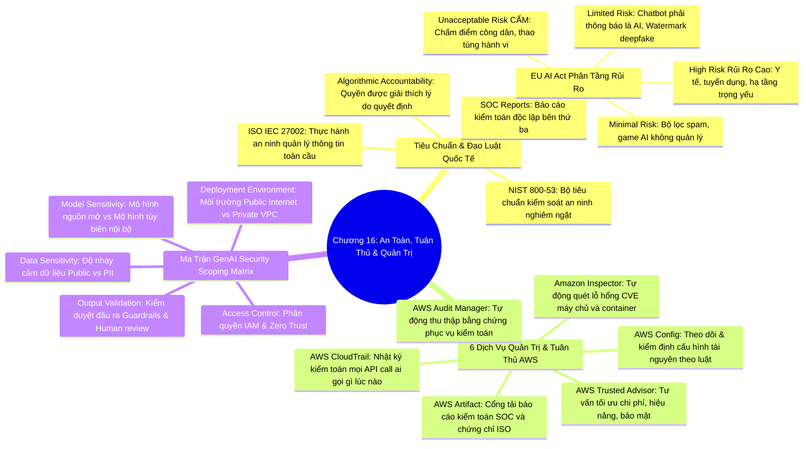

# CHƯƠNG 16: BẢO MẬT HỆ THỐNG AI, TIÊU CHUẨN TUÂN THỦ PHÁP LÝ VÀ CÁC DỊCH VỤ QUẢN TRỊ AWS
*(Section 16 - Domain 5: Security, Compliance, and Governance for AI Solutions)*

---

## 🎯 MỤC TIÊU BÀI HỌC & TRỌNG TÂM THI (EXAM FOCUS)
- Nắm vững các tiêu chuẩn và đạo luật tuân thủ pháp lý quốc tế áp dụng cho hệ thống AI:
  - **ISO/IEC 27001 & ISO/IEC 27002** (Thực hành quản lý an toàn thông tin)
  - **SOC Reports (SOC 1, SOC 2, SOC 3)** (Báo cáo kiểm toán độc lập)
  - **NIST SP 800-53** (Khung kiểm soát an ninh liên bang)
  - **EU AI Act (Đạo luật AI của Liên minh Châu Âu)**: 4 phân tầng rủi ro (*Bị cấm, Rủi ro cao, Rủi ro hạn chế, Rủi ro tối thiểu*).
  - **Luật Trách nhiệm Giải trình Thuật toán (Algorithmic Accountability Laws)**.
- Phân biệt chính xác chức năng của 6 dịch vụ Quản trị và Tuân thủ của AWS:
  1. **AWS Config** (Theo dõi lịch sử thay đổi cấu hình tài nguyên)
  2. **Amazon Inspector** (Tự động quét lỗ hổng bảo mật CVE và phơi nhiễm mạng)
  3. **AWS Audit Manager** (Tự động thu thập bằng chứng kiểm toán liên tục)
  4. **AWS Artifact** (Cổng tải báo cáo tuân thủ SOC/ISO và thỏa thuận BAA)
  5. **AWS CloudTrail** (Nhật ký ghi vết mọi lời gọi API)
  6. **AWS Trusted Advisor** (Tối ưu hóa theo 5 trụ cột AWS Well-Architected)
- Hiểu cấu trúc của **Ma trận Đánh giá Phạm vi An toàn Generative AI (Generative AI Security Scoping Matrix)**.

---

## 🧠 BẢN ĐỒ TƯ DUY (MINDMAP) CHƯƠNG 16

### Sơ đồ tư duy trực quan (Mermaid Diagram)


---

## 📚 KIẾN THỨC CỐT LÕI CHI TIẾT (DEEP DIVE)

### 1. Các tiêu chuẩn và Đạo luật Tuân thủ Pháp lý Quốc tế cho AI

Trong bối cảnh AI phát triển bùng nổ, các cơ quan quản lý toàn cầu đã ban hành nhiều khung pháp lý khắt khe mà các kỹ sư AI bắt buộc phải thấu hiểu:

#### A. Các tiêu chuẩn bảo mật truyền thống áp dụng cho AI:
- **ISO/IEC 27001 & ISO/IEC 27002:** Bộ tiêu chuẩn quốc tế uy tín nhất đưa ra các thực hành tốt nhất về xây dựng hệ thống quản lý an toàn thông tin (ISMS), bao gồm các hướng dẫn cụ thể về mã hóa, ẩn danh hóa dữ liệu và kiểm soát truy cập hệ thống AI.
- **Báo cáo SOC (System and Organization Controls):** Các báo cáo kiểm toán độc lập từ bên thứ ba đánh giá mức độ tuân thủ của AWS về tính bảo mật, tính khả dụng và tính bảo mật thông tin (SOC 1, SOC 2, SOC 3). Khách hàng sử dụng báo cáo này để chứng minh với cổ đông và cơ quan quản lý rằng hạ tầng lưu trữ S3 và SageMaker của họ đạt chuẩn an toàn cao nhất.
- **NIST SP 800-53:** Khung kiểm soát an ninh và quyền riêng tư do Viện Tiêu chuẩn và Công nghệ Quốc gia Hoa Kỳ ban hành, bắt buộc cho các hệ thống thông tin liên bang và là thước đo chuẩn mực cho các ngân hàng và tổ chức tài chính toàn cầu.

#### B. Đạo luật Trí tuệ Nhân tạo Liên minh Châu Âu (EU AI Act):
Đạo luật toàn diện đầu tiên trên thế giới về AI, chia các hệ thống AI thành 4 cấp độ rủi ro:
1. **Rủi ro không thể chấp nhận được (Unacceptable Risk - BỊ CẤM HOÀN TOÀN):**
   - Các hệ thống AI chấm điểm hành vi xã hội (Social Scoring).
   - Hệ thống khai thác điểm yếu của trẻ em hoặc thao túng tâm lý hành vi gây hại.
   - Nhận diện khuôn mặt sinh trắc học thời gian thực tại nơi công cộng phục vụ giám sát đại trà (trừ trường hợp khẩn cấp của cảnh sát).
2. **Rủi ro cao (High Risk - QUẢN LÝ NGHIÊM NGẶT):**
   - Ứng dụng trong y tế (chẩn đoán phẫu thuật), hạ tầng giao thông trọng yếu, tuyển dụng lao động (chấm CV tự động), chấm điểm tín dụng ngân hàng, tuyển sinh đại học.
   - *Yêu cầu:* Bắt buộc phải có đánh giá rủi ro, dữ liệu huấn luyện chất lượng cao, ghi log kiểm toán đầy đủ, có tính năng giải thích quyết định và phải có **sự giám sát của con người (Human Oversight)**.
3. **Rủi ro hạn chế (Limited Risk - NGHĨA VỤ MINH BẠCH):**
   - Các ứng dụng tương tác như Chatbot (khách hàng phải được thông báo rõ ràng rằng họ đang trò chuyện với máy móc).
   - Nội dung do AI tạo ra (Deepfakes, ảnh AI) bắt buộc phải được gắn nhãn nhận diện hoặc đóng dấu bản quyền kỹ thuật số (**Watermarking**).
4. **Rủi ro tối thiểu (Minimal / Unregulated Risk - TỰ DO SỬ DỤNG):**
   - Bộ lọc thư rác (Spam filters), trò chơi điện tử tích hợp AI.

#### C. Luật Trách nhiệm Giải trình Thuật toán (Algorithmic Accountability):
- Yêu cầu các doanh nghiệp triển khai AI ra quyết định tự động ảnh hưởng đến quyền lợi người dân (như từ chối việc làm, từ chối cho vay) phải có trách nhiệm giải thích lý do cụ thể và chứng minh hệ thống không bị thiên lệch sắc tộc, giới tính.

---

### 2. Bộ 6 Dịch vụ Quản trị và Tuân thủ của AWS (Governance & Compliance)

Bảng phân biệt sâu sắc 6 dịch vụ thường xuyên bị nhầm lẫn trong bài thi AIF-C01:

| Tên Dịch Vụ AWS | Vai trò cốt lõi | Từ khóa nhận diện trong đề thi |
| :--- | :--- | :--- |
| **AWS Config** | **Theo dõi và đánh giá cấu hình tài nguyên:** Ghi lại toàn bộ lịch sử thay đổi cấu hình của tài nguyên AWS (như S3 bucket, EC2, Security Group) và tự động đối chiếu xem cấu hình đó có vi phạm chính sách tuân thủ hay không. | *"Track resource configuration history", "Detect non-compliant resources", "Audit configuration changes over time"* |
| **Amazon Inspector** | **Tự động quét lỗ hổng bảo mật:** Quét các máy chủ EC2, container images trong Amazon ECR và mã nguồn AWS Lambda để tìm các lỗ hổng phần mềm đã biết (**CVE - Common Vulnerabilities and Exposures**) và các phơi nhiễm mạng ngoài ý muốn. | *"Automated vulnerability management", "Scan container images and EC2 for CVEs", "Software vulnerabilities"* |
| **AWS Audit Manager** | **Tự động thu thập bằng chứng kiểm toán:** Liên tục thu thập bằng chứng kỹ thuật từ các dịch vụ AWS khác và ánh xạ vào các khung tiêu chuẩn định sẵn (như PCI-DSS, HIPAA, SOC 2, GDPR) để xuất báo cáo sẵn sàng cho kiểm toán viên. | *"Automate evidence collection for audits", "Simplify compliance assessments", "Pre-built compliance frameworks"* |
| **AWS Artifact** | **Cổng tải báo cáo tuân thủ:** Nơi khách hàng truy cập theo yêu cầu (On-demand) để tải về các tài liệu bảo mật chính thức của AWS như chứng chỉ ISO, báo cáo SOC 1/2/3 và ký kết các thỏa thuận pháp lý (như Thỏa thuận liên kết kinh doanh **BAA** cho HIPAA). | *"Download AWS compliance reports", "Access SOC reports and ISO certifications", "Sign agreements like HIPAA BAA"* |
| **AWS CloudTrail** | **Nhật ký kiểm toán hoạt động API:** Ghi nhận và lưu vết toàn bộ các hành vi và lời gọi API diễn ra trong tài khoản AWS (*Ai đã xóa mô hình học máy? Ai đã truy cập dữ liệu S3? Lúc nào? Từ IP nào?*). | *"Record all API calls", "Audit trail of user activity", "Who did what and when"* |
| **AWS Trusted Advisor** | **Tư vấn tối ưu hóa hệ thống:** Quét toàn bộ tài khoản AWS và đưa ra các khuyến nghị tốt nhất dựa trên 5 trụ cột: **Tối ưu chi phí, Hiệu năng, Bảo mật, Khả năng chịu lỗi và Giới hạn dịch vụ**. | *"Provide best practice recommendations", "Cost optimization", "Security checks like open ports"* |

---

### 3. Ma trận Đánh giá Phạm vi An toàn Generative AI (Generative AI Security Scoping Matrix)

AWS giới thiệu công cụ **Generative AI Security Scoping Matrix** giúp các tổ chức xác định **mức độ trách nhiệm bảo mật** dựa trên cách họ **tương tác với Generative AI**. Ma trận chia thành **5 phạm vi (Scope)** theo mức độ kiểm soát tăng dần:

```
┌────────────────────────────────────────────────────────────────────────────────────────┐
│                    GENERATIVE AI SECURITY SCOPING MATRIX                                │
│                                                                                        │
│  Mức kiểm soát thấp                                           Mức kiểm soát cao        │
│  (Ít trách nhiệm bảo mật)                                    (Nhiều trách nhiệm nhất)  │
│                                                                                        │
│  Scope 1        Scope 2        Scope 3        Scope 4        Scope 5                   │
│  Consumer       Consumer +     Application    Model           Model                    │
│  (Sử dụng       Customization  Builder        Fine-tuner      Provider                 │
│   AI có sẵn)    (Prompt/RAG)   (Xây ứng dụng) (Tinh chỉnh FM) (Tự huấn luyện từ 0)    │
│                                                                                        │
│  ◄────────────────────────────────────────────────────────────────────────────────────► │
│  VD: Dùng       VD: Bedrock    VD: Xây chatbot VD: Fine-tune  VD: Tự pre-train        │
│  ChatGPT/       Knowledge      trên Bedrock    Titan trên     LLM từ đầu trên         │
│  Bedrock API    Bases + RAG    + Lambda        dữ liệu riêng  SageMaker HyperPod       │
└────────────────────────────────────────────────────────────────────────────────────────┘
```

#### Bảng chi tiết 5 Scope:

| Scope | Tên gọi | Mô tả | Ví dụ AWS | Trách nhiệm bảo mật chính |
| :--- | :--- | :--- | :--- | :--- |
| **Scope 1** | **Consumer** (Người tiêu dùng AI) | Sử dụng trực tiếp dịch vụ GenAI có sẵn qua API hoặc giao diện, **không tùy biến gì**. | Gọi Bedrock API trực tiếp, dùng Amazon Q | Bảo vệ API key, không gửi PII lên prompt, cấu hình IAM |
| **Scope 2** | **Consumer + Customization** (Tùy biến nhẹ) | Sử dụng GenAI kèm tùy biến **không thay đổi trọng số**: Prompt Engineering, RAG, Guardrails. | Bedrock + Knowledge Bases (RAG), Prompt Templates, Guardrails | Scope 1 + Bảo mật dữ liệu trong Vector DB, quản lý chunking & embedding, cấu hình Guardrails |
| **Scope 3** | **Application Builder** (Xây dựng ứng dụng) | Tự xây dựng **ứng dụng phần mềm hoàn chỉnh** tích hợp GenAI (chatbot, trợ lý, agent). | Bedrock Agents + Lambda + API Gateway, ứng dụng web tích hợp FM | Scope 2 + Bảo mật mã nguồn ứng dụng, kiểm soát input/output validation, quản lý session, logging |
| **Scope 4** | **Model Fine-tuner** (Tinh chỉnh mô hình) | Thực hiện **Fine-tuning hoặc Continued Pre-training** trên FM có sẵn với dữ liệu riêng. | Bedrock Custom Model (Fine-tuning), SageMaker Fine-tuning | Scope 3 + Bảo mật tập dữ liệu huấn luyện, chống Data Poisoning, kiểm tra bias, quản lý model artifacts |
| **Scope 5** | **Model Provider** (Nhà cung cấp mô hình) | Tự **huấn luyện từ đầu (Pre-training from scratch)** hoặc phát triển kiến trúc mô hình mới. | SageMaker HyperPod, Custom Docker Containers, Trainium | Toàn bộ trách nhiệm: kiến trúc mô hình, dữ liệu, hạ tầng GPU, bảo mật toàn diện |

#### 5 chiều kích đánh giá rủi ro trong mỗi Scope:

```
┌────────────────────────────────────────────────────────────────────────┐
│ 5 CHIỀU KÍCH ĐÁNH GIÁ RỦI RO (Risk Dimensions)                        │
├──────────────────────────┬─────────────────────────────────────────────┤
│ 1. Data Sensitivity      │ Độ nhạy cảm của dữ liệu: Public ➔ Nội bộ    │
│    (Độ nhạy cảm dữ liệu) │ ➔ Bí mật kinh doanh ➔ PII / Dữ liệu Y tế.   │
├──────────────────────────┼─────────────────────────────────────────────┤
│ 2. Model Sensitivity     │ Mô hình sử dụng: FM mã nguồn mở công cộng   │
│    (Độ nhạy cảm mô hình) │ ➔ Mô hình thương mại ➔ Mô hình độc quyền.  │
├──────────────────────────┼─────────────────────────────────────────────┤
│ 3. Deployment Env.       │ Môi trường chạy: Web công cộng Internet     │
│    (Môi trường triển khai)│ ➔ Mạng nội bộ công ty ➔ Private VPC cô lập. │
├──────────────────────────┼─────────────────────────────────────────────┤
│ 4. Access Control        │ Kiểm soát người dùng: Ai được phép gọi API? │
│    (Kiểm soát truy cập)  │ Xác thực IAM, phân quyền theo vai trò RBAC. │
├──────────────────────────┼─────────────────────────────────────────────┤
│ 5. Output Validation     │ Thẩm định đầu ra: Có sử dụng Guardrails?    │
│    (Kiểm định kết quả)   │ Có bộ lọc PII? Có kiểm duyệt con người?     │
└──────────────────────────┴─────────────────────────────────────────────┘
```

> [!IMPORTANT]
> **Quy tắc cốt lõi:** Scope càng cao (từ 1 → 5), trách nhiệm bảo mật của tổ chức càng **nặng nề hơn**, cần nhiều biện pháp phòng vệ hơn và đội ngũ chuyên gia bảo mật AI chuyên sâu hơn.

#### Các biện pháp quản trị bổ trợ trong tổ chức:
- **Chính sách doanh nghiệp (Policies):** Quy định rõ nhân viên được phép dùng những công cụ AI nào và dữ liệu nào tuyệt đối cấm nhập vào câu lệnh Prompt.
- **Tần suất đánh giá định kỳ (Review Cadence):** Thực hiện rà soát mã nguồn (Code review), kiểm tra bảo mật (Security audit) và đánh giá đạo đức trước khi release bất kỳ tính năng AI nào ra công chúng.
- **Đào tạo nhân sự (Team Training):** Nâng cao nhận thức của đội ngũ kỹ sư về Prompt Injection, bảo mật dữ liệu và các nguyên tắc Responsible AI.

---

## ⚠️ MẸO THI & BẪY CẦN TRÁNH (EXAM TIPS & TRAPS)

> [!TIP]
> **Phân biệt ngay 3 dịch vụ "A" dễ nhầm lẫn:**
> - *"Cần tải báo cáo SOC 2 của AWS để nộp cho kiểm toán viên"* ➔ **AWS Artifact**.
> - *"Cần tự động gom bằng chứng cấu hình và log để chuẩn bị kỳ kiểm toán"* ➔ **AWS Audit Manager**.
> - *"Cần tư vấn giảm chi phí và vá các cổng bảo mật đang mở rộng"* ➔ **AWS Trusted Advisor**.

> [!TIP]
> **Phân biệt Config vs Inspector:**
> - *"Resource configuration changes over time against compliance rules"* ➔ **AWS Config**.
> - *"Scan EC2 instances and ECR container images for software CVE vulnerabilities"* ➔ **Amazon Inspector**.

---

## 📝 BỘ CÂU HỎI ÔN TẬP MÔ PHỎNG (PRACTICE QUESTIONS)

#### Câu 1:
Một công ty tài chính đang chuẩn bị tiếp đoàn kiểm toán định kỳ để đánh giá sự tuân thủ theo tiêu chuẩn PCI-DSS. Để giảm thiểu công sức thủ công cho đội ngũ kỹ sư, công ty muốn một giải pháp tự động liên tục thu thập các bằng chứng kỹ thuật từ các tài nguyên AWS và ánh xạ chúng vào các điều khoản của chuẩn PCI-DSS. Dịch vụ AWS nào phù hợp nhất?
- A. AWS Artifact
- B. AWS Audit Manager
- C. Amazon Inspector
- D. AWS Trusted Advisor
> **Đáp án đúng: B**  
> *Giải thích:* AWS Audit Manager giúp tự động hóa quá trình thu thập bằng chứng kiểm toán (evidence collection) và ánh xạ chúng vào các khung tuân thủ tiêu chuẩn định sẵn như PCI-DSS, SOC 2, HIPAA. AWS Artifact chỉ là nơi tải về các báo cáo có sẵn của AWS.

#### Câu 2:
Một kỹ sư phụ trách bảo mật muốn đảm bảo rằng mọi thay đổi cấu hình trên các thùng chứa Amazon S3 (chẳng hạn như việc một bucket chứa dữ liệu huấn luyện AI vô tình bị chuyển sang chế độ Public) sẽ được tự động ghi nhận, phát hiện vi phạm và gửi thông báo cảnh báo tức thì. Dịch vụ AWS nào cung cấp tính năng này?
- A. AWS Config
- B. Amazon Inspector
- C. AWS Artifact
- D. Amazon Rekognition
> **Đáp án đúng: A**  
> *Giải thích:* AWS Config liên tục theo dõi, ghi lại lịch sử thay đổi cấu hình của tài nguyên AWS và đánh giá chúng dựa trên các quy tắc tuân thủ (Rules) để phát hiện và cảnh báo các tài nguyên không tuân thủ (non-compliant).

#### Câu 3:
Theo phân tầng rủi ro của Đạo luật Trí tuệ Nhân tạo Liên minh Châu Âu (EU AI Act), trường hợp sử dụng AI nào sau đây bị xếp vào nhóm "Rủi ro không thể chấp nhận được" (Unacceptable Risk) và bị **CẤM HOÀN TOÀN** triển khai?
- A. Ứng dụng chatbot chăm sóc khách hàng trên trang web ngân hàng.
- B. Hệ thống lọc thư rác trong hòm thư điện tử của doanh nghiệp.
- C. Hệ thống chính phủ sử dụng AI để chấm điểm tín nhiệm xã hội (Social Scoring) nhằm phân loại và hạn chế quyền lợi của công dân.
- D. Hệ thống hỗ trợ bác sĩ chẩn đoán hình ảnh chụp cắt lớp vi tính.
> **Đáp án đúng: C**  
> *Giải thích:* Theo EU AI Act, các hệ thống chấm điểm xã hội (Social Scoring) và các hệ thống thao túng hành vi người dùng gây hại bị xếp vào cấp độ "Unacceptable Risk" và bị nghiêm cấm hoàn toàn. Ứng dụng y tế là "High Risk", Chatbot là "Limited Risk", còn lọc thư rác là "Minimal Risk".
